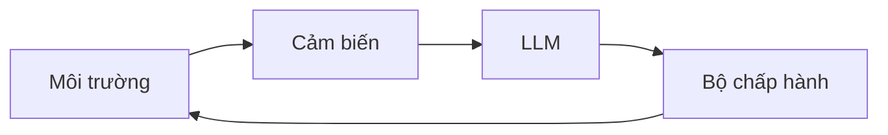
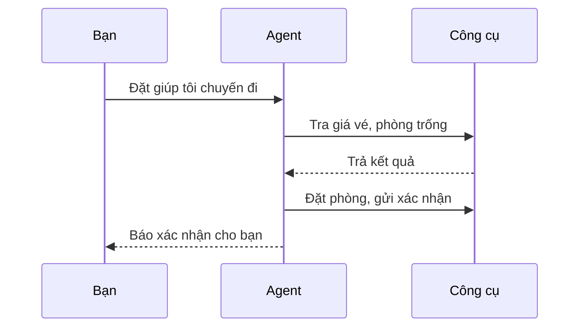

# AI agent là gì và dùng vào việc gì

Làm sao để mô hình ngôn ngữ không chỉ nói mà còn làm? Trước khi dựng agent, bạn cần hiểu hai điều: AI agent thực sự là gì, và khi nào nên dùng nó. Bài này trả lời cả hai, rồi chỉ ra các "khối xây dựng" bạn sẽ gặp suốt khóa học.

Sau bài này bạn có thể:

- Giải thích AI agent là gì và khác gì một giải pháp AI thông thường.
- Biết khi nào nên dùng agent, và khi nào không.
- Phác thảo một thiết kế agent cơ bản cho một bài toán thật.

## Từ viết tắt

- **AI** (Artificial Intelligence) — trí tuệ nhân tạo.
- **LLM** (Large Language Model) — mô hình ngôn ngữ lớn: phần hiểu và sinh ngôn ngữ tự nhiên.
- **MAS** (Multi-Agent System) — hệ nhiều agent cùng làm việc, hợp tác hoặc cạnh tranh.
- **MAF** (Microsoft Agent Framework) — bộ khung của Microsoft dùng để dựng agent sẵn sàng chạy thật.
- **API** (Application Programming Interface) — giao diện để chương trình gọi nhau.
- **OpenAPI** — chuẩn mô tả API, giúp agent biết cách gọi một công cụ.
- **Prompt** — lời nhắc hoặc yêu cầu bạn gõ cho LLM.

## AI agent là gì

Cách nghĩ đơn giản nhất: **AI agent là hệ thống cho phép LLM thực sự *làm việc*, bằng cách trao cho nó công cụ và tri thức để tác động lên thế giới, thay vì chỉ trả lời lời nhắc (prompt) của người dùng.**

Hãy tách câu đó ra:

- **Hệ thống**: agent không phải một thứ đơn lẻ mà là nhiều bộ phận chạy cùng nhau. Mọi agent đều có ba phần:
  - **Môi trường**: nơi agent làm việc. Với agent đặt vé du lịch, đó là nền tảng đặt vé.
  - **Cảm biến**: cách agent đọc trạng thái hiện tại của môi trường, ví dụ xem phòng còn trống hay giá vé.
  - **Bộ chấp hành**: cách agent hành động, ví dụ đặt phòng, gửi xác nhận hoặc hủy đặt chỗ.
- **LLM**: agent có từ trước LLM, nhưng LLM làm agent hiện đại mạnh hơn hẳn. Nó hiểu ngôn ngữ tự nhiên, suy luận theo ngữ cảnh và biến một yêu cầu mơ hồ thành kế hoạch cụ thể.
- **Thực hiện hành động**: bên ngoài hệ thống agent, LLM chỉ sinh văn bản. Bên trong, nó có thể chạy các bước: tra cơ sở dữ liệu, gọi API, gửi tin nhắn.
- **Công cụ**: agent dùng được công cụ nào tùy vào môi trường nó chạy và những gì lập trình viên trao cho nó. Agent du lịch có thể tìm chuyến bay nhưng không sửa được hồ sơ khách hàng.
- **Bộ nhớ và tri thức**: bộ nhớ ngắn hạn là cuộc trò chuyện hiện tại; bộ nhớ dài hạn là cơ sở dữ liệu khách hàng hay các lần tương tác trước. Nhờ vậy agent có thể "nhớ" bạn thích ngồi cạnh cửa sổ.

### Agent có gì trong người

Gộp lại, một agent gồm LLM (hiểu và lập kế hoạch), công cụ (tìm chuyến bay, gọi API), bộ nhớ ngắn hạn (cuộc trò chuyện hiện tại) và bộ nhớ dài hạn (dữ liệu khách hàng).

### Ví dụ từng bước: agent đặt vé

Tra giá vé thuộc phần cảm biến; đặt phòng và gửi xác nhận thuộc bộ chấp hành.

## Các loại AI agent

Bảng dưới dùng chung một ví dụ: agent đặt vé du lịch.

| Loại | Làm gì | Ví dụ |
|---|---|---|
| Phản xạ đơn giản | Làm theo quy tắc cứng, không nhớ, không lập kế hoạch | Thấy email khiếu nại thì chuyển cho bộ phận chăm sóc khách hàng |
| Phản xạ có mô hình | Giữ một mô hình thế giới trong đầu và cập nhật khi mọi thứ đổi | Theo dõi giá vé theo thời gian, báo tuyến nào bỗng đắt |
| Hướng mục tiêu | Có mục tiêu và tự tìm cách đạt từng bước | Đặt trọn chuyến đi (bay, thuê xe, khách sạn) từ vị trí hiện tại của bạn đến đích |
| Hướng lợi ích | Không chỉ tìm *một* lời giải mà tìm lời giải *tốt nhất* bằng cách cân nhắc đánh đổi | Cân chi phí với sự tiện lợi để chọn chuyến đi hợp ý bạn nhất |
| Biết học | Tốt dần theo thời gian nhờ phản hồi | Chỉnh gợi ý lần sau dựa trên khảo sát sau chuyến đi |
| Phân cấp | Agent cấp cao chia việc và giao cho agent cấp thấp | Yêu cầu "hủy chuyến" tách thành hủy vé bay, hủy khách sạn, hủy thuê xe |
| Nhiều agent (MAS) | Nhiều agent độc lập cùng làm việc hoặc cạnh tranh | Hợp tác: mỗi agent lo khách sạn, vé bay, giải trí. Cạnh tranh: nhiều agent giành lấp đầy phòng với giá tốt nhất |

## Khi nào nên dùng AI agent

Có thể dùng agent không có nghĩa lúc nào cũng nên dùng. Agent tỏa sáng trong ba tình huống:

- **Bài toán mở**: các bước giải không thể lập trình sẵn, cần LLM tự tìm đường đi.
- **Quy trình nhiều bước**: việc cần dùng công cụ qua nhiều lượt, không chỉ một lần tra cứu hay sinh văn bản.
- **Cải thiện theo thời gian**: bạn muốn hệ thống thông minh dần nhờ phản hồi của người dùng hoặc tín hiệu từ môi trường.

Bài về agent đáng tin cậy ở phần sau của khóa sẽ nói kỹ hơn về khi nào *không* nên dùng.

## Những khối xây dựng của một giải pháp agent

- **Phát triển agent**: bước đầu tiên là xác định agent *làm được gì*: công cụ, hành động, hành vi. Khóa học dùng **Microsoft Foundry Agent Service** làm nền tảng chính. Nó hỗ trợ mô hình của OpenAI, Mistral, Meta (Llama), dữ liệu có bản quyền từ nhà cung cấp như Tripadvisor, và định nghĩa công cụ theo chuẩn OpenAPI 3.0.
- **Mẫu thiết kế agent (agentic pattern)**: bạn trò chuyện với LLM bằng prompt, nhưng với agent không thể tự viết tay mọi prompt cho từng bước. Mẫu thiết kế là những chiến lược dùng lại được để ra lệnh và điều phối LLM một cách ổn định, mở rộng được. Khóa học xoay quanh các mẫu phổ biến nhất.
- **Framework dựng agent**: cho lập trình viên khuôn mẫu, công cụ và hạ tầng sẵn có, giúp nối công cụ, theo dõi và gỡ lỗi agent, và cho nhiều agent phối hợp. Khóa này tập trung vào **MAF** để dựng agent chạy thật.

## Nhìn hình trả lời

Agent tra giá vé thì thuộc phần nào: cảm biến hay bộ chấp hành?

Đáp án

Tra giá vé là **cảm biến** (đọc trạng thái môi trường). Đặt phòng là **bộ chấp hành** (hành động lên môi trường).

## Nguồn đối chiếu

- [Introduction to AI Agents and Agent Use Cases](https://github.com/microsoft/ai-agents-for-beginners/blob/9923c54bcc2df67e7119945e12cd2d45944da2f6/01-intro-to-ai-agents/README.md)

*Dựa trên bài 01 của microsoft/ai-agents-for-beginners (MIT License, © Microsoft Corporation).*
