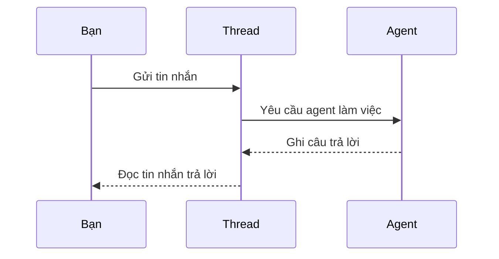

# Khám phá các framework dựng AI agent

Làm sao dựng agent mà không làm lại từ số 0? Framework dựng AI agent là nền tảng phần mềm giúp việc tạo, triển khai và quản lý agent đơn giản hơn. Chúng cho lập trình viên các thành phần dựng sẵn và công cụ, để bạn tập trung vào phần riêng của ứng dụng thay vì làm lại những thứ ai cũng cần.

Sau bài này bạn có thể:

- Hiểu vai trò của framework agent trong phát triển AI.
- Biết framework giúp dựng agent thông minh bằng cách nào.
- Phân biệt Microsoft Agent Framework với Microsoft Foundry Agent Service.

## Từ viết tắt

- **AI** (Artificial Intelligence) — trí tuệ nhân tạo.
- **LLM** (Large Language Model) — mô hình ngôn ngữ lớn.
- **API** (Application Programming Interface) — giao diện để chương trình gọi nhau.
- **Prompt** — lời nhắc hoặc yêu cầu bạn gõ cho mô hình AI.
- **SDK** (Software Development Kit) — bộ công cụ lập trình sẵn để dựng phần mềm.
- **MAF** (Microsoft Agent Framework) — bộ SDK của Microsoft để dựng agent chạy thật.
- **RAG** (Retrieval-Augmented Generation) — cách cho mô hình tra tài liệu rồi mới trả lời.
- **Foundry** — nền tảng AI của Microsoft, nơi đặt Foundry Agent Service.

## Framework agent khác framework AI thường ở đâu

Framework AI thông thường giúp bạn đưa AI vào ứng dụng: cá nhân hóa gợi ý (như dịch vụ xem phim gợi ý theo lịch sử xem), tự động hóa việc lặp lại (chatbot trả lời câu hỏi phổ biến) và cải thiện trải nghiệm (nhận diện giọng nói).

Framework agent làm được nhiều hơn: nó giúp tạo ra agent có thể tương tác với người dùng, với agent khác và với môi trường để đạt mục tiêu. Framework agent có ba khả năng chính:

- **Phối hợp nhiều agent**: nhiều agent cùng làm việc, trao đổi và điều phối để giải việc phức tạp.
- **Tự động hóa và quản lý tác vụ**: tự động hóa quy trình nhiều bước, giao việc, điều chỉnh việc linh hoạt giữa các agent.
- **Hiểu ngữ cảnh và thích nghi**: agent hiểu bối cảnh, thích nghi khi môi trường đổi và quyết định dựa trên thông tin theo thời gian thực.

## Dựng thử và cải tiến nhanh bằng cách nào

Lĩnh vực này đổi rất nhanh, nhưng phần lớn framework đều có ba thứ giúp bạn dựng thử và lặp nhanh:

1. **Linh kiện dựng sẵn**: SDK như MAF có sẵn kết nối với mô hình AI và bộ nhớ, định nghĩa công cụ, mẫu prompt. Nhóm lắp chúng lại thành bản chạy thử mà không phải làm từ số 0. Ví dụ: một bộ tách thông tin từ câu người dùng, một mô-đun bộ nhớ và một bộ sinh prompt.
2. **Công cụ cộng tác**: tạo agent với vai trò và nhiệm vụ riêng (lấy dữ liệu, phân tích, ra quyết định), cho chúng trao đổi thông tin để hoàn thành mục tiêu chung, rồi thử và tinh chỉnh quy trình phối hợp.
3. **Học theo thời gian thực**: tạo vòng phản hồi để agent học từ tương tác và chỉnh hành vi. Agent phân tích phản hồi của người dùng, dữ liệu môi trường và kết quả công việc để cập nhật tri thức và tốt dần.

Ví dụ ngắn dùng MAF: một agent đặt vé với công cụ `book_flight`.

```python
agent = provider.as_agent(
    name="travel_agent",
    instructions="Help the user book travel. Use the book_flight tool when ready.",
    tools=[book_flight],
)
response = await agent.run("I'd like to go to New York on January 1, 2025")
```

Ở đây `provider` là `FoundryChatClient` đã tạo sẵn và `book_flight` là hàm đặt vé. Bạn khai báo tên, chỉ dẫn và công cụ; agent tự gọi công cụ khi cần.

## Microsoft Agent Framework (MAF)

MAF là SDK gọn để dựng agent bằng `FoundryChatClient`. Nó cho phép tạo agent dùng mô hình Azure OpenAI, có sẵn gọi công cụ, quản lý hội thoại và bảo mật cấp doanh nghiệp qua danh tính Azure. Dùng cho: agent chạy thật có dùng công cụ, quy trình nhiều bước và tích hợp doanh nghiệp.

Các khái niệm chính:

- **Agent**: tạo bằng `FoundryChatClient`, cấu hình bằng tên, chỉ dẫn và công cụ. Agent xử lý tin nhắn của người dùng, tự gọi công cụ theo ngữ cảnh và giữ trạng thái hội thoại qua nhiều lượt.
- **Công cụ**: hàm Python mà agent tự gọi; đăng ký khi tạo agent.
- **Phối hợp nhiều agent**: ví dụ một agent lập kế hoạch ("chia việc phức tạp thành các bước") và một agent thực thi ("làm các bước bằng công cụ có sẵn").
- **Tích hợp danh tính Azure**: xác thực không cần khóa, nên bạn khỏi quản lý khóa API trực tiếp.

## Microsoft Foundry Agent Service

Đây là dịch vụ mới hơn, giới thiệu tại Microsoft Ignite 2024. Nó cho dựng và triển khai agent với mô hình linh hoạt hơn, kể cả gọi trực tiếp LLM mã nguồn mở như Llama 3, Mistral và Cohere. Bảo mật doanh nghiệp và cách lưu dữ liệu mạnh hơn, nên hợp với ứng dụng doanh nghiệp. Nó chạy sẵn với MAF. Theo nguồn, dịch vụ khi đó đang ở bản xem trước công khai (Public Preview) và hỗ trợ Python và C#.

Khái niệm chính:

- **Agent**: trong Foundry, agent là một "dịch vụ nhỏ thông minh" (microservice): trả lời câu hỏi (RAG), thực hiện hành động hoặc tự động hóa trọn quy trình, nhờ kết hợp mô hình AI sinh nội dung với công cụ truy cập dữ liệu thật.
- **Thread và tin nhắn**: thread là một cuộc hội thoại giữa agent và người dùng, dùng để theo dõi tiến trình, lưu ngữ cảnh và quản lý trạng thái. Tin nhắn có thể là văn bản, hình ảnh hoặc tệp.

Ví dụ một lượt làm việc với thread (đã đơn giản hóa):



- **Kết hợp với MAF**: dựng agent bằng `FoundryChatClient` rồi triển khai qua Agent Service cho môi trường thật.

## Chọn cái nào

| | Microsoft Agent Framework | Microsoft Foundry Agent Service |
|---|---|---|
| Bản chất | SDK gọn để dựng agent | Nền tảng và dịch vụ triển khai agent |
| Trọng tâm | Gọi công cụ, quản lý hội thoại, danh tính Azure | Mô hình linh hoạt, bảo mật doanh nghiệp, kết nối Azure OpenAI, Azure AI Search, Bing Search, chạy code |
| Hợp khi | Muốn dựng agent chạy thật nhanh | Cần triển khai doanh nghiệp, tích hợp sẵn với dịch vụ Azure |

Nếu vẫn phân vân, lời khuyên của bài: dựng agent bằng MAF trước, rồi dùng Foundry Agent Service khi cần triển khai và mở rộng. Cách này cho phép lặp nhanh phần logic agent mà vẫn có đường lên môi trường doanh nghiệp.

Về công cụ Azure sẵn có: bạn tích hợp trực tiếp được. Foundry Agent Service được dựng để làm việc trơn tru với dịch vụ Azure khác, ví dụ Bing, Azure AI Search và Azure Functions. MAF cũng gọi được dịch vụ Azure từ công cụ của agent qua `FoundryChatClient` và danh tính Azure.

## Nhìn hình trả lời

Muốn dựng agent chạy thật nhanh rồi mới mở rộng, bắt đầu với cái nào?

<details>
<summary>Đáp án</summary>

MAF trước, rồi Foundry Agent Service khi cần triển khai và mở rộng.

</details>

## Nguồn đối chiếu

- [Explore AI Agent Frameworks](https://github.com/microsoft/ai-agents-for-beginners/blob/9923c54bcc2df67e7119945e12cd2d45944da2f6/02-explore-agentic-frameworks/README.md)

*Dựa trên bài 02 của microsoft/ai-agents-for-beginners (MIT License, © Microsoft Corporation).*
