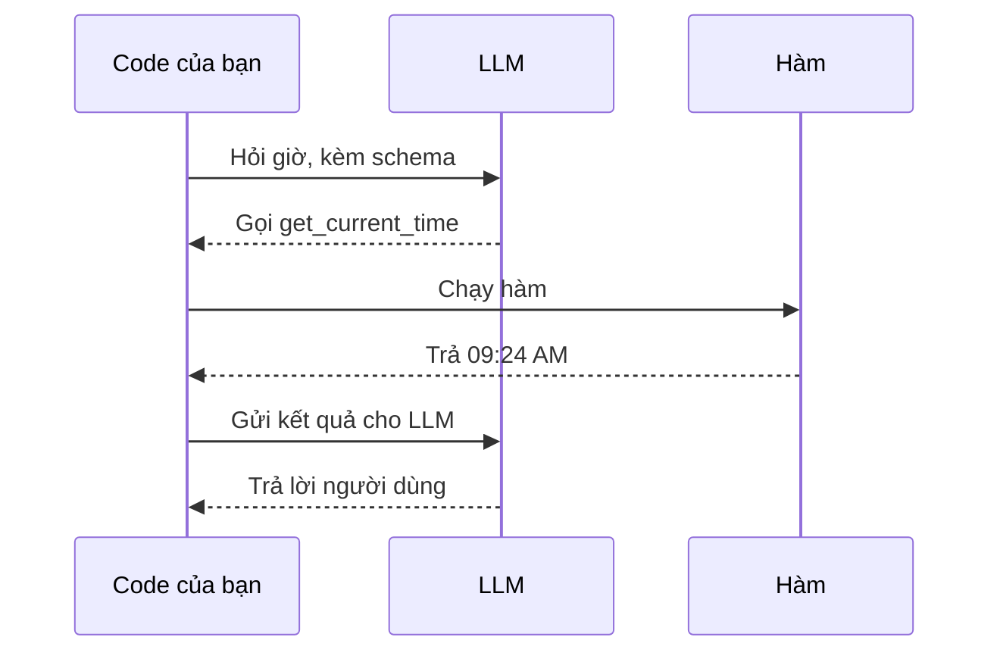

# Mẫu thiết kế dùng công cụ

Làm sao để agent làm được nhiều việc hơn? Nhờ công cụ. Thay vì chỉ có một tập hành động hữu hạn, thêm một công cụ là agent làm thêm được cả loạt việc mới. Bài này nói về **mẫu thiết kế dùng công cụ**: cách agent dùng những công cụ cụ thể để đạt mục tiêu.

Sau bài này bạn có thể:

- Nêu mẫu thiết kế dùng công cụ là gì và để làm gì.
- Nhận ra các tình huống áp dụng được.
- Hiểu các thành phần chính để triển khai.
- Biết những điều cần lưu ý để agent dùng công cụ vẫn đáng tin.

## Từ viết tắt

- **LLM** (Large Language Model) — mô hình ngôn ngữ lớn.
- **API** (Application Programming Interface) — giao diện để chương trình gọi nhau.
- **SQL** — ngôn ngữ truy vấn cơ sở dữ liệu.
- **SQLite** — một cơ sở dữ liệu nhỏ dạng tệp.
- **CRM** (Customer Relationship Management) — hệ thống quản lý quan hệ khách hàng.
- **MCP** (Model Context Protocol) — giao thức để máy chủ công bố công cụ cho agent dùng.
- **Schema** — bản mô tả công cụ: tên, mục đích, tham số cần có, kết quả mong đợi.

## Mẫu thiết kế dùng công cụ là gì

Mẫu này trao cho LLM khả năng tương tác với công cụ bên ngoài để đạt mục tiêu cụ thể. Công cụ là đoạn code mà agent có thể chạy để thực hiện hành động. Một công cụ có thể là hàm đơn giản như máy tính, hoặc một lệnh gọi API tới dịch vụ bên thứ ba như tra giá cổ phiếu hay dự báo thời tiết. Với agent, công cụ được chạy để đáp lại **lệnh gọi hàm do mô hình sinh ra**.

## Dùng vào những việc nào

Agent dùng công cụ để hoàn thành việc phức tạp, lấy thông tin hoặc ra quyết định, thường khi cần tương tác động với hệ thống bên ngoài như cơ sở dữ liệu, dịch vụ web hay trình chạy code:

| Tình huống | Ví dụ |
|---|---|
| Lấy thông tin động | Truy vấn API hoặc cơ sở dữ liệu để lấy dữ liệu mới: giá cổ phiếu, thời tiết, phân tích dữ liệu trong SQLite |
| Chạy code | Giải bài toán, lập báo cáo, chạy mô phỏng |
| Tự động hóa quy trình | Nối công cụ như bộ hẹn giờ, dịch vụ email, đường ống dữ liệu |
| Hỗ trợ khách hàng | Làm việc với CRM, hệ thống phiếu hỗ trợ, kho tri thức |
| Tạo và sửa nội dung | Dùng công cụ kiểm tra ngữ pháp, tóm tắt văn bản, đánh giá an toàn nội dung |

## Sáu khối xây dựng

- **Schema của công cụ**: định nghĩa chi tiết mỗi công cụ để LLM hiểu có những công cụ nào và tạo yêu cầu hợp lệ thế nào.
- **Logic thực thi**: quyết định khi nào và cách gọi công cụ theo ý định người dùng và ngữ cảnh hội thoại (có thể gồm mô-đun lập kế hoạch hay luồng điều kiện).
- **Hệ thống xử lý tin nhắn**: quản lý luồng giữa lời người dùng, câu trả lời của LLM, lệnh gọi công cụ và kết quả công cụ.
- **Khung tích hợp công cụ**: hạ tầng nối agent với công cụ, đơn giản hay phức tạp.
- **Xử lý lỗi và kiểm tra**: xử lý khi công cụ chạy hỏng, kiểm tra tham số, xử lý phản hồi bất ngờ.
- **Quản lý trạng thái**: ghi nhớ ngữ cảnh, các lần dùng công cụ trước và dữ liệu lâu dài để nhiều lượt hội thoại vẫn nhất quán.

## Gọi hàm (function calling) từng bước

Gọi hàm là cách chính để LLM tương tác với công cụ. "Hàm" và "công cụ" thường dùng thay nhau, vì hàm (khối code dùng lại được) chính là công cụ agent dùng. Để một hàm được chạy, LLM phải so yêu cầu người dùng với mô tả hàm. Vì vậy ta gửi cho LLM một schema chứa mô tả mọi hàm có sẵn. LLM chọn hàm phù hợp nhất rồi trả về **tên hàm và đối số**. Hàm được chạy, kết quả gửi lại cho LLM, và LLM dùng nó để trả lời người dùng.

Bạn cần: một mô hình hỗ trợ gọi hàm (không phải mô hình nào cũng có), một schema mô tả hàm, và code của từng hàm.



Điều quan trọng: lần gọi đầu LLM trả về **lệnh gọi công cụ**, chưa phải câu trả lời cuối. Câu trả lời cuối chỉ có sau khi kết quả hàm được gửi lại.

## Thử ngay: biến hàm thành công cụ

Tự viết schema và xử lý từng lệnh gọi đôi khi khó. Framework giúp việc này, như bài về framework đã học. Với Microsoft Agent Framework, bạn đặt `@tool` lên hàm Python; framework tự tạo schema và lo việc trao đổi giữa mô hình với code của bạn.

```python
@tool(approval_mode="never_require")
def get_current_time(location: str) -> str:
    """Get the current time"""
agent = provider.as_agent(name="TimeAgent", tools=get_current_time)
```

Ví dụ ở trên là hỏi giờ ở San Francisco.

Bên tay phải của slide là cách này; bên trái là cách tự làm: viết schema cho hàm, đọc lệnh gọi rồi chạy hàm, gửi kết quả lại cho mô hình. Đoạn code rút gọn; `provider` là `FoundryChatClient` đã tạo sẵn.

## Công cụ trong Microsoft Foundry Agent Service

Dịch vụ này là dịch vụ do Microsoft quản lý, giúp dựng, triển khai và mở rộng agent mà không phải tự lo hạ tầng tính toán và lưu trữ. Nó tự động gọi công cụ: bạn không cần tự đọc lệnh gọi, chạy công cụ và xử lý phản hồi, mọi thứ diễn ra phía máy chủ. Dữ liệu cũng được quản lý an toàn: thay vì tự giữ trạng thái hội thoại, bạn dùng thread (nơi lưu lịch sử tin nhắn của một cuộc hội thoại). Nó có sẵn công cụ để nối nguồn dữ liệu, chia hai nhóm:

- **Công cụ tri thức**: Grounding with Bing Search, File Search, Azure AI Search.
- **Công cụ hành động**: Function Calling, Code Interpreter, công cụ định nghĩa theo OpenAPI, Azure Functions.

Các công cụ gom lại thành một `toolset`. Trong ví dụ bán hàng của công ty Contoso, LLM nhìn toolset rồi tự quyết dùng hàm do người dùng tạo (`fetch_sales_data_using_sqlite_query`) hay Code Interpreter có sẵn, tùy yêu cầu.

## Công cụ từ máy chủ MCP

Công cụ cũng không nhất thiết là hàm trong code của bạn: máy chủ MCP công bố công cụ kèm schema, và framework nạp chúng như hàm có `@tool`. Ví dụ trong bài dùng một máy chủ tìm kiếm web; máy chủ này công bố hai công cụ, `search_web_pages` và `fetch_page_content`; mô hình gọi `search_web_pages` rồi nhận tiêu đề, đường dẫn và đoạn trích để viết câu trả lời. Như với mọi công cụ từ xa, câu truy vấn mô hình viết ra sẽ được gửi tới máy chủ đó.

## Lưu ý để agent đáng tin

Điều hay lo là SQL do LLM sinh ra có thể bị tiêm SQL (SQL injection) hoặc gây hành động phá hoại như xóa hay sửa cơ sở dữ liệu. Nỗi lo này có cơ sở, nhưng giảm được bằng cách cấu hình quyền truy cập đúng: với đa số cơ sở dữ liệu là đặt chế độ chỉ đọc; với PostgreSQL hay Azure SQL thì cấp cho ứng dụng vai trò chỉ đọc (SELECT). Chạy ứng dụng trong môi trường an toàn cũng giúp. Trong doanh nghiệp, dữ liệu thường được chuyển sang một cơ sở dữ liệu hoặc kho dữ liệu chỉ đọc, để ứng dụng chỉ có quyền đọc hạn chế.

## Nhìn hình trả lời

LLM tự sinh SQL đọc dữ liệu bán hàng. Giảm rủi ro bị xóa hay sửa dữ liệu bằng cách nào?

<details>
<summary>Đáp án</summary>

Cơ sở dữ liệu chỉ đọc (vai trò SELECT), chạy trong môi trường an toàn.

</details>

## Nguồn đối chiếu

- [Tool Use Design Pattern](https://github.com/microsoft/ai-agents-for-beginners/blob/9923c54bcc2df67e7119945e12cd2d45944da2f6/04-tool-use/README.md)

*Dựa trên bài 04 của microsoft/ai-agents-for-beginners (MIT License, © Microsoft Corporation).*
