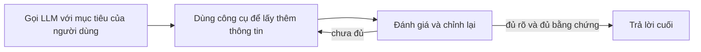

# Agentic RAG: agent tự đi tìm thông tin

Bài này giới thiệu **Agentic RAG** (RAG kiểu agent): một hướng mới trong AI, nơi mô hình ngôn ngữ lớn tự lên kế hoạch cho bước tiếp theo trong khi lấy thông tin từ nguồn bên ngoài. Khác với kiểu "tra cứu xong rồi đọc" cố định, Agentic RAG gọi LLM lặp đi lặp lại, xen kẽ với việc gọi công cụ và nhận kết quả có cấu trúc. Hệ thống đánh giá kết quả, chỉnh lại câu truy vấn, gọi thêm công cụ khi cần và cứ thế cho tới khi có lời giải thỏa đáng.

Sau bài này bạn có thể:

- Hiểu Agentic RAG là gì.
- Nắm kiểu lặp "người làm, người kiểm" (maker-checker).
- Nhận ra những tình huống Agentic RAG phát huy tác dụng.

## Từ viết tắt

- **RAG** (Retrieval-Augmented Generation) — cách cho mô hình tra thông tin ngoài rồi mới trả lời.
- **LLM** (Large Language Model) — mô hình ngôn ngữ lớn.
- **SQL** — ngôn ngữ truy vấn cơ sở dữ liệu.
- **NL2SQL** — biến câu hỏi tự nhiên thành câu lệnh SQL.
- **API** (Application Programming Interface) — giao diện để chương trình gọi nhau.
- **AGI** (Artificial General Intelligence) — trí tuệ nhân tạo tổng quát, ngang con người ở mọi việc.

## Agentic RAG là gì

Phần "agent" nằm ở đây: hệ thống **tự làm chủ quá trình suy luận**. Nó viết lại truy vấn bị hỏng, chọn cách truy xuất khác và kết hợp nhiều công cụ trước khi chốt câu trả lời, ví dụ tìm kiếm vector trong Azure AI Search, cơ sở dữ liệu SQL hay API tùy chỉnh. Kiểu làm việc này gọi là **"người làm, người kiểm"**: lặp lại để tăng độ chính xác, xử lý truy vấn sai cú pháp tới cơ sở dữ liệu có cấu trúc (như NL2SQL) và đảm bảo kết quả chất lượng.

RAG truyền thống thường dựa vào đường đi người ta định sẵn: một chuỗi suy nghĩ ghi rõ lấy gì, lúc nào. Hệ thống agentic thì tự quyết thứ tự các bước dựa trên chất lượng thông tin nó tìm được. Nhờ vậy không cần khung điều phối quá phức tạp: một vòng lặp đơn giản "gọi LLM → dùng công cụ → gọi LLM → …" có thể cho kết quả tinh vi và có căn cứ.

## Vòng lặp: gọi, dùng công cụ, đánh giá, lặp lại

- **Gọi lần đầu**: mục tiêu (prompt) của người dùng được đưa cho LLM.
- **Dùng công cụ**: nếu thấy thiếu thông tin hoặc chỉ dẫn mơ hồ, mô hình chọn công cụ hoặc cách truy xuất, như truy vấn cơ sở dữ liệu vector hoặc gọi SQL, để có thêm ngữ cảnh.
- **Đánh giá và chỉnh lại**: xem dữ liệu trả về rồi quyết định đã đủ chưa. Chưa đủ thì chỉnh truy vấn, đổi công cụ hoặc đổi cách làm.
- **Lặp lại tới khi hài lòng**: chu trình tiếp tục cho tới khi mô hình đủ rõ ràng và bằng chứng để trả lời có lý lẽ.
- **Bộ nhớ và trạng thái**: hệ thống nhớ các lần thử trước và kết quả của chúng, nên tránh lặp vô ích và quyết định sáng suốt hơn.

## Thử ngay: chiến lược ra mắt sản phẩm

Hãy xem một agent tự quyết các bước khi được nhờ lập chiến lược ra mắt sản phẩm, thay vì làm theo một lời nhắc ghi sẵn toàn bộ quy trình:

1. Lấy báo cáo xu hướng thị trường hiện tại bằng Bing Web Grounding.
2. Tìm dữ liệu đối thủ liên quan bằng Azure AI Search.
3. Đối chiếu số liệu bán hàng nội bộ trong quá khứ bằng Azure SQL Database.
4. Tổng hợp kết quả thành một chiến lược mạch lạc qua Azure OpenAI Service.
5. Kiểm tra chiến lược xem còn lỗ hổng hay mâu thuẫn không, nếu cần thì quay lại truy xuất thêm.

Mọi bước (chỉnh truy vấn, chọn nguồn, lặp tới khi "hài lòng") do mô hình quyết, không phải con người viết sẵn.

## Tự sửa lỗi khi gặp ngõ cụt

Khi lấy phải tài liệu không liên quan hoặc truy vấn hỏng, hệ thống có thể:

- **Lặp và truy vấn lại**: thử chiến lược tìm kiếm mới, viết lại truy vấn cơ sở dữ liệu hoặc xem bộ dữ liệu khác, thay vì trả lời kém giá trị.
- **Dùng công cụ chẩn đoán**: gọi thêm hàm giúp gỡ lỗi các bước suy luận hoặc xác nhận dữ liệu đúng. Những công cụ như Azure AI Tracing quan trọng để quan sát và giám sát.
- **Nhờ con người khi cần**: với việc rủi ro cao hoặc cứ thất bại lặp lại, mô hình có thể báo không chắc và xin hướng dẫn. Khi người đưa phản hồi sửa, mô hình đưa bài học đó vào các bước sau.

Nhờ vậy nó không chỉ là hệ thống "một phát ăn ngay" mà học được từ sai sót trong cùng một phiên.

## Giới hạn của sự tự chủ

Dù tự chủ trong một nhiệm vụ, Agentic RAG không phải AGI. Khả năng "agent" của nó bị giới hạn trong công cụ, nguồn dữ liệu và chính sách do lập trình viên cung cấp; nó không tự bịa ra công cụ mới hay bước ra ngoài phạm vi đã đặt.

1. **Tự chủ trong một lĩnh vực**: hướng tới mục tiêu người dùng đặt, trong lĩnh vực đã biết, bằng cách như viết lại truy vấn hay chọn công cụ.
2. **Phụ thuộc hạ tầng**: năng lực tùy vào công cụ và dữ liệu được tích hợp; không vượt được nếu con người không can thiệp.
3. **Tôn trọng rào chắn**: quy tắc đạo đức, tuân thủ và chính sách kinh doanh vẫn rất quan trọng. Sự tự do của agent luôn bị ràng buộc bởi biện pháp an toàn và giám sát.

## Dùng vào những việc nào

| Tình huống | Agentic RAG làm gì |
|---|---|
| Nơi độ chính xác là trên hết (kiểm tra tuân thủ, phân tích quy định, nghiên cứu pháp lý) | Kiểm chứng sự kiện nhiều lần, hỏi nhiều nguồn, viết lại truy vấn tới khi có câu trả lời được kiểm kỹ |
| Tương tác phức tạp với cơ sở dữ liệu (truy vấn hay hỏng, cần chỉnh) | Tự chỉnh truy vấn với Azure SQL hoặc Microsoft Fabric OneLake để kết quả đúng ý người dùng |
| Quy trình kéo dài | Liên tục đưa dữ liệu mới vào, đổi chiến lược khi hiểu thêm về bài toán |

## Quản trị, minh bạch và niềm tin

Khi hệ thống tự chủ hơn trong suy luận, quản trị và minh bạch là then chốt:

- **Suy luận giải thích được**: mô hình có thể cung cấp dấu vết các truy vấn đã làm, nguồn đã tham khảo và các bước suy luận. Công cụ như Azure AI Content Safety và Azure AI Tracing giúp giữ minh bạch.
- **Kiểm soát thiên lệch**: nhà phát triển chỉnh cách truy xuất để cân nhắc nguồn cân bằng, đại diện, và kiểm tra định kỳ kết quả để phát hiện thiên lệch.
- **Con người giám sát**: với việc nhạy cảm, con người xem xét vẫn thiết yếu. Agentic RAG không thay phán đoán của con người ở quyết định rủi ro cao mà bổ trợ bằng các lựa chọn được kiểm chứng kỹ hơn.

Cần công cụ ghi lại rõ các hành động: thiếu chúng, gỡ lỗi một quy trình nhiều bước rất khó.

## Nhìn hình trả lời

Trong vòng lặp "gọi LLM, dùng công cụ, đánh giá", điều gì xảy ra khi dữ liệu lấy về chưa đủ?

Đáp án

Mô hình chỉnh lại truy vấn, đổi công cụ hoặc đổi cách làm rồi lặp lại, cho tới khi đủ rõ ràng và bằng chứng để trả lời.

## Nguồn đối chiếu

- [Agentic RAG](https://github.com/microsoft/ai-agents-for-beginners/blob/9923c54bcc2df67e7119945e12cd2d45944da2f6/05-agentic-rag/README.md)

*Dựa trên bài 05 của microsoft/ai-agents-for-beginners (MIT License, © Microsoft Corporation).*
