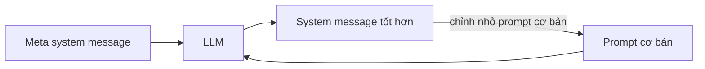
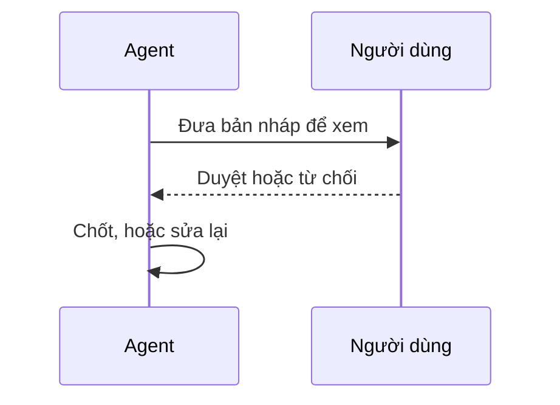

# Xây AI agent đáng tin cậy

Làm sao để agent vừa an toàn vừa hiệu quả? Bài này nói về cách dựng và triển khai agent an toàn, các điểm bảo mật cần cân nhắc và cách giữ dữ liệu cũng như quyền riêng tư của người dùng khi phát triển agent.

Sau bài này bạn có thể:

- Nhận diện và giảm thiểu rủi ro khi tạo agent.
- Áp dụng biện pháp bảo mật để dữ liệu và quyền truy cập được quản lý đúng.
- Tạo agent giữ được quyền riêng tư dữ liệu và mang lại trải nghiệm tốt.

## Từ viết tắt

- **AI** (Artificial Intelligence) — trí tuệ nhân tạo.
- **LLM** (Large Language Model) — mô hình ngôn ngữ lớn.
- **System message / system prompt** — chỉ dẫn nền đặt ra luật chơi và hướng dẫn cho LLM khi nó làm việc với người dùng và dữ liệu.
- **Meta prompt** — lời nhắc dùng để LLM tự viết ra system prompt cho agent.
- **Docker container** — một môi trường chạy tách biệt, bị giới hạn, cho ứng dụng.
- **Human-in-the-loop** — con người đưa phản hồi cho agent ngay lúc nó đang chạy.

## An toàn nghĩa là gì

An toàn nghĩa là agent làm đúng như thiết kế. Người xây agent có phương pháp và công cụ để tối đa hóa điều đó. Trước hết là một system prompt vững: với agent, system prompt còn quan trọng hơn, vì agent cần chỉ dẫn rất cụ thể để làm xong các việc ta giao.

## Khung system message: bốn bước

Để tạo system prompt có thể mở rộng cho một hay nhiều agent, ta dùng một khung gồm bốn bước:

1. **Tạo meta system message**: lời nhắc LLM dùng để sinh system prompt cho các agent. Viết nó như một mẫu để tạo nhiều agent nhanh. Ví dụ: "Bạn là chuyên gia tạo trợ lý agent AI; được cung cấp tên công ty, vai trò, trách nhiệm và thông tin khác để viết system prompt, hãy mô tả càng kỹ càng tốt."
2. **Viết một prompt cơ bản** mô tả agent: vai trò, các việc agent làm và trách nhiệm khác. Ví dụ: "Bạn là nhân viên du lịch của Contoso Travel, giỏi đặt chuyến bay: tra chuyến, đặt vé, hỏi sở thích chỗ ngồi và giờ bay, hủy vé đã đặt, báo khách khi chuyến trễ hay bị hủy."
3. **Đưa cả hai cho LLM**: dùng meta message làm system message và prompt cơ bản làm nội dung, LLM trả về một system message được thiết kế tốt hơn: có tên công ty, vai trò, mục tiêu, các trách nhiệm chính, giọng điệu, hướng dẫn tương tác với người dùng và lưu ý bổ sung.
4. **Lặp lại và cải tiến**: hiếm khi system message chạy đúng ngay lần đầu. Chỉnh nhỏ prompt cơ bản rồi chạy lại qua hệ thống cho phép bạn so sánh và đánh giá kết quả.

Giá trị của khung này là tạo system message cho nhiều agent dễ mở rộng và cải thiện dần theo thời gian.

## Năm mối đe dọa và cách giảm

Muốn agent đáng tin, cần hiểu và giảm các rủi ro. Bài chỉ nêu một vài loại:

| Mối đe dọa | Là gì | Cách giảm |
|---|---|---|
| Nhiệm vụ và chỉ dẫn | Kẻ tấn công đổi chỉ dẫn hay mục tiêu của agent bằng prompt hoặc đầu vào thao túng | Kiểm tra hợp lệ và lọc đầu vào để phát hiện prompt nguy hiểm trước khi agent xử lý; giới hạn số lượt hội thoại |
| Truy cập hệ thống quan trọng | Agent chạm tới hệ thống chứa dữ liệu nhạy cảm; kẻ tấn công nhắm vào kênh giữa agent và dịch vụ, trực tiếp hoặc gián tiếp | Chỉ cấp quyền khi thật cần; kênh liên lạc an toàn; xác thực và kiểm soát truy cập |
| Quá tải tài nguyên và dịch vụ | Gửi lượng yêu cầu lớn qua agent tới các dịch vụ, gây hỏng hệ thống hoặc tốn kém | Đặt chính sách giới hạn số yêu cầu agent gửi tới một dịch vụ; giới hạn lượt hội thoại và yêu cầu |
| Đầu độc cơ sở tri thức | Nhắm vào cơ sở tri thức và dịch vụ agent dùng, làm hỏng dữ liệu khiến kết quả thiên lệch hoặc ngoài ý muốn | Thường xuyên kiểm tra dữ liệu agent dùng; bảo đảm chỉ người đáng tin được sửa dữ liệu |
| Lỗi dây chuyền | Lỗi do kẻ tấn công gây ra lan sang các hệ thống khác agent đang nối, khó khắc phục | Cho agent chạy trong môi trường giới hạn (như Docker container); có cơ chế dự phòng và thử lại khi hệ thống báo lỗi |

Để dễ nhớ, có thể gom các cách giảm trên thành ba nhóm: kiểm tra và giới hạn (lọc đầu vào, giới hạn lượt và yêu cầu, kiểm tra dữ liệu), quyền hạn (quyền tối thiểu, kênh an toàn, xác thực, chỉ người đáng tin được sửa dữ liệu), và chống lan lỗi (môi trường giới hạn, dự phòng, thử lại). Cách gom này là của khóa học, không phải của bài gốc.

## Con người trong vòng lặp

Cách hiệu quả khác để xây hệ thống agent đáng tin là **con người trong vòng lặp** (human-in-the-loop): người dùng đưa phản hồi cho agent ngay lúc nó đang chạy. Người dùng như một agent trong hệ nhiều agent, có thể duyệt hoặc dừng tiến trình.

Ví dụ với Microsoft Agent Framework: agent viết bài thơ bốn dòng về biển, hỏi người dùng duyệt (APPROVE) hay từ chối (REJECT); duyệt thì chốt, từ chối thì sửa lại.

## Kết luận

Xây agent đáng tin cần thiết kế cẩn thận, biện pháp bảo mật vững và liên tục cải tiến. Dùng hệ thống meta prompt có cấu trúc, hiểu các mối đe dọa và áp dụng cách giảm thiểu, nhà phát triển tạo được agent vừa an toàn vừa hiệu quả. Thêm con người trong vòng lặp giúp agent bám sát nhu cầu người dùng mà vẫn giảm rủi ro.

## Nhìn hình trả lời

Kẻ tấn công gửi hàng loạt yêu cầu qua agent tới một dịch vụ, làm hỏng hệ thống hoặc tốn kém. Đó là mối đe dọa nào, và cách giảm là gì?

Đáp án

Quá tải tài nguyên và dịch vụ. Giảm bằng chính sách giới hạn số yêu cầu agent gửi tới dịch vụ, và giới hạn số lượt hội thoại.

## Nguồn đối chiếu

- [Building Trustworthy AI Agents](https://github.com/microsoft/ai-agents-for-beginners/blob/9923c54bcc2df67e7119945e12cd2d45944da2f6/06-building-trustworthy-agents/README.md)

*Dựa trên bài 06 của microsoft/ai-agents-for-beginners (MIT License, © Microsoft Corporation).*
