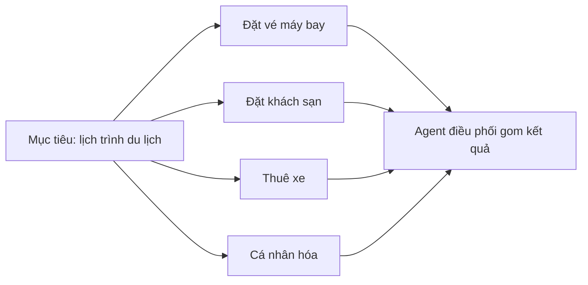
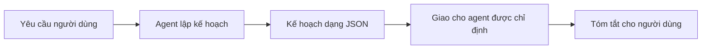
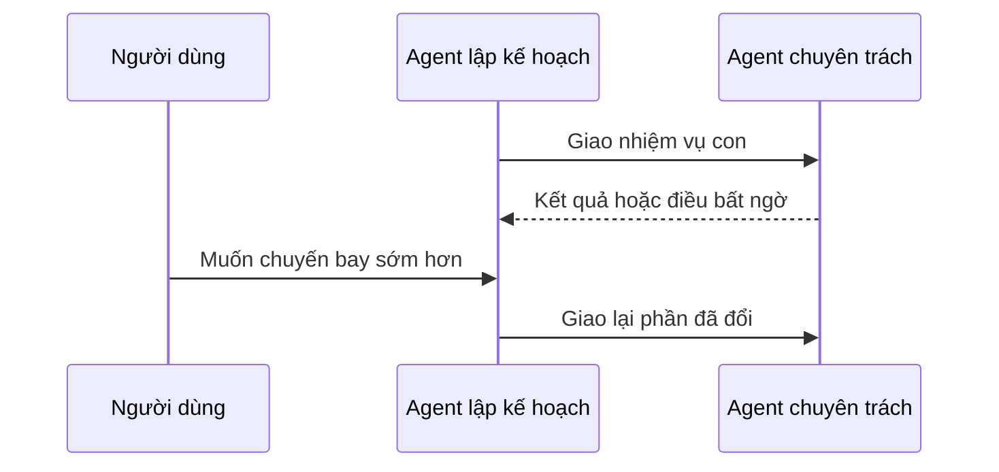

# Thiết kế lập kế hoạch

Làm sao để agent xử lý một việc lớn mà không làm một lèo? Bài này nói về **lập kế hoạch**: đặt mục tiêu rõ, chia việc phức tạp thành các nhiệm vụ con, dùng đầu ra có cấu trúc để máy đọc được, và lập kế hoạch lại khi có điều bất ngờ.

Sau bài này bạn có thể:

- Đặt mục tiêu tổng thể rõ ràng cho agent.
- Chia một việc phức tạp thành các nhiệm vụ con và xếp theo thứ tự hợp lý.
- Trang bị công cụ phù hợp cho agent, quyết định khi nào và cách dùng, và xử lý tình huống bất ngờ.
- Đánh giá kết quả từng nhiệm vụ con, đo hiệu quả và lặp lại để cải thiện kết quả cuối.

## Từ viết tắt

- **LLM** (Large Language Model) — mô hình ngôn ngữ lớn.
- **JSON** — định dạng văn bản có cấu trúc, dễ cho chương trình đọc.
- **Structured output** — đầu ra có cấu trúc: LLM trả lời theo khuôn cố định như JSON thay vì văn bản tự do.
- **Planner** — agent lập kế hoạch: chia mục tiêu thành nhiệm vụ con và giao cho agent phù hợp.
- **Orchestrator** — bộ điều phối: tạo kế hoạch, giao việc và theo dõi tiến độ (như trong Magentic-One).

## Đặt mục tiêu và chia nhỏ việc

Phần lớn việc thực tế quá phức tạp để làm trong một bước. Agent cần một mục tiêu ngắn gọn để dẫn đường cho việc lập kế hoạch và hành động. Ví dụ: "Tạo lịch trình du lịch 3 ngày." Câu này dễ nói nhưng còn cần làm rõ. Mục tiêu càng rõ, agent (và người cộng tác) càng tập trung vào đúng kết quả, như một lịch trình đầy đủ gồm chuyến bay, khách sạn và hoạt động.

### Chia nhỏ nhiệm vụ

Việc lớn hay rắc rối dễ quản lý hơn khi tách thành các nhiệm vụ con hướng tới mục tiêu. Với lịch trình du lịch, ta có thể chia thành:

- Đặt vé máy bay
- Đặt khách sạn
- Thuê xe
- Cá nhân hóa

Mỗi nhiệm vụ con do một agent hoặc quy trình chuyên trách làm. Một agent giỏi tìm giá vé tốt, một agent lo khách sạn, và cứ thế. Một agent điều phối ở "phía sau" gom kết quả thành một lịch trình mạch lạc cho người dùng.

Cách làm theo mô-đun này cũng cho phép cải thiện dần: có thể thêm agent gợi ý món ăn hay hoạt động địa phương và tinh chỉnh lịch trình theo thời gian.

## Đầu ra có cấu trúc

LLM có thể sinh đầu ra có cấu trúc (ví dụ JSON), giúp agent hoặc dịch vụ phía sau đọc và xử lý dễ hơn. Điều này đặc biệt hữu ích khi nhiều agent làm việc cùng nhau: ta chỉ cần nhận kế hoạch rồi mới giao việc.

| | Văn bản tự do | Đầu ra có cấu trúc |
|---|---|---|
| Hình thức | Câu chữ thoải mái | Khuôn cố định như JSON |
| Phía sau xử lý | Khó đọc bằng chương trình hơn | Dễ đọc và xử lý hơn |

Trong đoạn code mẫu của bài, một agent lập kế hoạch nhận yêu cầu rồi trả về kế hoạch gồm: nhiệm vụ chính (`main_task`), danh sách nhiệm vụ con (`subtasks`), mỗi nhiệm vụ con có mô tả và agent được giao (`assigned_agent`), và một cờ cho biết đó có phải lời chào không (`is_greeting`).

## Agent lập kế hoạch và điều phối nhiều agent

Trong ví dụ, một agent định tuyến theo ngữ nghĩa nhận yêu cầu của người dùng (như "Tôi cần kế hoạch khách sạn cho chuyến đi"). Agent lập kế hoạch sau đó làm bốn việc:

1. **Nhận yêu cầu**: dựa vào tin nhắn của người dùng và system prompt (có thông tin các agent sẵn có), nó tạo ra một kế hoạch có cấu trúc.
2. **Liệt kê agent và công cụ**: sổ đăng ký agent chứa danh sách agent (chuyến bay, khách sạn, thuê xe, hoạt động) cùng hàm hoặc công cụ mỗi agent có.
3. **Giao kế hoạch cho đúng agent**: tùy số nhiệm vụ con, nó gửi thẳng cho một agent chuyên trách (khi chỉ có một việc), hoặc điều phối qua một quản lý nhóm chat khi nhiều agent cần cộng tác.
4. **Tóm tắt kết quả**: cuối cùng tóm tắt kế hoạch cho rõ ràng.

Với yêu cầu "lập kế hoạch du lịch cho gia đình có 2 trẻ từ Singapore đến Melbourne", kế hoạch trả về có năm nhiệm vụ con:

| Agent được giao | Nhiệm vụ |
|---|---|
| Đặt vé máy bay | Đặt vé khứ hồi từ Singapore đến Melbourne |
| Đặt khách sạn | Tìm khách sạn thân thiện với gia đình ở Melbourne |
| Thuê xe | Sắp xếp xe thuê phù hợp gia đình bốn người ở Melbourne |
| Đặt hoạt động | Liệt kê hoạt động phù hợp gia đình ở Melbourne |
| Thông tin điểm đến | Cung cấp thông tin về Melbourne như một điểm đến |

Ta dùng đầu ra có cấu trúc này để giao việc cho `assigned_agent` và tóm tắt kế hoạch cho người dùng.

## Lập kế hoạch lặp lại

Có việc cần qua lại hoặc lập kế hoạch lại, khi kết quả của một nhiệm vụ con ảnh hưởng nhiệm vụ kế tiếp. Ví dụ, nếu agent gặp định dạng dữ liệu bất ngờ khi đặt vé, nó có thể phải đổi chiến lược trước khi sang đặt khách sạn.

Phản hồi của người dùng (ví dụ người đó muốn chuyến bay sớm hơn) cũng có thể kéo theo việc lập lại một phần kế hoạch. Cách làm động, lặp đi lặp lại này giúp lời giải khớp với ràng buộc thực tế và sở thích thay đổi của người dùng.

Trong code mẫu, cách làm là truyền kèm lịch sử người dùng và kế hoạch hiện tại để agent lập kế hoạch lại.

## Magentic-One

Muốn lập kế hoạch đầy đủ hơn, bài giới thiệu **Magentic-One**, một hệ nhiều agent tổng quát để giải việc phức tạp, đạt kết quả ấn tượng trên nhiều bộ đánh giá agent khó. Trong đó, bộ điều phối tạo kế hoạch riêng cho từng việc và giao các việc đó cho các agent sẵn có. Ngoài lập kế hoạch, bộ điều phối còn có cơ chế theo dõi để giám sát tiến độ và lập kế hoạch lại khi cần.

## Tóm tắt

Bài này nêu ví dụ về một agent lập kế hoạch tự chọn trong các agent đã định nghĩa. Đầu ra của nó chia nhỏ việc và giao cho agent để chạy. Bài giả định các agent đã có hàm hoặc công cụ cần để làm việc. Ngoài ra có thể thêm các mẫu khác như phản chiếu (reflection), tóm tắt, và trò chuyện luân phiên để tùy biến thêm.

## Nhìn hình trả lời

Người dùng nói muốn chuyến bay sớm hơn, trong khi kế hoạch đã chia xong. Agent lập kế hoạch nên làm gì?

Đáp án

Lập lại một phần kế hoạch: truyền kèm lịch sử và kế hoạch hiện tại, rồi giao lại phần đã đổi cho agent chuyên trách.

## Nguồn đối chiếu

- [Planning Design](https://github.com/microsoft/ai-agents-for-beginners/blob/9923c54bcc2df67e7119945e12cd2d45944da2f6/07-planning-design/README.md)

*Dựa trên bài 07 của microsoft/ai-agents-for-beginners (MIT License, © Microsoft Corporation).*
