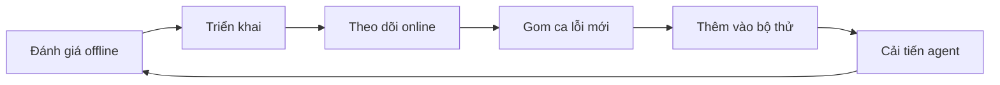

# Bài 10 · Đưa AI agent vào vận hành: quan sát và đánh giá

## Từ viết tắt

- **LLM** (Large Language Model) — mô hình ngôn ngữ lớn: bộ não chữ nghĩa đứng sau agent.
- **SLM** (Small Language Model) — mô hình ngôn ngữ nhỏ: rẻ hơn, đủ dùng cho việc đơn giản.
- **OTel** (OpenTelemetry) — chuẩn chung để agent phát ra dữ liệu theo dõi.
- **MAF** (Microsoft Agent Framework) — khung dựng agent của Microsoft, có sẵn OTel.
- **API** (Application Programming Interface) — cổng để chương trình này gọi dịch vụ của chương trình khác.
- **CI/CD** (Continuous Integration/Continuous Delivery) — quy trình tự kiểm tra và phát hành mã.
- **A/B test** — chạy bản agent mới song song với bản cũ để so sánh.

## Từ hộp đen sang hộp kính

Không có quan sát, agent như một "hộp đen": khó biết bên trong nó đang làm gì và vì sao ra kết quả
đó, nên khó tìm lỗi hay tối ưu. Bài này dạy cách biến nó thành "hộp kính": nhìn xuyên được vào bên
trong, đo được, và cải thiện được.

Công cụ quan sát (ví dụ Langfuse hay Microsoft Foundry) ghi lại mỗi lần agent chạy dưới dạng:

- **Trace**: toàn bộ một việc của agent, từ đầu đến cuối (ví dụ xử lý một câu hỏi của người dùng).
- **Span**: từng bước nhỏ trong trace (ví dụ gọi mô hình, hoặc lấy dữ liệu).

Khi chạy thật, quan sát giúp bạn bốn việc: tìm gốc lỗi khi agent trả lời lạ, quản lý độ trễ và chi
phí (vì LLM tính tiền theo token (đơn vị chữ mà mô hình xử lý) hoặc theo lần gọi), kiểm tra an toàn (dấu vết là bản ghi để phát hiện
prompt injection (cài lệnh lừa agent) hay lộ thông tin cá nhân), và cải tiến liên tục dựa trên cách agent chạy ngoài đời.

## Những chỉ số nên theo dõi

| Chỉ số | Câu hỏi nó trả lời |
|---|---|
| Độ trễ | Agent trả lời nhanh đến mức nào? |
| Chi phí | Mỗi lần chạy tốn bao nhiêu? |
| Lỗi yêu cầu | Bao nhiêu lần gọi API hay công cụ thất bại? |
| Phản hồi rõ ràng | Người dùng chấm thích hay không, mấy sao? |
| Phản hồi ngầm | Họ có hỏi lại, lặp câu hỏi, bấm thử lại không? |
| Độ chính xác | Agent làm đúng bao nhiêu lần? |
| Đánh giá tự động | Một LLM hoặc thư viện chấm điểm đầu ra |

Ví dụ trong bài: một agent mất 20 giây cho các lần gọi mô hình có thể nhanh hơn nếu dùng mô hình nhanh
hơn hoặc gọi song song. Nếu thấy agent gọi LLM năm lần chỉ để cải thiện chút chất lượng, hãy cân nhắc
có đáng tiền không. Lỗi thì xử lý bằng thử lại hoặc nhà cung cấp dự phòng. Bước đầu của độ chính xác là
tự định nghĩa thế nào là "thành công".

## Gắn thiết bị đo cho agent

Muốn có dữ liệu trace, bạn phải gắn thiết bị đo vào mã: để agent phát ra trace và chỉ số cho nền tảng
quan sát thu và hiển thị. **OpenTelemetry (OTel)** là chuẩn phổ biến cho việc này, và MAF tích hợp sẵn.

```python
from agent_framework.observability import get_tracer, get_meter
tracer = get_tracer()
meter = get_meter()
with tracer.start_as_current_span("agent_run"):
    pass  # agent chạy ở đây và được ghi vết tự động
```

Khi cần thông tin riêng, bạn tạo span thủ công và gắn thêm thuộc tính như `user_id`, `session_id` hay
`model_version` để sau này dễ lần lại.

## Đánh giá agent: offline và online

Quan sát cho bạn số liệu; **đánh giá** là dùng số liệu đó để biết agent làm tốt đến đâu. Agent không cho
kết quả giống nhau mỗi lần và có thể lệch dần, nên phải đánh giá đều đặn.

Thường ta bắt đầu bằng offline, vì đó là bước tối thiểu trước khi triển khai bất kỳ agent nào.

- **Offline**: chạy agent trên bộ dữ liệu thử đã biết đáp án, thường trong lúc phát triển hay trong
  CI/CD. Ưu điểm: lặp lại được, đo độ chính xác rõ. Thách thức: bộ thử phải đủ rộng và luôn cập nhật
  ca mới. Nên có cả bộ nhỏ (kiểm nhanh) lẫn bộ lớn.
- **Online**: theo dõi agent trên lượt dùng thật. Bắt được điều phòng thí nghiệm không lường trước,
  như mô hình trôi dần (hiệu quả giảm khi kiểu đầu vào đổi dần). Có thể kết hợp phản hồi người dùng, chạy thử song song ngầm hoặc A/B test. Thách thức: khó
  có nhãn đáng tin cho lượt dùng thật.

Hai kiểu bổ sung cho nhau, và nhiều đội chạy theo vòng lặp:



## Lỗi thường gặp và cách xử lý

| Vấn đề | Hướng xử lý |
|---|---|
| Làm việc không nhất quán | Làm rõ prompt; tách việc cho nhiều agent |
| Chạy vòng lặp mãi | Đặt điều kiện dừng rõ; với việc phức tạp, dùng mô hình lớn chuyên lập luận |
| Gọi công cụ kém | Thử công cụ riêng ngoài agent; chỉnh tham số, prompt, tên công cụ |
| Hệ nhiều agent không ổn định | Prompt riêng biệt cho từng agent; thêm agent điều phối |

Có quan sát thì những lỗi này dễ lộ ra: trace chỉ đúng bước nào hỏng.

## Giữ chi phí trong tầm tay

1. **Dùng mô hình nhỏ (SLM)** cho việc đơn giản như phân loại ý định, lấy tham số; dành mô hình lớn cho
   lập luận khó. Hãy dựng đánh giá để so sánh trước khi chọn.
2. **Dùng mô hình định tuyến**: gửi câu đơn giản cho mô hình nhỏ, nhanh; chỉ câu phức tạp mới đến mô
   hình đắt.
3. **Lưu đệm câu trả lời**: câu hỏi hay gặp được trả sẵn, khỏi chạm hệ agent.

## Nhìn hình trả lời

Người dùng liên tục hỏi lại cùng một câu. Đó là tín hiệu gì, xem ở đâu, và đưa ca đó vào đâu?

<details>
<summary>Đáp án</summary>

Phản hồi ngầm: agent chưa làm đúng. Mở trace để tìm span hỏng, rồi thêm ca đó vào bộ thử offline.

</details>

## Nguồn đối chiếu

- Bài gốc: [10-ai-agents-production](https://github.com/microsoft/ai-agents-for-beginners/blob/9923c54bcc2df67e7119945e12cd2d45944da2f6/10-ai-agents-production/README.md)
- *Dựa trên bài 10 của microsoft/ai-agents-for-beginners (MIT License, © Microsoft Corporation).*
