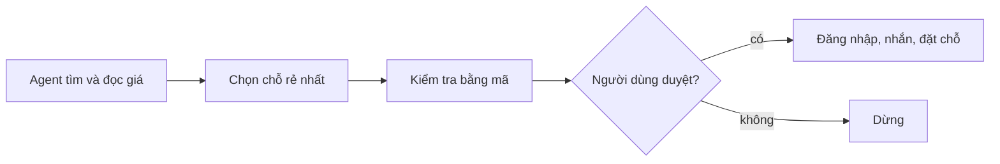

# Bài 15 · Xây agent điều khiển máy tính

## Từ viết tắt

- **CUA** (Computer Use Agent) — agent điều khiển máy tính: chương trình dùng trình duyệt như người thật.
- **CDP** (Chrome DevTools Protocol) — giao thức để chương trình điều khiển trình duyệt Chrome.
- **API** (Application Programming Interface) — cổng để chương trình này gọi dịch vụ của chương trình khác.
- **UI** (User Interface) — giao diện người dùng: phần bạn nhìn và bấm trên màn hình.

## Agent điều khiển máy tính là gì

**Agent điều khiển máy tính (CUA)** dùng website giống một người: mở trình duyệt, xem trang, rồi chọn
việc tiếp theo hợp lý nhất từ những gì nó thấy. Trong bài, bạn dựng một agent tự động hóa trình duyệt:
tìm trên Airbnb, rút dữ liệu có cấu trúc của các chỗ ở, rồi chọn chỗ rẻ nhất ở Stockholm.

Bài ghép bốn thứ: **Browser-Use** để AI tự điều hướng, **Playwright** và **CDP** để điều khiển trình
duyệt, **Azure OpenAI** để suy luận có khả năng nhìn ảnh, và **Pydantic** để rút dữ liệu theo khuôn.

Agent trình duyệt hợp hơn tự động hóa chỉ dùng API khi việc phụ thuộc vào thứ hiện trên giao diện web,
website không có API cần dùng, hoặc trang đổi thường xuyên đến mức logic cố định dễ gãy. Nếu đã có API
ổn định cho cùng việc, nên dùng API vì thường nhanh hơn, dễ kiểm thử và dễ bảo mật hơn.

## Kiến trúc lai: agent cộng điều khiển trực tiếp

Notebook của bài chạy một quy trình lai:

1. Chrome khởi động với CDP bật, để cả Playwright và Browser-Use dùng chung một phiên trình duyệt.
2. Agent Browser-Use lo phần điều hướng mở, như mở Airbnb, tắt cửa sổ quảng cáo, tìm Stockholm.
3. Trang đang mở được đọc theo một khuôn Pydantic để lấy tên, giá mỗi đêm, điểm đánh giá và đường dẫn.
4. Mã Python so sánh các chỗ ở rồi nêu bật kết quả rẻ nhất.

Cách này giữ được lập luận linh hoạt dựa trên hình ảnh mà Browser-Use giỏi, nhưng vẫn cho bạn điều khiển
trình duyệt chắc chắn khi cần.

## Chọn agent hay actor

**Agent** là kiểu để AI tự xoay xở bằng ngôn ngữ tự nhiên. **Actor** là kiểu điều khiển trang trực tiếp
bằng mã. Chọn theo việc có đoán trước được không:

| Tình huống | Dùng agent | Dùng actor |
|---|---|---|
| Bố cục động | Có: AI thích nghi khi trang đổi | Không: bộ chọn cứng dễ gãy |
| Cấu trúc đã biết | Không: agent chậm hơn | Có: nhanh và chính xác |
| Tìm phần tử | Có: nói bằng ngôn ngữ tự nhiên | Không: cần bộ chọn chính xác |
| Kiểm soát thời gian | Không: khó đoán hơn | Có: toàn quyền chờ và thử lại |
| Quy trình phức tạp | Có: xử lý trạng thái UI bất ngờ | Không: phải viết rõ từng nhánh |

Thực hành tốt: bắt đầu bằng agent để khám phá, chuyển sang điều khiển trực tiếp khi tương tác đã đoán
được, dùng khuôn dữ liệu có cấu trúc để kết quả được kiểm tra kiểu, thêm độ trễ có chủ đích sau hành động
làm giao diện đổi, chụp màn hình khi thử để dễ tìm lỗi, và chuẩn bị phương án dự phòng cho cửa sổ quảng
cáo hay bố cục đổi.

## Thử ngay: cài và chạy notebook

Cài các gói mà notebook dùng:

```bash
pip install browser_use playwright python-dotenv
playwright install chromium
# .env
AZURE_OPENAI_ENDPOINT=...
AZURE_OPENAI_API_KEY=...
```

Rồi đặt biến môi trường cho Azure OpenAI (thêm cả tên deployment chat). Cần Python
3.12 trở lên, Chrome hoặc Chromium cài sẵn, và biết cơ bản về Python bất đồng bộ.

## Rào an toàn cho agent trình duyệt

Agent trình duyệt chạy trên website thật, nên cần ranh giới chặt hơn một đoạn mã chỉ gọi API đã biết. Bảy
việc nên làm:

1. **Khoanh vùng môi trường duyệt**: chạy trong hồ sơ trình duyệt riêng hoặc hộp cát, chỉ cho vào những
   tên miền cần cho việc.
2. **Tách quan sát khỏi hành động**: cho agent tìm, đọc, rút dữ liệu trước; cần bước duyệt rõ ràng trước
   khi nó gửi biểu mẫu, nhắn tin, đặt chỗ, mua hàng, xóa dữ liệu hay đổi cài đặt tài khoản.
3. **Giữ bí mật ngoài lời nhắc và nhật ký**: đừng đưa mật khẩu, thông tin thanh toán, cookie phiên hay
   dữ liệu cá nhân thô vào ngữ cảnh mô hình; để người dùng tự đăng nhập.
4. **Coi nội dung trang là đầu vào không tin cậy**: trang có thể chứa chỉ dẫn nhắm vào agent. Agent phải
   bỏ qua chữ bảo nó đổi mục tiêu, lộ dữ liệu, tắt rào an toàn hay sang trang không liên quan.
5. **Kiểm tra bằng mã quanh bước rủi ro**: xác minh đường dẫn, tiêu đề trang, món đã chọn, giá, người
   nhận rồi mới xin duyệt bước cuối.
6. **Đặt ngân sách và điều kiện dừng**: giới hạn số hành động, lần thử lại, tab và số phút; trang mơ hồ
   thì dừng, đừng cứ bấm tiếp.
7. **Ghi bằng chứng hữu ích, không ghi hết**: giữ tóm tắt hành động, thời gian, đường dẫn, mô tả phần tử
   đã chọn và tham chiếu ảnh chụp, để xem lại lỗi mà không lưu thừa dữ liệu nhạy cảm.

Với ví dụ Airbnb, mặc định an toàn là tìm chỗ ở và rút giá. Đăng nhập, nhắn chủ nhà hay đặt chỗ là hành
động riêng, cần người dùng duyệt.

## Ví dụ thực tế: Microsoft Project Opal

Agent bạn dựng là một bản CUA nhỏ, chạy cục bộ. Microsoft đưa cùng ý tưởng này vào doanh nghiệp với
**Project Opal (Frontier)**, một tính năng của Microsoft 365 Copilot. Bạn mô tả việc, agent làm thay bằng
cách điều khiển máy tính trên một **Windows 365 Cloud PC** an toàn, chạy nền không đồng bộ, và bạn có thể
hướng dẫn hay giành quyền điều khiển bất cứ lúc nào. Việc mẫu: quản lý yêu cầu thành viên nhóm bảo mật,
gom bằng chứng kiểm toán, phân loại sự cố IT, dựng bảng số liệu tài chính từ Excel.

Opal cho thấy một CUA đáng tin trông thế nào: dừng lại khi cần thông tin đăng nhập hay dữ liệu nhạy cảm
và không tự nhập mật khẩu hay gửi biểu mẫu khi chưa xác nhận; chạy trong Cloud PC cô lập, mặc định chỉ
trình duyệt, dùng danh tính của chính bạn, ghi lại mọi hành động; lập kế hoạch trước rồi tự giám sát
suy luận từng bước; và có **kỹ năng** (skills) viết sẵn để dùng lại cho việc lặp. Hiện Opal chỉ có cho
người dùng chương trình truy cập sớm Frontier, cần quản trị viên thiết lập, và tính năng có thể đổi.

## Nhìn hình trả lời

Agent đặt chỗ đã tìm được một chỗ ở rẻ nhất. Trước khi nó đăng nhập, nhắn chủ nhà hay đặt chỗ, cần có
bước gì, và nên hiển thị gì cho người duyệt?



<details>
<summary>Đáp án</summary>

Cần dừng lại và xin người dùng duyệt rõ ràng. Trước đó hiển thị tóm tắt chỗ ở đã chọn, đường dẫn, giá,
ngày và hành động định làm. Tìm kiếm và rút giá có thể tự động; truy cập tài khoản, tin nhắn, mua và đặt
chỗ phải do người dùng duyệt.

</details>

## Nguồn đối chiếu

- Bài gốc: [15-browser-use](https://github.com/microsoft/ai-agents-for-beginners/blob/9923c54bcc2df67e7119945e12cd2d45944da2f6/15-browser-use/README.md)
- *Dựa trên bài 15 của microsoft/ai-agents-for-beginners (MIT License, © Microsoft Corporation).*
