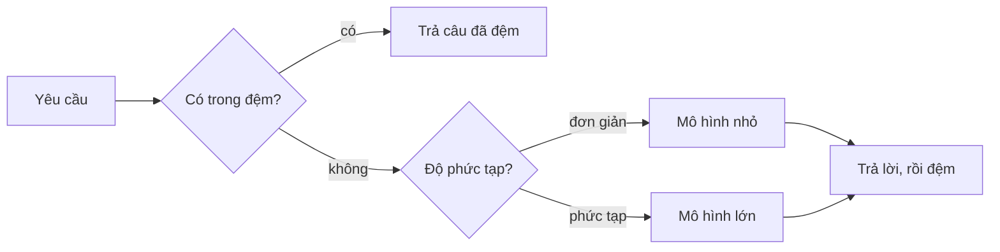

# Bài 16 · Triển khai agent mở rộng được với Microsoft Foundry

## Từ viết tắt

- **RBAC** (Role-Based Access Control) — phân quyền theo vai trò: mỗi danh tính chỉ được làm đúng việc của nó.
- **RAG** (Retrieval Augmented Generation) — cách cho mô hình tra cứu thông tin ngoài rồi mới trả lời.
- **MCP** (Model Context Protocol) — giao thức để agent dùng công cụ bên ngoài qua một cổng chuẩn.
- **OTel** (OpenTelemetry) — chuẩn chung để agent phát ra dữ liệu theo dõi từng bước.

## Từ máy của bạn đến sản xuất

Đến giờ agent của bạn chạy trên laptop, trong notebook, nhờ `az login` và vài biến môi trường. Học thì thế là
đúng, nhưng không đủ để chạy một agent mà hàng nghìn khách hàng cần lúc 3 giờ sáng. Bài này lấp khoảng cách
giữa "chạy được trên máy tôi" và "chạy ổn, đáng tiền, trong sản xuất", bằng **Microsoft Foundry** và
**Microsoft Foundry Agent Service**.

Agent nguyên mẫu và agent sản xuất có chung một vòng lõi: suy luận, gọi công cụ, trả lời. Khác nhau ở mọi
thứ bao quanh vòng đó. Bài gốc nói ước chừng mô hình chỉ khoảng 20% agent sản xuất, 80% còn lại là bộ khung
vận hành.

| Mối lo | Nguyên mẫu | Sản xuất |
|---|---|---|
| Nơi chạy | Trong notebook | Dịch vụ được lưu trữ, có phiên bản |
| Danh tính | Token `az login` của bạn | Danh tính được quản lý, phân quyền RBAC hẹp |
| Trạng thái | Trong bộ nhớ, mất khi khởi động lại | Đưa ra ngoài (kho luồng, dịch vụ bộ nhớ) |
| Lỗi | Bạn tự đọc lỗi | Thử lại, phương án dự phòng, cảnh báo |
| Chi phí | "Vài xu thôi" | Đo theo từng yêu cầu, định tuyến, đệm, có ngân sách |
| Chất lượng | Bạn nhìn bằng mắt | Tự động đánh giá trước mỗi bản phát hành |
| Niềm tin | Bạn duyệt mọi hành động | Chính sách và người duyệt cho hành động rủi ro |

## Ba mẫu triển khai

Ba mẫu này thường dùng chung.

1. **Agent tự lưu trữ (client-hosted)**: agent sống trong tiến trình ứng dụng của bạn, vòng suy luận chạy
   trong dịch vụ của bạn, như mọi bài trước. Hợp khi cần toàn quyền kiểm soát vòng lặp hoặc gắn agent vào
   hệ thống sẵn có. Đổi lại, bạn tự lo mở rộng, trạng thái và độ bền.
2. **Agent được lưu trữ (Hosted Agent)**: agent được đăng ký như một tài nguyên trong Foundry. Foundry chạy
   vòng suy luận, lưu luồng, áp dụng an toàn nội dung và RBAC, và hiện agent trên cổng Foundry. Ứng dụng của
   bạn chỉ còn là máy khách mỏng. Hợp khi cần độ bền, quan sát và quản trị có sẵn; đổi lại bớt quyền kiểm
   soát chi tiết.
3. **Quy trình agent (Agent Workflow)**: nhiều agent và công cụ ghép thành một đồ thị có luồng điều khiển rõ
   ràng: tuần tự, rẽ nhánh, nút chờ người duyệt, điểm lưu có thể tạm dừng và chạy tiếp. Hợp khi một việc đi
   qua nhiều agent chuyên biệt hoặc cần bước duyệt ở giữa; đổi lại nhiều bộ phận hơn.

## Vòng đời agent trên Foundry

Triển khai agent không phải một lần đẩy là xong, mà là một vòng, giống chu kỳ phát hành phần mềm:
**tạo, đặt phiên bản, đánh giá ngoại tuyến, triển khai, quan sát trực tuyến, gom ca lỗi, quay lại tạo**, và
cuối cùng là cho bản cũ nghỉ.

Ý chính, kế thừa từ bài 10 của khóa gốc: **đánh giá ngoại tuyến là cổng chặn, không phải việc làm sau**. Bản
agent mới không được phát hành nếu chưa vượt ngưỡng đánh giá. Quan sát trực tuyến rồi đưa lỗi thật trở lại bộ
thử ngoại tuyến. Hỏng cổng thì quay về bước tạo.

## Mở rộng quy mô

Mở rộng agent khác mở rộng một API không trạng thái, vì mỗi yêu cầu có thể kéo theo nhiều lần gọi mô hình và
công cụ tốn kém. Bốn kỹ thuật gánh phần lớn việc:

- **Xử lý yêu cầu không trạng thái**: đừng giữ trạng thái từng người dùng trong bộ nhớ tiến trình. Lưu luồng
  trò chuyện ở kho luồng của Foundry hoặc dịch vụ bộ nhớ để mọi bản chạy đều xử lý được mọi yêu cầu. Nhờ vậy
  thêm máy là mở rộng ngang được, khỏi cần dính phiên.
- **Định tuyến mô hình**: không phải yêu cầu nào cũng cần mô hình mạnh và đắt nhất. Việc đơn giản như phân
  loại ý định hay trả lời ngắn thì giao mô hình nhỏ, nhanh; mô hình lớn để dành cho suy luận thật sự. Foundry
  có **Model Router** làm giúp, hoặc bạn tự viết bộ phân loại nhẹ.
- **Đệm câu trả lời (cache)**: nhiều câu hỏi gần như trùng nhau ("đặt lại mật khẩu thế nào?"). Đệm lại để trả
  lời mà không gọi mô hình. Tỷ lệ trúng khiêm tốn cũng cắt được đáng kể chi phí và độ trễ.
- **Đồng thời và áp lực ngược**: nhà cung cấp mô hình có giới hạn tốc độ. Hãy giới hạn số việc chạy cùng lúc,
  thử lại với thời gian chờ tăng dần, và lỗi cho nhẹ nhàng (trả lời "đang xử lý" tốt hơn lỗi 500).

## Quan sát và chi phí

Không vận hành được thứ mình không nhìn thấy. Microsoft Agent Framework phát vết **OTel** có sẵn: mỗi lần gọi
mô hình, công cụ hay bước điều phối là một đoạn vết (span). Ở sản xuất, bạn xuất các vết đó sang Foundry
(hoặc nơi nào hiểu OTel) để lần theo trọn một khiếu nại của khách qua mọi lần gọi, xem độ trễ và chi phí mỗi
yêu cầu theo thời gian, và đặt cảnh báo khi lỗi hay chi phí bất thường tăng vọt. Gắn thuộc tính như hạng khách
hàng hay mô hình đã được chọn thì đống vết thành câu hỏi trả lời được, ví dụ "khách doanh nghiệp có bị đẩy
sang mô hình nhỏ quá nhiều không?".

Chi phí agent sản xuất chủ yếu là token. Ba đòn bẩy, theo thứ tự tác động:

1. **Chọn cỡ mô hình vừa đủ**: mô hình nhỏ vượt được cổng đánh giá hầu như luôn rẻ hơn mô hình lớn cũng vượt.
   Dùng đánh giá để chứng minh mô hình nhỏ đủ tốt, đừng mặc định chọn cái to nhất cho yên tâm.
2. **Định tuyến theo độ phức tạp**: chỉ trả giá mô hình lớn cho yêu cầu cần suy luận lớn.
3. **Đệm mạnh tay**: lần gọi mô hình rẻ nhất là lần không phải gọi.

## Kiểm soát cho doanh nghiệp

- **Quản trị**: Hosted Agent thừa hưởng RBAC, an toàn nội dung và nhật ký kiểm toán của Foundry. Cho mỗi agent
  một danh tính được quản lý với quyền tối thiểu: chỉ đọc kho tri thức, quyền hẹp với hệ thống phiếu hỗ trợ.
- **Người duyệt**: có việc quá hệ trọng để tự động hóa hẳn, như hoàn tiền, xóa tài khoản, chuyển lên bộ phận
  pháp lý. Agent Framework hỗ trợ công cụ **cần phê duyệt**: agent đề xuất, việc dừng lại, người duyệt hoặc
  từ chối, quy trình chạy tiếp.
- **MCP khi sản xuất**: coi mỗi máy chủ MCP là ranh giới không tin cậy. Ghim phiên bản, chạy với danh tính
  hẹp, kiểm tra kết quả trả về, và không bao giờ đưa bí mật cho nó. Máy chủ MCP là một phụ thuộc, và phụ
  thuộc thì phải vá, kiểm toán và giới hạn tốc độ.

## Thử ngay: bộ xử lý yêu cầu hỗ trợ

Bài thực hành lắp một agent hỗ trợ khách hàng với đủ thứ: công cụ, RAG, bộ nhớ, định tuyến mô hình, đệm, người
duyệt hoàn tiền lớn, quy trình đánh giá và vết OTel. Lõi của nó là bộ xử lý yêu cầu (bản rút gọn):

```python
cached = response_cache.get(normalize(query))
if cached:
    return cached
model = "gpt-5-nano" if is_simple(query) else "gpt-5-mini"
response = await support_agent.run(query, model=model)
```

Ba dòng đầu trả từ bộ đệm nếu có, sau đó chọn mô hình theo độ phức tạp rồi chạy agent.

Agent đã triển khai còn cần một phép thử rẻ hơn nữa: **endpoint có thật sự trả lời không?** Triển khai
"thành công" chỉ chứng tỏ khai báo được chấp nhận, chưa chứng tỏ agent đáp lại. **Bài kiểm tra khói (smoke
test)** bắt lỗi đó trong vài giây ở mỗi lần triển khai. Hãy xếp thành kim tự tháp: kiểm tra khói (có tới được
và có trả lời không?) chạy mỗi lần triển khai, đánh giá ngoại tuyến (đủ tốt để phát hành chưa?) chạy trước khi
đưa lên, đánh giá trực tuyến (ngoài đời đang ra sao?) chạy liên tục.

## Nhìn hình trả lời

Một yêu cầu đến agent hỗ trợ. Trường hợp nào đi đường nào: câu hỏi quen thuộc đã có trong bộ đệm, câu hỏi
mới đơn giản, câu hỏi mới cần suy luận phức tạp?



<details>
<summary>Đáp án</summary>

Câu đã có trong đệm được trả ngay, không gọi mô hình. Câu mới đơn giản đi tới mô hình nhỏ, nhanh và rẻ. Câu
mới phức tạp đi tới mô hình lớn. Kết quả được đệm lại cho lần sau.

</details>

## Nguồn đối chiếu

- Bài gốc: [16-deploying-scalable-agents](https://github.com/microsoft/ai-agents-for-beginners/blob/9923c54bcc2df67e7119945e12cd2d45944da2f6/16-deploying-scalable-agents/README.md)
- *Dựa trên bài 16 của microsoft/ai-agents-for-beginners (MIT License, © Microsoft Corporation).*
