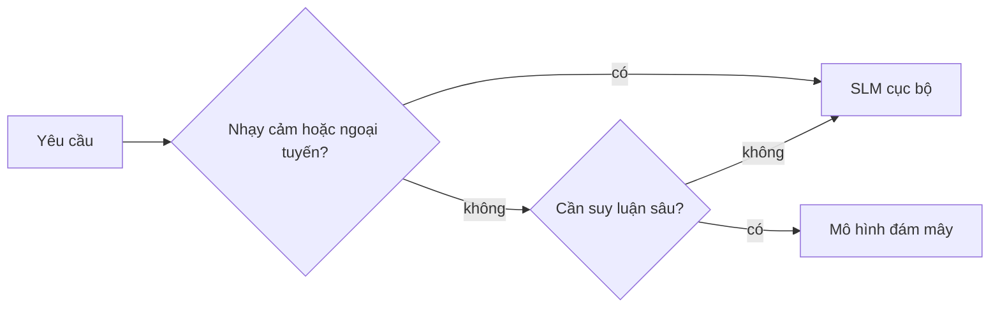

# Bài 17 · Tạo AI agent chạy trên máy với Foundry Local và Qwen

## Từ viết tắt

- **SLM** (Small Language Model) — mô hình ngôn ngữ nhỏ: vài tỷ tham số, đủ nhẹ để chạy trên laptop.
- **RAG** (Retrieval Augmented Generation) — cách cho mô hình tra cứu thông tin ngoài rồi mới trả lời.
- **MCP** (Model Context Protocol) — giao thức để agent dùng công cụ bên ngoài qua một cổng chuẩn.
- **API** (Application Programming Interface) — cổng để chương trình này gọi dịch vụ của chương trình khác.
- **CPU / GPU / NPU** — bộ xử lý chung, bộ xử lý đồ họa, và bộ xử lý chuyên cho AI trên máy.

## Đưa agent xuống một chiếc máy

Bài trước đưa agent lên đám mây. Bài này làm ngược lại: đưa agent xuống **một máy duy nhất**. Xong bài, bạn có một
trợ lý kỹ thuật biết suy luận, gọi công cụ, đọc tệp và tìm trong tài liệu của bạn, mà **không cần một lần gọi
mô hình trên đám mây nào**. Ba lý do thường gặp:

- **Riêng tư**: mã và tài liệu không rời khỏi máy; không câu lệnh, đoạn mã hay dữ liệu khách nào đi qua mạng.
- **Chi phí**: chạy cục bộ không tính tiền theo token, thử cả ngày chỉ tốn tiền điện.
- **Ngoại tuyến**: trên máy bay, trong cơ sở kín, hay lúc hệ thống sự cố, agent vẫn chạy.

Cái giá là bạn đổi mô hình đám mây hàng đầu lấy một **SLM** chạy trên CPU, GPU hoặc NPU của mình. Bài này dạy dựng
agent *giỏi trong giới hạn đó*, chứ không giả vờ giới hạn không có.

## SLM giỏi gì, yếu gì

Mô hình đám mây hàng đầu có hàng trăm tỷ tham số và cả trung tâm dữ liệu đứng sau. SLM chỉ có vài tỷ tham số và
phải nằm vừa trong RAM laptop. Khác biệt đó định ra kỳ vọng rõ ràng.

**SLM giỏi**: việc có cấu trúc, có giới hạn (phân loại, trích xuất, tóm tắt một tài liệu đã biết); **gọi công cụ**
(chọn hàm nào, với đối số nào); thử nhanh, rẻ, riêng tư trên dữ liệu của bạn.

**SLM yếu**: suy luận mở, nhiều bước trên ngữ cảnh lớn; kiến thức thế giới rộng (nó thấy ít hơn và quên nhiều hơn).

Vì vậy chiến lược thắng là: **để SLM điều phối, để công cụ làm việc nặng**. Mô hình không cần *biết* mã nguồn của
bạn, chỉ cần biết lúc nào gọi `read_file` và `search_docs`. Đúng sở trường của SLM.

## Foundry Local và Qwen

**Microsoft Foundry Local** là môi trường chạy gọn nhẹ: tải, quản lý và phục vụ mô hình ngay trên máy bạn. Điểm
quan trọng nhất là nó mở một **điểm cuối HTTP tương thích OpenAI**, nên SDK OpenAI và client OpenAI của Microsoft
Agent Framework dùng được chỉ bằng cách đổi `base_url`. Mọi điều bạn học về dựng agent đều dùng lại; chỉ điểm cuối
dời từ đám mây về `localhost`. Foundry Local còn tự chọn bản mô hình hợp với phần cứng: bản CPU, bản GPU hay bản NPU.

Một agent chỉ là agent khi gọi được công cụ. Nhiều SLM chat được nhưng sinh lệnh gọi công cụ sai cấu trúc. Các mô
hình **Qwen** được huấn luyện cho việc gọi hàm và cho lệnh gọi đúng cấu trúc một cách nhất quán, nhờ đó mô hình chat
cục bộ thành *agent* cục bộ.

## Thử ngay: chạy Qwen trên máy

Cài Foundry Local theo tài liệu cho hệ điều hành của bạn, rồi tải và chạy một mô hình Qwen:

```bash
foundry model run qwen2.5-7b-instruct
foundry service status
```

Khi dịch vụ chạy, bạn có một điểm cuối cục bộ tương thích OpenAI. Trong Python, notebook dùng `foundry-local-sdk` để
tự tìm điểm cuối, khỏi gõ cứng cổng:

```python
manager = FoundryLocalManager("qwen2.5-7b-instruct")
client = OpenAI(base_url=manager.endpoint, api_key=manager.api_key)
```

Khóa API ở đây chỉ là giá trị giữ chỗ cục bộ. Cần máy có RAM tối thiểu thực tế khoảng 8 GB (16 GB trở lên thì thoải
mái); GPU hoặc NPU giúp nhanh hơn nhưng không bắt buộc.

## Công cụ và RAG cục bộ

Công cụ chỉ là hàm Python thường, giới hạn trong một thư mục dự án. Ví dụ `read_file` chặn đường dẫn nằm ngoài thư
mục dự án, vì ngay cả cục bộ, một công cụ đọc đường dẫn tùy ý cũng là mối nguy.

Tìm tài liệu là việc mà agent cục bộ lập công. Thay vì mong SLM thuộc lòng tài liệu, bạn nhúng tài liệu vào một **cơ
sở dữ liệu vector cục bộ** (Chroma, chạy ngay trong tiến trình, không cần máy chủ) rồi để agent lấy đúng đoạn cần.
Cả đường ống đều chạy trên máy: mô hình nhúng cục bộ, vector cục bộ, truy xuất cục bộ, SLM cục bộ. Đó vẫn là mẫu RAG
dạng agent đã học, chỉ khác là mọi bộ phận nằm trên máy bạn.

## MCP cục bộ vẫn cần ranh giới

**MCP** là một cách truyền, không phải dịch vụ đám mây. Một máy chủ MCP có thể chạy như tiến trình cục bộ qua
`stdio`, để dùng lại kho máy chủ MCP có sẵn (tệp, git, truy vấn cơ sở dữ liệu) hoàn toàn ngoại tuyến. Nhưng nó vẫn chạy
với quyền của người dùng, nên hãy giới hạn phạm vi (một thư mục dự án, không phải cả thư mục cá nhân) và coi kết quả
của nó là đầu vào cần kiểm tra.

## Mẫu lai: cục bộ và đám mây

Ưu tiên cục bộ không có nghĩa là chỉ cục bộ. Hệ thống trưởng thành định tuyến theo độ nhạy cảm và độ khó:

| Tình huống | Chạy ở đâu |
|---|---|
| Mã hay dữ liệu nhạy cảm, hoặc ngoại tuyến | SLM cục bộ |
| Việc đơn giản, có giới hạn | SLM cục bộ (rẻ, nhanh) |
| Suy luận khó, nhiều bước, dữ liệu không nhạy cảm | Mô hình đám mây |
| Mọi thứ, lúc đám mây sự cố | SLM cục bộ (xuống cấp nhẹ nhàng) |

Đây là ý tưởng định tuyến mô hình của bài trước, chỉ khác một "mô hình" nay là chính máy của bạn. Thiết kế chắc
chắn sẽ lùi về cục bộ khi đám mây không dùng được, để agent kém đi chứ không hỏng hẳn.

## Nhìn hình trả lời

Bạn có một mã nguồn nội bộ nhạy cảm cần hỏi agent, và một câu hỏi suy luận khó nhiều bước trên dữ liệu công khai.
Mỗi việc nên chạy ở đâu?



<details>
<summary>Đáp án</summary>

Mã nội bộ nhạy cảm chạy ở **SLM cục bộ** để dữ liệu không rời máy. Câu suy luận khó nhiều bước trên dữ liệu không
nhạy cảm có thể đi tới **mô hình đám mây**.

</details>

## Nguồn đối chiếu

- Bài gốc: [17-creating-local-ai-agents](https://github.com/microsoft/ai-agents-for-beginners/blob/9923c54bcc2df67e7119945e12cd2d45944da2f6/17-creating-local-ai-agents/README.md)
- *Dựa trên bài 17 của microsoft/ai-agents-for-beginners (MIT License, © Microsoft Corporation).*
