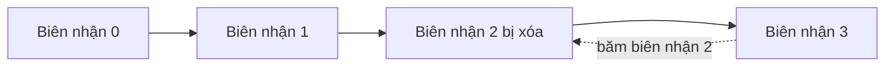

# Bài 18 · Bảo mật AI agent bằng biên nhận mật mã

## Từ viết tắt

- **JSON** (JavaScript Object Notation) — định dạng văn bản cho dữ liệu có cấu trúc, dạng cặp tên và giá trị.
- **JCS** (JSON Canonicalization Scheme) — cách viết JSON theo một dạng chuẩn duy nhất để cùng nội dung ra cùng byte.
- **Ed25519** — thuật toán chữ ký số: ký bằng khóa riêng, ai có khóa công khai cũng kiểm được.
- **SHA-256** — hàm băm: biến dữ liệu bất kỳ thành một dấu vân tay có độ dài cố định.
- **RFC** (Request for Comments) — văn bản tiêu chuẩn của Internet, ví dụ RFC 8785 mô tả JCS.

## Vấn đề: dấu vết kiểm toán của agent

Hãy tưởng tượng bạn triển khai một agent cho Contoso Travel. Nó đọc yêu cầu khách, gọi API chuyến bay để tra
cứu, và đặt chỗ thay khách. Quý trước nó xử lý 50.000 lượt đặt. Hôm nay kiểm toán viên đến và hỏi: "Cho tôi xem agent
đã làm gì." Bạn đưa nhật ký. Họ hỏi tiếp câu khó hơn: **"Làm sao tôi biết các nhật ký này chưa bị sửa?"**

Phần lớn hệ thống hiện nay dựa vào ba thứ:

- **Nhật ký ứng dụng**: do chính agent ghi, ai có quyền vào hệ thống tệp đều sửa được.
- **Dịch vụ log đám mây**: chống sửa ở cấp nền tảng, nhưng chỉ khi kiểm toán viên tin nhà vận hành nền tảng.
- **Nhật ký giao dịch cơ sở dữ liệu**: hợp với thay đổi dữ liệu, không hợp với lệnh gọi công cụ bất kỳ.

Cả ba đều buộc kiểm toán viên phải tin ai đó. Với dùng nội bộ, niềm tin ấy thường chấp nhận được; với việc chịu quản lý
chặt (tài chính, y tế, mọi thứ thuộc EU AI Act) thì không. **Biên nhận mật mã** khiến mỗi hành động của agent tự kiểm
chứng được: kiểm toán viên không cần tin bạn, chỉ cần khóa công khai và chính biên nhận.

## Biên nhận mật mã là gì

Biên nhận là một đối tượng JSON ghi lại agent đã làm gì, kèm chữ ký số. Các trường chính: loại biên nhận, mã agent, tên
công cụ, băm của đối số, băm của kết quả, mã chính sách, thời điểm, số thứ tự, băm của biên nhận trước, và đối tượng
chữ ký. Băm đối số và kết quả (thay vì chép nguyên văn) giữ biên nhận nhỏ và giữ kín nội dung nhạy cảm; kiểm toán viên
so băm với bản gốc lưu riêng.

Luồng làm ra biên nhận: agent gọi công cụ, dựng nội dung biên nhận, chuẩn hóa JSON theo JCS, ký các byte chuẩn đó
bằng Ed25519, rồi kiểm toán viên xác minh ngoại tuyến. Ba tính chất làm nên sức mạnh:

1. **Chữ ký**: cổng của agent ký bằng khóa riêng Ed25519. Ai có khóa công khai tương ứng đều kiểm được ngoại tuyến. Sửa
   bất kỳ trường nào cũng làm chữ ký hỏng.
2. **Mã hóa chuẩn tắc (canonical)**: trước khi ký, biên nhận được viết theo JCS (RFC 8785), để hai bên cài đặt khác nhau
   cùng ra đúng từng byte. Không có bước này, hai bộ ghi JSON khác nhau sẽ cho hai chữ ký cho cùng một nội dung.
3. **Chuỗi băm**: trường `previous_receipt_hash` nối mỗi biên nhận với biên nhận ngay trước. Xóa hay đảo thứ tự một biên
   nhận làm hỏng mọi biên nhận phía sau, dù chữ ký lẻ có bị vượt qua.

Ba tính chất ấy cho ba bảo đảm: **quy kết** (khóa này đã ký nội dung này), **toàn vẹn** (nội dung không đổi từ lúc ký) và
**thứ tự** (biên nhận này đến sau biên nhận kia).

## Thử ngay: ký và xác minh

Không cần thư viện đặc biệt: bạn dựng bằng Python thuần với PyNaCl (Ed25519) và gói `jcs`. Phần cốt lõi của bước xác
minh, đảo ngược việc ký, nằm trong vài dòng:

```python
payload = {k: v for k, v in receipt.items() if k != "signature"}
canonical_bytes = canonicalize(payload)
verify_key = signing.VerifyKey(b64url_decode(sig_obj["public_key"]))
verify_key.verify(canonical_bytes, b64url_decode(sig_obj["sig"]))
```

Hàm này trả về đúng hoặc sai, không gọi mạng, không phụ thuộc dịch vụ nào, không cần tin bên thứ ba. Để thấy phát hiện
sửa đổi, bạn làm theo ba bước: ký một biên nhận và xác minh được; sửa một byte của `tool_args_hash`; chạy lại xác minh và thấy
nó thất bại. Chỉ cần một sửa đổi nhỏ nhất cũng phá chữ ký.

## Nối biên nhận thành chuỗi

Một biên nhận ký bảo vệ một hành động; một chuỗi biên nhận bảo vệ cả một dãy. Mỗi biên nhận ghi băm của biên nhận
trước. Muốn lặng lẽ bỏ biên nhận số 2, kẻ tấn công phải sửa `previous_receipt_hash` của biên nhận số 3 (làm hỏng chữ ký
của nó), hoặc giả một chữ ký mới cho biên nhận 3 đã sửa (cần khóa riêng của agent). Nếu khóa riêng nằm trong kho khóa
phần cứng và bạn công bố khóa công khai kèm biên nhận, cả hai cách đều không làm được mà không bị phát hiện.

## Biên nhận chứng minh gì, và không chứng minh gì

Đây là phần quan trọng nhất của bài. **Biên nhận chứng minh**: quy kết, toàn vẹn, thứ tự. **Biên nhận KHÔNG chứng minh**:

1. **Tính đúng đắn**: hành động có đúng không. Biên nhận có thể ký cho câu trả lời sai sạch sẽ như cho câu đúng.
2. **Tuân thủ chính sách**: chính sách trong `policy_id` có thật sự được đánh giá hay không. Biên nhận ghi điều được
   nêu ra, không ghi điều được thực thi.
3. **Danh tính ngoài khóa**: biên nhận nói "khóa này ký nội dung này", không nói "người này cho phép". Nối khóa với người
   hay tổ chức cần hạ tầng danh tính riêng.
4. **Tính thật của đầu vào**: nếu agent nhận một lời nhắc bị thao túng và làm theo, biên nhận vẫn ghi trung thực. Biên nhận
   nằm phía sau kiểm tra đầu vào, không thay thế nó.

Lỗi hay gặp là nghĩ "có biên nhận" nghĩa là "đã được quản trị". Không phải: biên nhận là nền móng, quản trị là hệ thống bạn xây trên đó.

## Chứng minh con người duyệt đúng hành động

Với việc rủi ro cao (hoàn tiền, xóa dữ liệu, chuyển khoản), cần đúng câu mà biên nhận hành động không nói: "một người
đã cho phép". Cùng bộ công cụ trên làm được: người duyệt có tên **ký toàn bộ hành động ở dạng chuẩn tắc và băm của nó**
trước khi chạy; biên nhận hành động của agent mang **cùng băm hành động** và một `parent_approval_ref` trỏ tới biên nhận
duyệt. Một lần `verify_chain` đi qua cả hai, với hai kho khóa ghim riêng (khóa người duyệt, khóa agent), nên mã dùng chung
nhưng quyền lực không bao giờ lẫn.

Tính chất đạt được: *người đã duyệt đúng hành động này, và agent đã chạy đúng hành động được duyệt.* Chữ ký duyệt tự nó
không phải quyền lực: quyền lực chỉ có khi cả hai biên nhận vẫn gắn cùng một hành động chuẩn tắc lúc thực thi. Chữ ký còn
hợp lệ vẫn bị từ chối nếu quyền lực đã cũ (chính sách đổi phiên bản, khóa người duyệt bị thu hồi, hay lệnh duyệt hết hạn), hoặc nếu biên nhận hành động trỏ
tới một lệnh duyệt thật nhưng gắn với hành động khác.

## Đưa lên sản xuất

Khi sẵn sàng dùng thật: để khóa ký ngoài laptop lập trình (Key Vault, KMS hay HSM); công bố khóa công khai để kiểm toán
viên kiểm ngoại tuyến; định kỳ ghim đầu chuỗi vào nhật ký minh bạch; lưu biên nhận ở kho chỉ ghi thêm; quyết định thời
gian lưu giữ; và ghi rõ trong sổ vận hành điều biên nhận không bao phủ. Bài gốc cũng nhắc tới các thư viện biên nhận có sẵn
và các hướng nâng cao như tiết lộ chọn lọc, thu hồi biên nhận và chữ ký chống máy tính lượng tử; bài này dạy đường tự dựng để bạn hiểu từng nguyên liệu.

## Nhìn hình trả lời

Có chuỗi biên nhận 0, 1, 2, 3. Một kẻ tấn công lặng lẽ xóa biên nhận số 2. Điều gì không còn hợp lệ, và vì sao khó che giấu?



<details>
<summary>Đáp án</summary>

Mọi biên nhận phía sau biên nhận bị xóa không còn khớp: `previous_receipt_hash` của biên nhận 3 trỏ tới thứ không còn
tồn tại. Muốn che giấu, kẻ tấn công phải ký lại mọi biên nhận phía sau, và việc đó cần khóa riêng của agent.

</details>

## Nguồn đối chiếu

- Bài gốc: [18-securing-ai-agents](https://github.com/microsoft/ai-agents-for-beginners/blob/9923c54bcc2df67e7119945e12cd2d45944da2f6/18-securing-ai-agents/README.md)
- *Dựa trên bài 18 của microsoft/ai-agents-for-beginners (MIT License, © Microsoft Corporation).*
