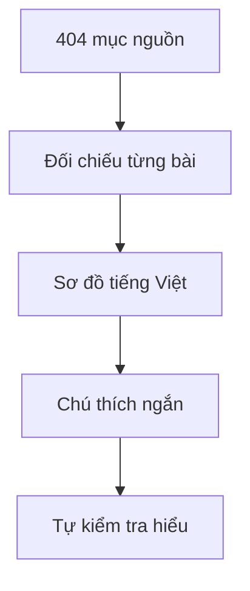
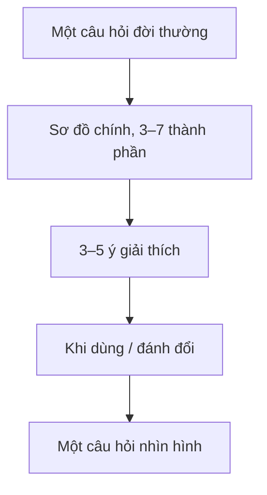

# System Design 101 — học bằng hình, tiếng Việt

**Đề xuất v0; quyết định đã chốt nằm ở [DECISIONS.md](DECISIONS.md) và thắng khi mâu thuẫn.** Giữ 15 nhóm và 404 mục bài học theo mục lục
[ByteByteGo](https://github.com/ByteByteGoHq/system-design-101). Mỗi mục nguồn có một ID
trong [source-map.json](source-map.json); những bài gần nhau vẫn có mục riêng.

| Bắt đầu ở đâu? | Nội dung |
|---|---|
| [Kết luận brainstorm](DECISIONS.md) | Quyết định đã chốt, giấy phép, schema tối thiểu, thứ tự viết |
| [Brief brainstorm](BRIEF.md) | Ràng buộc, đề xuất v0, câu hỏi cho Codex |
| [Mẫu bài trực quan](visual-prototype.md) | Polling / SSE / WebSocket, bốn sơ đồ nhỏ |
| [Bảng đối chiếu](source-map.json) | Đủ 404 mục, thứ tự nguồn, link, phiên bản đã ghim và mục trùng nguồn |

Nội dung học chỉ có tiếng Việt; tên công nghệ như SSE, HTTP, Redis giữ nguyên.
Tiêu đề tiếng Anh trong bảng đối chiếu chỉ là metadata nguồn. Đã đọc thân bài của 8 bài mẫu;
396 bài còn lại mới kiểm kê đường dẫn, chưa được biên soạn hoặc kiểm chứng nội dung.

## Khung một bài

Hình chiếm phần lớn bài; phần chính 150–300 từ là mặc định mềm (phần sâu tùy chọn), 5–8 phút học.
Đây là mục tiêu trình bày để thử nghiệm, chưa đo với người học thật.

## Bản đồ chương

| Nhóm | Số mục |
|---|---:|
| API và phát triển web | 50 |
| Tình huống thực tế | 32 |
| AI và học máy | 8 |
| Cơ sở dữ liệu và lưu trữ | 47 |
| Phỏng vấn kỹ thuật | 5 |
| Bộ nhớ đệm và hiệu năng | 29 |
| Thanh toán và công nghệ tài chính | 20 |
| Kiến trúc phần mềm | 24 |
| Công cụ và năng suất | 20 |
| Phát triển phần mềm | 28 |
| Đám mây và hệ thống phân tán | 49 |
| Hệ thống hoạt động thế nào? | 18 |
| DevOps và CI/CD | 27 |
| Bảo mật | 35 |
| Nền tảng máy tính | 12 |
| **Tổng** | **404** |

## Bước tiếp theo

Theo [DECISIONS.md](DECISIONS.md): viết lần lượt từng bài theo thứ tự nguồn, bắt đầu từ ba bài đầu
của nhóm API; mỗi PR một đợt nhỏ, gọi Codex review tới khi hết finding rồi merge. Tiến độ và bước
kiểm chứng của từng bài ghi ở `lesson.yaml` của bài đó, không ghi ở `source-map.json`.

PR này chưa thay đổi giáo trình Agentic Coding hoặc bộ sinh bài hiện tại.
