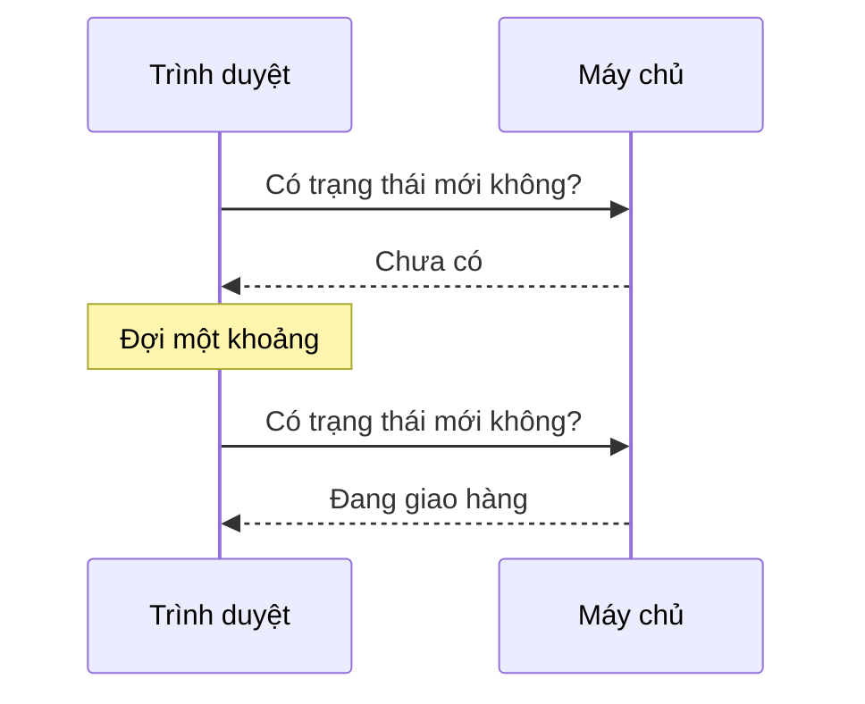
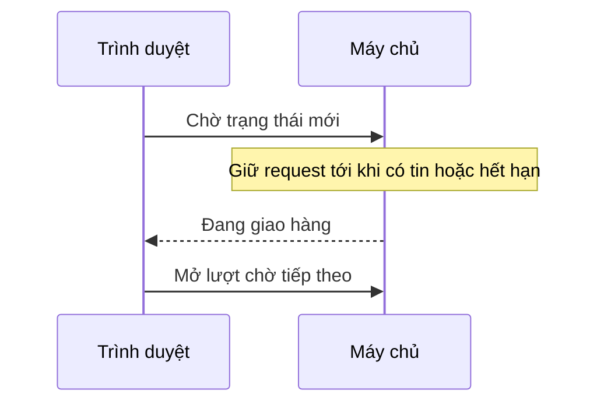
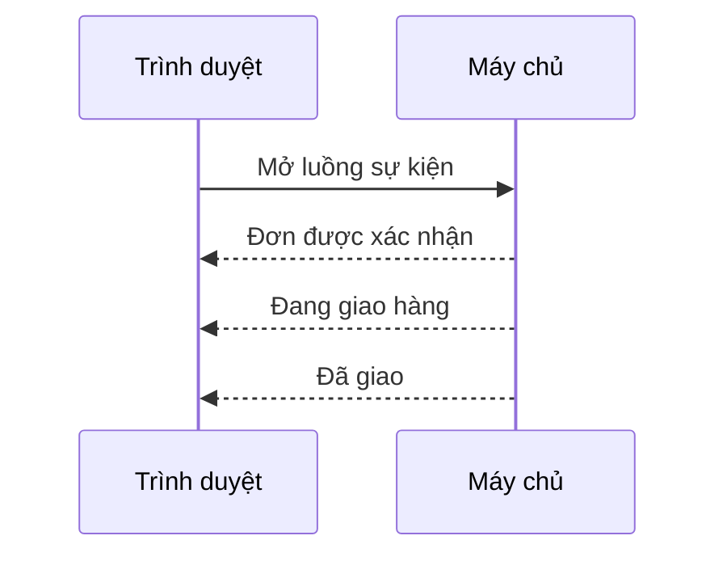
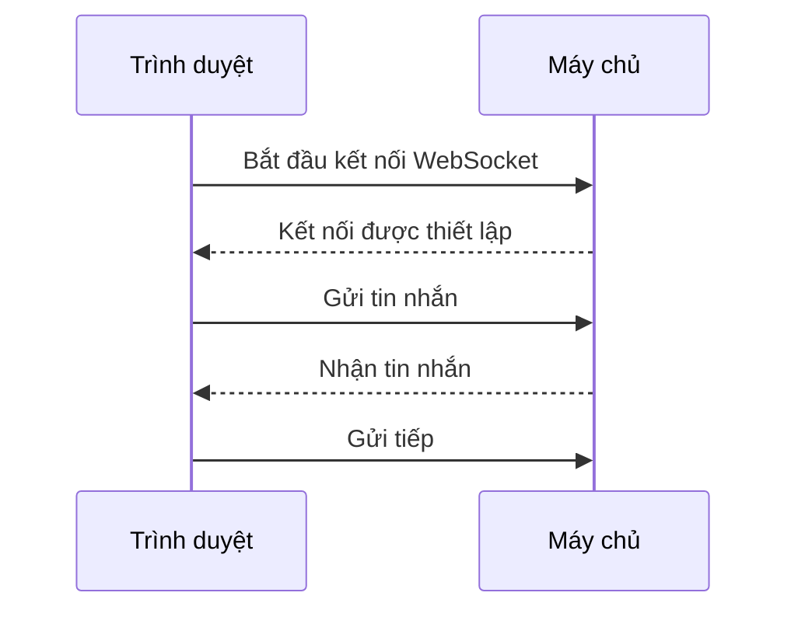

# Polling, SSE hay WebSocket?

> Mẫu trình bày v0, chưa phải bài đã duyệt. ID đối chiếu: `sd-01-001`.

**Bảng theo dõi đơn hàng nhận trạng thái mới bằng cách nào?** Trong các cách dưới đây,
trình duyệt đều bắt đầu kết nối.

## Polling ngắn — hỏi lại định kỳ

Dễ làm; nhiều lượt hỏi có thể không có dữ liệu mới. Chu kỳ hỏi dài làm cập nhật chậm hơn.

## Polling dài — giữ lượt hỏi đến khi có tin

Ít phản hồi rỗng hơn; vẫn cần gửi request mới sau mỗi phản hồi hoặc khi hết hạn.

## SSE — máy chủ gửi sự kiện một chiều

Hợp với thông báo trạng thái. **Luồng SSE chỉ đi từ máy chủ tới trình duyệt**;
trình duyệt vẫn có thể gửi HTTP request riêng, chẳng hạn để hủy đơn.

## WebSocket — trao đổi hai chiều

Hợp với chat hoặc tương tác liên tục. Cần quản lý kết nối và nối lại khi mất mạng.

| Nhu cầu | Cân nhắc |
|---|---|
| Dữ liệu đổi ít, chấp nhận chờ | Polling ngắn |
| Chờ cập nhật qua HTTP request | Polling dài |
| Nhận sự kiện một chiều | SSE |
| Trao đổi liên tục hai chiều | WebSocket |

**Nhìn hình:** Nhận trạng thái đơn hàng liên tục, chỉ gửi yêu cầu hủy thỉnh thoảng — có bắt buộc
dùng WebSocket không?

Xem gợi ý

Không. Có thể nhận trạng thái qua SSE và gửi yêu cầu hủy bằng HTTP riêng. Chọn theo nhu cầu,
hạ tầng và mức phức tạp chấp nhận được.

Nguồn đối chiếu: [bài ByteByteGo](https://github.com/ByteByteGoHq/system-design-101/blob/main/data/guides/shortlong-polling-sse-websocket.md).
Các sơ đồ là bố cục mới cho bản brainstorm. Bản học cuối cần bổ sung kiểm chứng từ tài liệu
giao thức chính thức; chưa kiểm tra hình render trên điện thoại.
