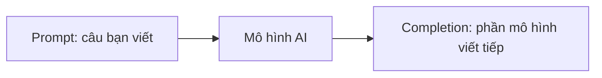
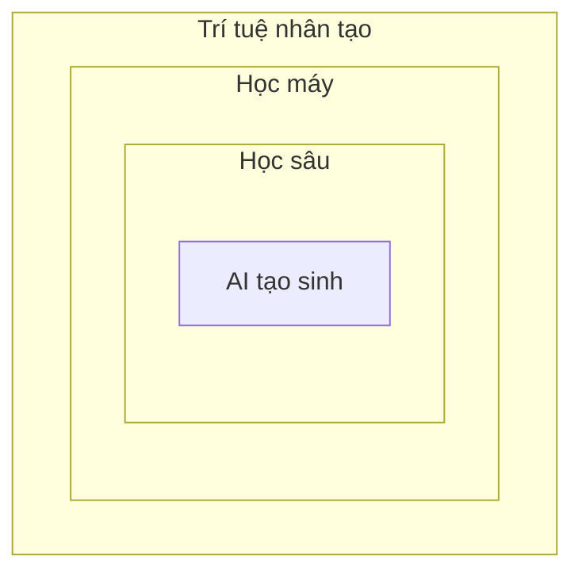
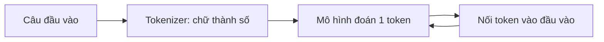

# AI tạo sinh và mô hình ngôn ngữ lớn là gì

> Câu hỏi mở đầu: vì sao chỉ cần gõ một câu tiếng Việt bình thường, máy đã viết được cả một đoạn văn trả lời bạn?

## Từ viết tắt

- **AI** (Artificial Intelligence) — trí tuệ nhân tạo: máy làm được những việc ta vẫn nghĩ cần trí óc con người.
- **LLM** (Large Language Model) — mô hình ngôn ngữ lớn: mô hình AI tạo sinh nhận chữ và trả ra chữ.
- **GPT** (Generative Pre-trained Transformer) — họ mô hình của OpenAI, "tạo sinh, huấn luyện trước, kiến trúc Transformer".
- **RNN** (Recurrent Neural Network) — mạng nơ-ron hồi quy: thế hệ mạng xử lý ngôn ngữ trước Transformer.

## Bài này giúp bạn làm gì

Sau bài này bạn sẽ:

- nói được AI tạo sinh là gì và vì sao ai cũng dùng được;
- kể lại ngắn gọn con đường từ chatbot đời đầu tới LLM;
- hiểu LLM làm việc thế nào: tách chữ thành token, đoán token kế tiếp, chọn có chút ngẫu nhiên;
- biết LLM làm tốt việc gì và vì sao không được tin nó tuyệt đối.

Xuyên suốt khóa học, ta theo chân một startup giáo dục giả định (gọi là *startup của chúng ta*). Sứ mệnh
của nó: giúp việc học dễ tiếp cận hơn trên toàn cầu, công bằng hơn, và hợp với nhu cầu riêng của từng người
học. Nhóm biết mình không làm được điều đó nếu không dùng tới LLM.

## AI tạo sinh: nói bằng lời, nhận lại nội dung

AI tạo sinh là loại AI **tạo ra** được chữ, hình ảnh và các nội dung khác. Điều làm nó đặc biệt: ai cũng
dùng được. Bạn không phải học Java hay SQL; bạn chỉ cần viết điều mình muốn bằng ngôn ngữ thường ngày, gọi là
**prompt**, và mô hình trả lại một gợi ý. Phần mô hình trả lại gọi là **completion** (phần "viết tiếp"),
vì mô hình làm việc bằng cách viết tiếp phần bạn đã đưa vào.

Với giáo dục, điều này có thể đổi cả cách dạy và học: học sinh có "gia sư ảo" 24 giờ mỗi ngày, còn giáo viên
có thêm công cụ mới để đánh giá và góp ý cho học sinh.

## Từ chatbot đời đầu tới AI tạo sinh

AI tạo sinh trông như mới xuất hiện, nhưng nó là kết quả của hàng chục năm nghiên cứu.

- **Thập niên 1960:** những nguyên mẫu đầu tiên là chatbot gõ phím. Chúng dựa vào kho kiến thức do chuyên gia
  soạn sẵn; câu trả lời bật ra khi câu hỏi chứa đúng từ khóa. Cách này sớm lộ ra là không mở rộng được.
- **Thập niên 1990:** cách tiếp cận thống kê ra đời, gọi là **học máy** (machine learning): máy tự học quy luật
  từ dữ liệu thay vì được lập trình từng luật. Mô hình học từ các cặp "câu – nhãn" để đoán ý định của một câu mới.
- **Gần đây:** phần cứng mạnh hơn cho phép **mạng nơ-ron** hay **học sâu** (deep learning). Mạng RNN giúp máy
  hiểu nghĩa của một từ theo ngữ cảnh trong câu; đây là công nghệ đứng sau các trợ lý ảo đầu thế kỷ, biết hiểu
  yêu cầu rồi trả lời theo kịch bản hoặc gọi một dịch vụ khác.
- **Ngày nay:** kiến trúc **Transformer** vượt giới hạn của RNN, nhận được đoạn văn dài hơn nhiều. Nó dựa trên cơ
  chế **attention** (chú ý): cho mỗi phần đầu vào một trọng số khác nhau, "chú ý" hơn vào chỗ chứa thông tin quan
  trọng, dù chỗ đó nằm đâu trong câu.

Có thể hình dung các khái niệm lồng vào nhau: AI chứa học máy, học máy chứa học sâu, và AI tạo sinh là một phần
của học sâu.

Phần lớn mô hình AI tạo sinh gần đây được gọi là **LLM**, vì chúng nhận chữ và trả ra chữ, và hầu hết dựa trên
Transformer. Chúng được huấn luyện trên lượng rất lớn dữ liệu chưa gán nhãn (sách, bài báo, trang web), nên dùng
được cho rất nhiều việc khác nhau và viết ra câu đúng ngữ pháp, có chút "sáng tạo".

## LLM làm việc thế nào

Lấy họ mô hình GPT của OpenAI làm ví dụ. Có ba bước cần nhớ.

1. **Tách chữ thành token.** Mô hình là mô hình thống kê, làm việc với số tốt hơn với chữ. Vì vậy mọi đầu vào đều
   qua một bộ **tokenizer**: nó cắt câu thành các mẩu gọi là **token** (mỗi token dài ngắn khác nhau), rồi gán cho
   mỗi token một con số.
2. **Đoán token kế tiếp.** Nhận vào một dãy token, mô hình đoán ra **một** token. Token đó được nối vào đầu vào
   cho lượt đoán sau, cứ thế câu trả lời dài dần. Vì vậy đôi khi bạn thấy câu trả lời như dừng giữa chừng.
3. **Chọn theo xác suất, có chút ngẫu nhiên.** Mô hình tính xác suất cho mọi token có thể đứng tiếp theo. Nhưng nó
   không phải lúc nào cũng chọn token xác suất cao nhất: một chút ngẫu nhiên được thêm vào để mô phỏng sự sáng tạo.
   Mức ngẫu nhiên này chỉnh được bằng tham số **temperature**. Hệ quả: cùng một prompt, câu trả lời có thể khác nhau.

## Startup của chúng ta dùng LLM vào việc gì

Prompt có thể là:

- **một chỉ dẫn**: tóm tắt một bài báo, cuốn sách hay các bình luận sản phẩm; gợi ý ý tưởng cho một bài luận
  hay một bài tập;
- **một câu hỏi**, hỏi như đang trò chuyện;
- **một đoạn văn để viết tiếp**, tức là nhờ trợ giúp viết;
- **một đoạn code** kèm yêu cầu giải thích, hoặc một dòng chú thích nhờ viết code làm một việc cụ thể.

Những ví dụ trên chưa phải là tất cả, nhưng cho thấy AI tạo sinh dùng được rất nhiều, nhất là trong giáo dục.

## Giới hạn: bản nháp tốt, không phải sự thật

Kết quả của AI tạo sinh không hoàn hảo. Chính sự "sáng tạo" có thể quay lại hại nó: câu trả lời có thể xuyên
tạc sự thật hoặc gây xúc phạm. AI tạo sinh **không thông minh** theo nghĩa đầy đủ (lập luận phản biện, sáng tạo,
cảm xúc), **không cho kết quả cố định**, và **không đáng tin tuyệt đối**: nó có thể trộn thông tin bịa (như trích
dẫn sai) với thông tin đúng, rồi trình bày rất tự tin. Hãy coi kết quả là bản nháp đầu tiên tốt để bạn sửa tiếp.
Các bài sau sẽ bàn cách giảm những giới hạn này.

## Thực hành

Đọc thêm về AI tạo sinh và tìm một lĩnh vực chưa có nó mà bạn muốn đưa nó vào. So với "cách cũ" thì khác gì:
làm được việc trước đây không làm được, hay nhanh hơn? Viết khoảng 300 chữ mô tả startup AI mơ ước của bạn, với
các mục "Vấn đề", "Tôi dùng AI thế nào", "Tác động".

## Nhìn hình trả lời

Câu nào đúng về mô hình ngôn ngữ lớn?

1. Lần nào hỏi cũng nhận đúng một câu trả lời y hệt.
2. Nó làm mọi thứ hoàn hảo: cộng số giỏi, code luôn chạy.
3. Cùng một prompt, câu trả lời có thể khác nhau; nó cho bạn bản nháp đầu tốt, nhưng bạn phải sửa tiếp.

Đáp án

**Câu 3.** LLM không cho kết quả cố định: câu trả lời thay đổi, và bạn chỉnh mức thay đổi bằng temperature. Đừng
chờ nó làm hoàn hảo: nó làm phần nặng nhọc, cho bạn một bản đầu khá tốt để bạn sửa dần.

## Nguồn đối chiếu

- Bài nguồn (đã ghim): [Introduction to Generative AI and Large Language Models](https://github.com/microsoft/generative-ai-for-beginners/blob/c35bc1950f9dc56af773d2c362dafce6f76e9a56/01-introduction-to-genai/README.md)

*Dựa trên bài 01 của microsoft/generative-ai-for-beginners (MIT License, © Microsoft Corporation).*
