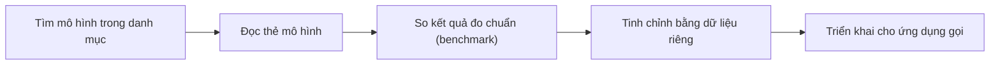

# Khám phá và so sánh các LLM

> Câu hỏi mở đầu: có hàng trăm mô hình AI, làm sao biết mô hình nào hợp với việc của mình?

## Từ viết tắt

- **LLM** (Large Language Model) — mô hình ngôn ngữ lớn: mô hình AI nhận chữ và trả ra chữ.
- **RAG** (Retrieval Augmented Generation) — sinh có truy xuất: tìm dữ liệu liên quan rồi đưa vào prompt trước khi mô hình trả lời.
- **GPT** (Generative Pre-trained Transformer) — họ mô hình của OpenAI.

## Bài này giúp bạn làm gì

Ở bài trước, startup giáo dục của chúng ta đã hiểu LLM làm việc thế nào. Bước tiếp theo là xem có những loại LLM
nào và loại nào hợp với mình. Sau bài này bạn sẽ:

- biết các cách phân loại LLM để chọn đúng mô hình cho việc của mình;
- biết cách thử, lặp lại và cải thiện kết quả của mô hình;
- biết doanh nghiệp đưa mô hình vào dùng thật ra sao.

Chọn mô hình nào tùy vào bạn định dùng nó làm gì (chữ, âm thanh, hình ảnh, video), dữ liệu bạn có, và bạn sẵn
sàng trả bao nhiêu. Đừng chọn chỉ theo ngày ra mắt hay giá: hãy so chất lượng trên đúng việc của bạn, tốc độ, độ dài
văn bản mô hình nhận được, và tổng chi phí.

## Nguồn mở hay độc quyền

Một cách chia LLM là theo việc ai giữ mô hình.

- **Mô hình mở** (mã nguồn mở hoặc "mở trọng số"): phần lõi của mô hình được công bố để xem, tải về hay tùy chỉnh,
  nhưng giấy phép mỗi mô hình một khác, có cái giới hạn cách dùng. Chúng hợp khi doanh nghiệp cần tự kiểm soát nơi
  chạy, dữ liệu nằm ở đâu, chi phí hay muốn tùy chỉnh. Đổi lại, nhóm phải tự lo giấy phép, chi phí chạy, bảo trì,
  cập nhật bảo mật và tự đánh giá chất lượng. Ví dụ: Llama của Meta, một số mô hình Mistral, nhiều mô hình trên Hugging Face.
- **Mô hình độc quyền**: do một nhà cung cấp sở hữu và vận hành. Chúng thường được tối ưu để dùng thật, có hỗ trợ,
  hệ thống an toàn và dễ mở rộng. Đổi lại, bạn không xem hay sửa được phần lõi, và phải đọc kỹ điều khoản về quyền
  riêng tư và lưu dữ liệu. Ví dụ: mô hình của OpenAI, Gemini của Google, Claude của Anthropic.

## Mô hình nền tảng

Khái niệm **mô hình nền tảng** (foundation model) do các nhà nghiên cứu Stanford đặt ra, cho mô hình có ba đặc điểm:

1. học từ dữ liệu **không cần người gán nhãn**;
2. **rất lớn**, là mạng nơ-ron rất sâu với hàng tỷ tham số (các con số mô hình học được);
3. dùng làm **nền** để xây các mô hình khác lên trên, bằng cách tinh chỉnh (fine-tuning).

Ví dụ lịch sử: các phiên bản ChatGPT đầu tiên dùng GPT-3.5 làm mô hình nền tảng. OpenAI tinh chỉnh tiếp bằng dữ
liệu hội thoại để có bản trò chuyện tốt hơn. Ngày nay một dịch vụ AI thường chuyển qua lại giữa vài biến thể mô hình, nên tên dịch vụ và tên mô hình bên
dưới không phải lúc nào cũng là một.

## Chia theo thứ mô hình tạo ra

- **Âm thanh**: nhận dạng giọng nói, ví dụ các mô hình kiểu Whisper.
- **Embedding**: biến chữ thành một dãy số. Dãy số này giúp máy thấy quan hệ giữa các từ, các câu, và làm đầu vào
  cho mô hình khác (như mô hình phân loại hay gom nhóm).
- **Tạo ảnh**: tạo ảnh mới hoặc sửa ảnh có sẵn. Ví dụ: các mô hình GPT Image, Stable Diffusion, Imagen.
- **Tạo chữ và code**: tóm tắt, dịch, trả lời câu hỏi; mô hình code thì viết code mới hay sửa lỗi code cũ.

Nhiều mô hình ngày nay còn **đa phương thức**: nhận cả ảnh, âm thanh hay video chứ không chỉ chữ. Luôn đọc thẻ mô
hình (model card) để biết nó nhận gì và trả ra gì.

## Ba kiểu kiến trúc qua một ví dụ

Sếp giao bạn soạn một bài kiểm tra cho học sinh, và bạn có hai đồng nghiệp:

| Kiểu kiến trúc (encoder: phần đọc hiểu, decoder: phần viết ra) | Giống ai | Ví dụ |
|---|---|---|
| Chỉ decoder | Người viết: nhìn chủ đề và phần đã viết, rồi viết tiếp | GPT, Llama |
| Chỉ encoder | Người duyệt: hiểu quan hệ giữa câu hỏi và đáp án, nhưng không giỏi viết | BERT |
| Encoder-decoder | Một người vừa viết vừa duyệt được | BART, T5 |

## Dịch vụ khác mô hình

**Mô hình** là phần lõi: mạng nơ-ron với các tham số, kiến trúc, bộ tokenizer (bộ cắt chữ thành token). Muốn tự chạy một mô hình (ví dụ một
mô hình mở) bạn cần phần cứng đủ mạnh, hạ tầng để phục vụ, theo dõi, và người biết vận hành.

**Dịch vụ** là sản phẩm một nhà cung cấp đám mây bán, ghép mô hình với dữ liệu và các thành phần khác. Dịch vụ dễ
dùng hơn, thường có giao diện, nhưng thường phải trả phí (thuê bao hoặc theo mức dùng). Ví dụ: Azure OpenAI Service tính tiền theo mức dùng và thêm bảo mật cho
doanh nghiệp.

## Thử và so sánh mô hình

Chọn được vài ứng viên rồi, nhóm phải thử chúng trên dữ liệu và công việc thật của mình: thử, đo, lặp lại. Trên
Microsoft Foundry (nền tảng AI của Azure), danh mục mô hình cho phép:

Không phải mô hình nào cũng tinh chỉnh được hay trả tiền theo mức dùng được: xem thẻ mô hình.

## Bốn cách cải thiện kết quả

Từ dễ và rẻ tới khó và tốn kém:

1. **Prompt có ngữ cảnh.** Viết yêu cầu chi tiết, kèm ví dụ. Không có ví dụ gọi là *zero-shot*, một ví dụ là
   *one-shot*, nhiều ví dụ là *few-shot*. Đây là cách **rẻ nhất để bắt đầu**.
2. **RAG.** LLM chỉ biết dữ liệu lúc được huấn luyện: không biết chuyện xảy ra sau đó, không thấy dữ liệu nội bộ.
   RAG tìm các đoạn tài liệu liên quan (nhờ cơ sở dữ liệu vector, loại cơ sở dữ liệu tìm đoạn văn theo nghĩa) rồi thêm vào prompt. Hợp khi không đủ dữ liệu,
   thời gian hay tiền để tinh chỉnh, mà vẫn muốn giảm câu trả lời bịa hoặc lỗi thời.
3. **Tinh chỉnh (fine-tuning).** Huấn luyện thêm mô hình bằng các cặp "prompt – câu trả lời" của bạn, tạo ra một mô
   hình mới. Hợp khi muốn một mô hình nhỏ làm tốt một việc hẹp cho rẻ và nhanh, khi prompt dài quá làm chậm, hoặc khi
   muốn mô hình luôn theo một khuôn, giọng văn, định dạng. Nếu vấn đề là kiến thức mới hay dữ liệu riêng hay đổi thì
   dùng RAG.
4. **Huấn luyện từ đầu.** Khó và tốn nhất: cần rất nhiều dữ liệu, người giỏi và máy mạnh. Chỉ đáng làm khi doanh
   nghiệp có việc rất chuyên biệt và rất nhiều dữ liệu của lĩnh vực đó.

## Thực hành

Đọc thêm về cách dùng RAG cho doanh nghiệp của bạn.

## Nhìn hình trả lời

Cách nào giúp cải thiện kết quả của LLM?

1. Prompt có ngữ cảnh
2. RAG
3. Tinh chỉnh mô hình

Đáp án

**Cả ba.** Bắt đầu bằng prompt có ngữ cảnh để cải thiện nhanh. Dùng RAG khi mô hình cần thông tin mới hoặc dữ liệu
riêng của doanh nghiệp. Chọn tinh chỉnh khi bạn có đủ ví dụ tốt và cần mô hình luôn theo một việc, một định dạng,
một giọng văn.

## Nguồn đối chiếu

- Bài nguồn (đã ghim): [Exploring and comparing different LLMs](https://github.com/microsoft/generative-ai-for-beginners/blob/c35bc1950f9dc56af773d2c362dafce6f76e9a56/02-exploring-and-comparing-different-llms/README.md)

*Dựa trên bài 02 của microsoft/generative-ai-for-beginners (MIT License, © Microsoft Corporation), commit c35bc19.*
