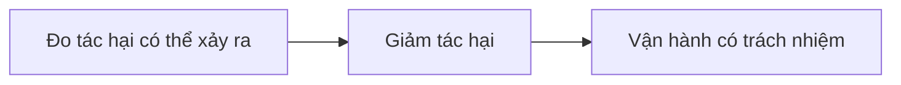

# Dùng AI tạo sinh có trách nhiệm

> Câu hỏi mở đầu: nếu AI trả lời sai mà rất tự tin, ai chịu trách nhiệm, và ta làm gì để chuyện đó ít xảy ra?

## Từ viết tắt

- **AI** (Artificial Intelligence) — trí tuệ nhân tạo.
- **LLM** (Large Language Model) — mô hình ngôn ngữ lớn: mô hình AI nhận chữ và trả ra chữ.
- **RAG** (Retrieval Augmented Generation) — sinh có truy xuất: tìm thông tin từ nguồn tin cậy rồi đưa vào prompt.
- **UX** (User Experience) — trải nghiệm người dùng: cách người dùng gặp và dùng ứng dụng.
- **API** (Application Programming Interface) — giao diện lập trình: cách một chương trình gọi dịch vụ của chương trình khác.

## Bài này giúp bạn làm gì

AI tạo sinh rất cuốn hút, nhưng dùng nó thì phải có trách nhiệm: kết quả phải công bằng, không gây hại. Sau bài
này bạn sẽ biết:

- vì sao phải đặt AI có trách nhiệm lên trước khi xây ứng dụng AI tạo sinh;
- các nguyên tắc cốt lõi của AI có trách nhiệm và lúc nào cần áp dụng;
- những công cụ và cách làm giúp biến các nguyên tắc đó thành việc cụ thể.

## Vì sao phải ưu tiên AI có trách nhiệm

Làm sản phẩm thì đặt người dùng vào trung tâm, luôn nghĩ tới lợi ích của họ, sẽ cho kết quả tốt nhất. Sức mạnh
của AI tạo sinh là tạo ra câu trả lời, thông tin, hướng dẫn và nội dung hữu ích mà không cần nhiều bước thủ công.
Nhưng nếu thiếu kế hoạch, nó cũng có thể gây hại cho người dùng, cho sản phẩm và cho cả xã hội. Ba tác hại có thể
gặp (chưa phải tất cả):

### Ảo giác

**Ảo giác** (hallucination) là khi LLM tạo ra nội dung vô nghĩa, hoặc sai so với các nguồn thông tin khác.

Giả sử startup giáo dục của chúng ta làm tính năng cho học sinh hỏi về lịch sử. Một học sinh hỏi: *"Ai là người
sống sót duy nhất của tàu Titanic?"*. Mô hình trả lời rất tự tin và chi tiết, nhưng sai: chỉ cần tìm hiểu một chút là
biết có nhiều người sống sót. Với một học sinh mới tìm hiểu, câu trả lời đủ thuyết phục để được tin là thật. Hậu quả:
hệ thống AI thành ra không đáng tin, và uy tín của startup bị ảnh hưởng. Các phiên bản LLM mới đã giảm ảo giác dần,
nhưng người làm ứng dụng và người dùng vẫn phải nhớ giới hạn này.

### Nội dung độc hại

Mô hình cũng có thể trả lời bằng nội dung độc hại, ví dụ:

- hướng dẫn hay khuyến khích tự làm hại bản thân, hoặc làm hại một nhóm người;
- nội dung thù ghét, hạ thấp người khác;
- giúp lên kế hoạch tấn công hay bạo lực;
- chỉ cách tìm nội dung phi pháp hay làm việc phi pháp;
- nội dung tình dục lộ liễu.

Startup cần đúng công cụ và cách làm để học sinh không bao giờ thấy loại nội dung này.

### Thiếu công bằng

**Công bằng** là bảo đảm hệ thống AI không thiên lệch, không phân biệt đối xử, đối xử với mọi người như nhau. Với AI
tạo sinh, ta không muốn kết quả của mô hình củng cố cái nhìn loại trừ các nhóm yếu thế. Những kết quả như vậy vừa làm
hỏng trải nghiệm sản phẩm, vừa gây hại thêm cho xã hội. Khi xây giải pháp, luôn nghĩ tới một tập người dùng rộng và đa
dạng.

## Sáu nguyên tắc của AI có trách nhiệm

AI tạo sinh đang thu hút rất nhiều người làm, sự chú ý và tiền đầu tư. Điều đó tốt cho ai muốn xây sản phẩm,
nhưng càng phải đi từng bước có trách nhiệm. Trong suốt khóa học, startup của chúng ta dựa trên sáu nguyên tắc: **Công bằng**, **Bao trùm** (không bỏ ai lại phía
sau), **Tin cậy và an toàn**, **Bảo mật và quyền riêng tư**, **Minh bạch** và **Chịu trách nhiệm**.

## Dùng AI tạo sinh có trách nhiệm: các bước

Bài nguồn nói có bốn bước nhưng mô tả ba bước dưới đây; việc đánh giá mô hình được nói chung trong bước giảm tác hại.

### Đo tác hại có thể xảy ra

Trong kiểm thử phần mềm, ta thử những thao tác người dùng hay làm. Tương tự, hãy thử một bộ prompt đa dạng mà người
dùng nhiều khả năng sẽ gõ. Với sản phẩm giáo dục, có thể chuẩn bị danh sách prompt về các môn học, sự kiện lịch sử và
đời sống học sinh.

### Giảm tác hại theo bốn lớp

1. **Mô hình.** Chọn đúng mô hình cho đúng việc. Mô hình lớn và phức tạp như GPT-4 (một mô hình của OpenAI) có thể dễ sinh nội dung độc hại hơn
   khi dùng cho việc nhỏ và hẹp. Tinh chỉnh bằng dữ liệu của mình cũng giảm rủi ro này.
2. **Hệ thống an toàn.** Bộ công cụ và cấu hình trên nền tảng chạy mô hình, ví dụ bộ lọc nội dung của Azure OpenAI (dịch vụ AI trên đám mây của Microsoft).
   Hệ thống cũng nên phát hiện các kiểu tấn công "bẻ khóa" (jailbreak) và hoạt động không mong muốn như yêu cầu từ bot.
3. **Metaprompt và grounding (neo vào nguồn).** Các chỉ dẫn hệ thống để định hướng và giới hạn mô hình, giữ câu trả lời trong phạm vi của sản phẩm.
   Có thể dùng RAG để mô hình chỉ lấy thông tin từ các nguồn tin cậy.
4. **Trải nghiệm người dùng (UX).** Thiết kế giao diện để giới hạn loại đầu vào người dùng gửi cho mô hình và nội dung
   hiện ra cho họ. Phải nói rõ ứng dụng làm được gì và không làm được gì.

Bên cạnh đó, luôn **đánh giá mô hình**: đo độ chính xác, độ tương đồng, mức bám nguồn và mức liên quan của câu trả
lời. Việc này giúp người dùng và các bên liên quan tin tưởng hơn.

### Vận hành có trách nhiệm

Bước cuối là xây cách vận hành: làm cùng bộ phận pháp lý và bảo mật để tuân thủ quy định; trước khi ra mắt, lên kế
hoạch triển khai, xử lý sự cố và quay lui (rollback) để tác hại, nếu có, không lan rộng.

## Công cụ

Làm AI có trách nhiệm nghe có vẻ nhiều việc, nhưng rất đáng. Công cụ hỗ trợ sẽ ngày càng nhiều. Ví dụ, **Azure AI
Content Safety** phát hiện nội dung và hình ảnh độc hại qua một lệnh gọi API.

## Thực hành

Đọc về Azure AI Content Safety và xem bạn có thể áp dụng gì cho việc của mình.

## Nhìn hình trả lời

Để dùng AI có trách nhiệm, bạn cần quan tâm điều gì?

1. Câu trả lời phải đúng.
2. Tránh dùng AI gây hại, như dùng cho mục đích phạm pháp.
3. Bảo đảm AI không thiên lệch, không phân biệt đối xử.

Đáp án

**Câu 2 và 3.** AI có trách nhiệm giúp bạn tính tới cách giảm tác hại, giảm thiên lệch và hơn thế nữa.

## Nguồn đối chiếu

- Bài nguồn (đã ghim): [Using Generative AI Responsibly](https://github.com/microsoft/generative-ai-for-beginners/blob/c35bc1950f9dc56af773d2c362dafce6f76e9a56/03-using-generative-ai-responsibly/README.md)

*Dựa trên bài 03 của microsoft/generative-ai-for-beginners (MIT License, © Microsoft Corporation), commit c35bc19.*
