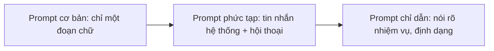

# Nền tảng kỹ thuật viết prompt

> Câu hỏi mở đầu: cùng một mô hình, vì sao người này nhận câu trả lời hay còn người kia nhận câu trả lời dở?

## Từ viết tắt

- **LLM** (Large Language Model) — mô hình ngôn ngữ lớn: mô hình AI nhận chữ và trả ra chữ.
- **GPT** (Generative Pre-trained Transformer) — họ mô hình của OpenAI.
- **RLHF** (Reinforcement Learning with Human Feedback) — học tăng cường từ phản hồi của con người: cách dạy mô hình làm theo chỉ dẫn nhờ người chấm câu trả lời.
- **API** (Application Programming Interface) — giao diện lập trình: cách chương trình của bạn gửi yêu cầu tới mô hình.
- **JSON** (JavaScript Object Notation) — một định dạng dữ liệu dạng chữ, máy dễ đọc.

## Bài này giúp bạn làm gì

Với AI tạo sinh, bạn gửi một đoạn chữ (**prompt**) và nhận lại câu trả lời (**completion**). Bạn có thể trò chuyện
nhiều lượt, sửa prompt cho tới khi câu trả lời đúng ý. Prompt giờ là "giao diện lập trình" chính của ứng dụng AI tạo
sinh: nó bảo mô hình làm gì và quyết định chất lượng câu trả lời. Sau bài này bạn sẽ:

- giải thích được kỹ thuật viết prompt (prompt engineering) là gì và vì sao quan trọng;
- biết một prompt gồm những phần nào;
- biết các cách làm tốt khi viết prompt.

Với startup giáo dục của chúng ta, mỗi người dùng "thiết kế" prompt theo cách riêng: quản lý nhờ AI phân tích
chương trình học để tìm chỗ còn thiếu; giáo viên nhờ AI soạn giáo án cho một nhóm học sinh và một chủ đề; học sinh
nhờ AI kèm một môn khó.

## Kỹ thuật viết prompt là gì

**Kỹ thuật viết prompt** là việc thiết kế và tối ưu prompt để nhận được câu trả lời ổn định, chất lượng, cho một mục
tiêu và một mô hình cụ thể. Có thể xem nó gồm hai bước: **thiết kế** prompt ban đầu, rồi **tinh chỉnh** nhiều lần
để câu trả lời tốt dần. Đây là việc thử và sai, cần trực giác và công sức. Hiện nay nó giống một nghệ thuật hơn là
một khoa học: cách tốt nhất để giỏi lên là luyện tập nhiều.

## Ba khái niệm nền

- **Token hóa: mô hình "thấy" prompt thế nào.** LLM nhìn prompt như một dãy **token** (mẩu chữ nhỏ mô hình xử lý, như một từ hay một phần của từ), và mỗi mô hình có thể cắt cùng
  một prompt theo cách khác nhau. Vì LLM được huấn luyện trên token, cách cắt ảnh hưởng thẳng tới chất lượng câu trả
  lời. Bạn có thể thử công cụ OpenAI Tokenizer để xem một prompt bị cắt thành token ra sao.
- **LLM nền: mô hình "xử lý" prompt thế nào.** Mô hình nền (foundation model) đoán token kế tiếp dựa trên quan hệ
  thống kê giữa các token. Nó **không hiểu nghĩa** của chữ; nó chỉ thấy một khuôn mẫu để "viết tiếp".
- **LLM tinh chỉnh theo chỉ dẫn: mô hình thấy "nhiệm vụ" thế nào.** Bắt đầu từ mô hình nền, người ta tinh chỉnh
  bằng các cặp ví dụ có chỉ dẫn rõ ràng và câu trả lời làm theo chỉ dẫn đó, dùng các kỹ thuật như RLHF. Nhờ vậy mô
  hình biết làm theo chỉ dẫn. Ví dụ: thêm chỉ dẫn hệ thống "Tóm tắt nội dung cho học sinh lớp hai, một đoạn với 3–5
  gạch đầu dòng", câu trả lời sẽ đúng mục tiêu và định dạng đó, giáo viên có thể dùng ngay.

## Vì sao cần kỹ thuật viết prompt

LLM hiện nay có ba thách thức:

| Thách thức | Prompt giúp gì |
|---|---|
| **Câu trả lời ngẫu nhiên**: cùng prompt, mô hình khác (hay cùng mô hình, lúc khác) trả lời khác | Đặt "rào chắn" để giảm khác biệt |
| **Mô hình bịa** (fabrication): dữ liệu huấn luyện có hạn, nên có thể trả lời sai, tưởng tượng | Nhờ AI nêu nguồn hay lý lẽ để phát hiện chỗ bịa |
| **Khả năng mỗi mô hình một khác**: mô hình mới mạnh hơn nhưng có điểm lạ, chi phí khác | Xây cách làm chung, thích nghi với từng mô hình |

Khóa học dùng từ "bịa" (fabrication) thay cho "ảo giác" để không gán đặc điểm con người cho máy. Ví dụ: prompt
*"Soạn giáo án về Cuộc chiến sao Hỏa năm 2076"* (một sự kiện không có thật, vì 2076 còn ở tương lai). Ba mô hình khác
nhau đều trả lời khác nhau một chút, nhưng cả ba đều viết ra giáo án đủ thuyết phục để người không biết tin là thật.
Metaprompt (chỉ dẫn đặt sẵn cho mô hình) và chỉnh temperature (mức ngẫu nhiên của câu trả lời) có thể giảm phần nào
chuyện bịa; bài sau nói kỹ hơn.

Trường hợp thực tế: GitHub Copilot, "lập trình viên AI ngồi cạnh bạn", biến prompt chữ thành code. Bản đầu dựa trên
mô hình Codex của OpenAI; các kỹ sư nhanh chóng thấy cần tinh chỉnh mô hình và viết prompt tốt hơn để code tốt hơn.

## Một prompt gồm những gì

- **Prompt cơ bản**: chỉ một đoạn chữ, không ngữ cảnh. Gửi vài chữ đầu một bài hát, mô hình viết tiếp ngay.
- **Prompt phức tạp**: một chuỗi tin nhắn gồm **tin nhắn hệ thống** (đặt bối cảnh, tính cách cho trợ lý) và các cặp
  tin nhắn người dùng / trợ lý. Đổi tin nhắn hệ thống có thể ảnh hưởng tới chất lượng ngang với đổi câu hỏi.
- **Prompt chỉ dẫn**: nói rõ nhiệm vụ. "Viết về cuộc Nội chiến" cho một đoạn văn; thêm "trong 1 đoạn, 3 gạch đầu dòng về các mốc thời gian
  và ý nghĩa, 3 gạch về các nhân vật, trả về dạng JSON" thì nhận được đúng khuôn đó.

**Nội dung chính.** Chia prompt thành chỉ dẫn (làm gì) và nội dung liên quan (làm trên cái gì), ví dụ một đoạn văn
về Sao Mộc kèm "Tóm tắt trong 2 câu ngắn". Nội dung chính dùng được theo ba cách:

- **Ví dụ**: cho mô hình xem mẫu rồi để nó tự suy ra. Không ví dụ là *zero-shot*, một ví dụ là *one-shot*, vài ví dụ
  là *few-shot*. Với few-shot, mô hình đoán chính xác hơn mà không cần thêm chỉ dẫn.
- **Gợi ý (cue)**: viết sẵn phần mở đầu câu trả lời, như "Ba điều ta học được:", để mô hình viết tiếp đúng kiểu.
- **Mẫu (template)**: "công thức" prompt có chỗ trống để điền dữ liệu, dùng lại được nhiều lần. Thư viện Prompts For
  Edu gom các mẫu prompt cho giáo dục.

**Nội dung phụ** là ngữ cảnh thêm để điều chỉnh kết quả, như chọn 5 thẻ chủ đề cần ưu tiên khi tóm tắt danh mục khóa
học.

## Cách làm tốt

Ba điều cần nhớ: **hiểu lĩnh vực** (dùng kiến thức chuyên môn để chỉnh prompt), **hiểu mô hình** (điểm mạnh, giới
hạn của nó), **lặp lại và kiểm tra** (ghi lại điều học được thành thư viện prompt). Một số cách làm tốt:

| Làm gì | Vì sao |
|---|---|
| Tách chỉ dẫn và ngữ cảnh | Dấu phân cách giúp mô hình phân biệt rõ hơn |
| Cụ thể, rõ ràng | Nói rõ bối cảnh, kết quả, độ dài, định dạng, giọng văn |
| Mô tả, kèm ví dụ | Thử zero-shot trước, rồi few-shot |
| Dùng gợi ý mở đầu | Đẩy câu trả lời đi đúng hướng |
| Nhắc lại | Đặt chỉ dẫn cả trước và sau nội dung chính |
| Thứ tự quan trọng | Thứ tự đưa thông tin có thể đổi kết quả |
| Cho mô hình "lối thoát" | Một câu trả lời dự phòng khi không làm được, giảm chuyện bịa |
| Đánh giá mô hình mới | Có thể tốt hơn nhưng đắt hơn |

## Thực hành

Bài nguồn có một sổ tay Jupyter để thử các kỹ thuật (cần khóa API Azure OpenAI và môi trường Python). Không có đáp
án đúng sai: cứ thử và xây trực giác. Thử thách: dùng kỹ thuật gợi ý với prompt *"Hoàn thành câu: Cho tôi xem ảnh
một chiếc xe màu đỏ hiệu Volvo và "*. Mô hình trả lời gì, và bạn sẽ sửa prompt thế nào?

## Nhìn hình trả lời

Prompt nào tốt nhất?

1. Cho tôi xem ảnh một chiếc xe màu đỏ.
2. Cho tôi xem ảnh một chiếc xe màu đỏ hiệu Volvo, mẫu XC90, đỗ cạnh vách đá lúc hoàng hôn.
3. Cho tôi xem ảnh một chiếc xe màu đỏ hiệu Volvo, mẫu XC90.

Đáp án

**Câu 2.** Nó nói rõ "cái gì", đi vào chi tiết (không phải xe bất kỳ mà một hiệu, một mẫu cụ thể) và tả cả khung
cảnh. Câu 3 đứng thứ hai vì cũng khá chi tiết.

## Nguồn đối chiếu

- Bài nguồn (đã ghim): [Understanding Prompt Engineering Fundamentals](https://github.com/microsoft/generative-ai-for-beginners/blob/c35bc1950f9dc56af773d2c362dafce6f76e9a56/04-prompt-engineering-fundamentals/README.md)

*Dựa trên bài 04 của microsoft/generative-ai-for-beginners (MIT License, © Microsoft Corporation), commit c35bc19.*
