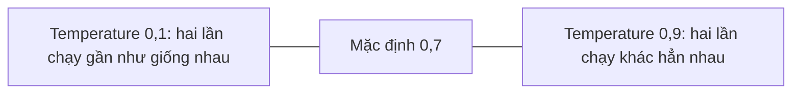

# Viết prompt nâng cao

> Câu hỏi mở đầu: cùng một câu hỏi, vì sao thêm một ví dụ hay vài bước giải mẫu lại làm mô hình trả lời đúng hơn hẳn?

## Từ viết tắt

- **LLM** (Large Language Model) — mô hình ngôn ngữ lớn: mô hình AI nhận chữ và trả ra chữ.
- **API** (Application Programming Interface) — giao diện lập trình: cách một chương trình gọi dịch vụ của chương trình khác.
- **Web API** — một API mà chương trình khác gọi qua mạng, theo từng đường dẫn (route) như `/products`.

## Bài này giúp bạn làm gì

Nhắc lại bài trước: kỹ thuật viết prompt là cách **dẫn mô hình tới câu trả lời phù hợp hơn** bằng chỉ dẫn hay ngữ
cảnh hữu ích hơn. Viết prompt có hai bước: dựng prompt (đưa ngữ cảnh phù hợp) và tối ưu (sửa prompt tốt dần). Bài
này đi sâu hơn: từ thử nhiều prompt khác nhau tới hiểu **vì sao** prompt này tốt hơn prompt kia. Sau bài này bạn sẽ:

- áp dụng được các kỹ thuật viết prompt giúp câu trả lời tốt hơn;
- biết cách làm cho câu trả lời đa dạng hơn hoặc ổn định hơn.

## Một prompt đơn giản đã chứa kỹ thuật

Lấy prompt *"Tạo 10 câu hỏi về địa lý"*. Trong đó bạn đã dùng hai kỹ thuật:

- **Ngữ cảnh**: câu hỏi phải về "địa lý";
- **Giới hạn đầu ra**: không quá 10 câu.

Nhưng kết quả chưa chắc như ý, vì:

- **Chủ đề quá rộng**: không biết là về nước, thủ đô hay sông ngòi;
- **Định dạng**: nếu bạn muốn câu hỏi trình bày theo một kiểu riêng thì sao?

Lưu ý: khả năng làm theo prompt là một đặc tính **tự nảy sinh** (emergent) của LLM. Nó không phải tính năng được
lập trình sẵn vào mô hình; người ta phát hiện ra nó khi dùng mô hình.

## Bảy kỹ thuật viết prompt

| Kỹ thuật | Ý chính |
|---|---|
| Zero-shot | Một prompt duy nhất; mô hình trả lời chỉ dựa vào dữ liệu huấn luyện |
| Few-shot | Kèm một hay vài ví dụ để mô hình dựa vào |
| Chuỗi suy luận (chain-of-thought) | Chỉ cho mô hình cách chia bài toán thành từng bước |
| Kiến thức tạo sẵn (generated knowledge) | Thêm dữ kiện, kiến thức vào prompt |
| Từ nhỏ tới lớn (least-to-most) | Chia bài toán lớn thành các bài nhỏ, làm lần lượt |
| Tự sửa (self-refine) | Phê bình câu trả lời rồi nhờ mô hình làm lại tốt hơn |
| Hỏi gợi mở (maieutic) | Bắt mô hình giải thích từng phần để kiểm tra câu trả lời đúng |

### Zero-shot và few-shot

**Zero-shot** là cách đơn giản nhất, có lẽ bạn vẫn dùng khi mới làm quen với LLM. Ví dụ hỏi *"Đại số là gì?"*, mô hình
trả lời: *"Đại số là một nhánh toán học nghiên cứu các ký hiệu toán học và quy tắc biến đổi chúng."*

**Few-shot** kèm vài ví dụ trong cùng prompt. Ví dụ: *"Viết một bài thơ theo phong cách Shakespeare"*, dán kèm vài
đoạn trích sonnet của Shakespeare, rồi mới yêu cầu *"Giờ hãy viết một bài sonnet về vẻ đẹp của mặt trăng"*. Ví dụ
cho mô hình biết ngữ cảnh, định dạng hay văn phong mong muốn, nên câu trả lời đúng ý và sát việc hơn.

### Chuỗi suy luận

Hỏi: *"Alice có 5 quả táo, ném đi 3 quả, cho Bob 2 quả, Bob trả lại 1 quả. Alice còn mấy quả?"*. Mô hình đáp **5**:
sai. Đáp án đúng là **1** (5 − 3 − 2 + 1 = 1).

Để dạy mô hình làm đúng, ta:

1. đưa một ví dụ tương tự;
2. viết ra cách tính đúng của ví dụ đó;
3. rồi mới đưa câu hỏi gốc.

```text
Lisa có 7 quả táo, ném đi 1 quả, cho Bart 4 quả, Bart trả lại 1 quả:
7 - 1 = 6
6 - 4 = 2
2 + 1 = 3
Alice có 5 quả táo, ném đi 3 quả, cho Bob 2 quả, Bob trả lại 1 quả. Alice còn mấy quả?
```

Lần này mô hình đáp **1**. Prompt dài hơn nhiều, nhưng ra đáp án đúng.

### Kiến thức tạo sẵn

Thường bạn muốn prompt dùng dữ liệu của chính công ty mình: một phần prompt lấy từ công ty, phần còn lại là câu hỏi.
Cách làm là dùng một **mẫu** có biến, như `{{budget}}` (ngân sách), mà chương trình thay bằng dữ liệu thật lấy qua API
của công ty.

Ví dụ một công ty bảo hiểm đưa danh sách gói bảo hiểm (giá mỗi tháng) rồi hỏi: *"Ngân sách 1000 USD, cần bảo hiểm xe,
nhà và nhân thọ, hãy gợi ý"*. Mô hình gợi ý ba gói rẻ nhất, tổng **1200 USD**, vượt ngân sách. Sau vài lần thử và
sửa, prompt được viết lại: ghi rõ **type** (loại) và **cost** (giá) cho từng gói, và thêm từ **restrict** (giới hạn) vào
yêu cầu: *"chỉ chọn trong loại: Xe, Nhà"*. Lần này mô hình gợi ý đúng gói xe giá rẻ, 500 USD.

Bài học: dù dùng kỹ thuật đơn giản, phần lớn trường hợp bạn vẫn phải **tối ưu prompt** mới ra kết quả mong muốn.

### Từ nhỏ tới lớn

Chia bài toán lớn thành các bài nhỏ để dẫn mô hình "chinh phục" từng phần. Ví dụ hỏi *"Làm khoa học dữ liệu trong 5
bước thế nào?"*, trợ lý AI trả lời: thu thập dữ liệu, làm sạch dữ liệu, phân tích dữ liệu, vẽ biểu đồ, trình bày.

### Tự sửa: phê bình kết quả

Đừng tin ngay kết quả của LLM: nó chỉ đưa ra điều *có khả năng cao nhất* để nói tiếp, chứ không phải điều *đúng*. Vì vậy
nên nhờ chính mô hình tự phê bình. Các bước:

1. Prompt đầu tiên nhờ mô hình giải một bài toán.
2. Mô hình trả lời.
3. Bạn phê bình câu trả lời và nhờ mô hình cải thiện.
4. Mô hình trả lời lại, có tính tới lời phê bình.

Lặp lại bao nhiêu lần tùy ý. Ví dụ: nhờ viết một Web API bằng Python có hai đường dẫn *products* và *customers*; mô
hình viết xong thì hỏi tiếp *"Gợi ý 3 cải tiến cho đoạn code trên"*. Mô hình chỉ ra lỗi import, đề nghị thêm phần
chạy chương trình chính, rồi viết lại đoạn code tốt hơn.

### Hỏi gợi mở

Giống tự sửa, nhưng tập trung vào việc bắt mô hình **tự giải thích** để giảm chỗ mâu thuẫn. Các bước:

1. Hỏi mô hình một câu.
2. Với từng phần của câu trả lời, nhờ nó giải thích sâu hơn.
3. Bỏ những phần mâu thuẫn.

Lặp lại bước 2 và 3 cho tới khi xét hết các phần. Ví dụ: hỏi cách lập kế hoạch ứng phó đại dịch trong 5 bước, mô hình
nêu 5 bước, bước đầu là "xác định rủi ro". Hỏi tiếp rủi ro gồm gì, rồi hỏi *"rủi ro lớn nhất là gì?"* và *"hai rủi ro
lớn nhất là gì?"*. Mô hình trả lời nhất quán: thiệt hại về người và về kinh doanh. Khi đó ta có thể yên tâm hơn,
nhưng vẫn phải tự kiểm tra kết quả.

## Câu trả lời thay đổi: temperature

LLM vốn **không cố định**: chạy cùng một prompt, mỗi lần ra kết quả khác. Ví dụ chạy hai lần prompt *"Viết code cho
một Web API bằng Python"*: lần hai ra một chương trình khác hẳn lần một.

Như vậy có phải là vấn đề không? Tùy việc. Cần một câu trả lời cụ thể thì có. Còn với *"Tạo 3 câu hỏi bất kỳ về địa
lý"*, kết quả khác nhau cũng không sao.

Muốn câu trả lời ổn định hơn, chỉnh **temperature**: một giá trị từ 0 tới 1, 0 là ổn định nhất, 1 là đa dạng nhất.
Bài nguồn ghi mặc định là 0,7.



Còn các tham số khác như top-k, top-p, phạt lặp lại, nhưng nằm ngoài phạm vi khóa học.

## Cách làm tốt

- **Nói rõ ngữ cảnh**: lĩnh vực, chủ đề… càng cụ thể càng tốt.
- **Giới hạn đầu ra**: muốn bao nhiêu mục, dài bao nhiêu thì nói rõ.
- **Nói cả "cái gì" lẫn "thế nào"**: ví dụ *"Viết Web API bằng Python có hai đường dẫn products và customers, chia làm
  3 file"*.
- **Dùng mẫu**: mẫu có biến để thay bằng dữ liệu thật của công ty.
- **Viết đúng chính tả**: mô hình vẫn có thể trả lời đúng, nhưng viết đúng thì câu trả lời tốt hơn.

## Thực hành

Bài nguồn cho một đoạn code Python nhỏ dùng Flask (thư viện làm web của Python) để dựng một API đơn giản. Dùng trợ lý
AI như GitHub Copilot hay ChatGPT, áp dụng kỹ thuật **tự sửa** để cải thiện đoạn code. Mẹo: giới hạn số cải tiến bạn
nhờ, và có thể nói rõ muốn cải thiện mặt nào (kiến trúc, hiệu năng, bảo mật…).

## Nhìn hình trả lời

Vì sao dùng chuỗi suy luận (chain-of-thought)?

1. Để dạy mô hình cách giải một bài toán.
2. Để dạy mô hình tìm lỗi trong code.
3. Để bảo mô hình nghĩ ra nhiều cách giải khác nhau.

<details>
<summary>Đáp án</summary>

**Câu 1.** Chuỗi suy luận chỉ cho mô hình cách giải bài toán qua một chuỗi bước, kèm bài tương tự và cách giải của nó.

</details>

## Nguồn đối chiếu

- Bài nguồn (đã ghim): [Creating Advanced Prompts](https://github.com/microsoft/generative-ai-for-beginners/blob/c35bc1950f9dc56af773d2c362dafce6f76e9a56/05-advanced-prompts/README.md)

*Dựa trên bài 05 của microsoft/generative-ai-for-beginners (MIT License, © Microsoft Corporation), commit c35bc19.*
