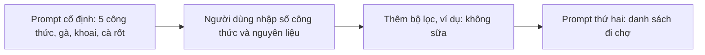

# Xây ứng dụng sinh văn bản

> Câu hỏi mở đầu: cần bao nhiêu dòng code để chương trình của bạn tự "viết tiếp" một câu chuyện?

## Từ viết tắt

- **LLM** (Large Language Model) — mô hình ngôn ngữ lớn: mô hình AI nhận chữ và trả ra chữ.
- **API** (Application Programming Interface) — giao diện lập trình: cách chương trình của bạn gửi yêu cầu tới một dịch vụ, ở đây là mô hình.
- **SDK** (Software Development Kit) — bộ công cụ phát triển: thư viện giúp gọi một dịch vụ dễ hơn.
- **UI** (User Interface) — giao diện người dùng: phần bạn nhìn và bấm. **GUI** là giao diện đồ họa (nút bấm, ô nhập, menu).

## Bài này giúp bạn làm gì

Các bài trước nói về prompt và kỹ thuật viết prompt. Nhiều công cụ như ChatGPT, Office 365 hay Microsoft Power Platform
đã cho bạn dùng prompt để làm việc. Muốn đưa trải nghiệm đó vào ứng dụng của mình, bạn cần hiểu prompt, completion
(phần mô hình viết ra) và chọn một thư viện để làm việc. Sau bài này bạn sẽ:

- giải thích được ứng dụng sinh văn bản là gì;
- xây được một ứng dụng sinh văn bản bằng thư viện `openai` của Python;
- chỉnh ứng dụng dùng nhiều hay ít **token** (mẩu chữ nhỏ mô hình đọc và viết; dịch vụ tính tiền theo token), và đổi temperature để câu trả lời đa dạng hơn.

## Ứng dụng sinh văn bản là gì

Ứng dụng thường có một trong hai kiểu giao diện:

- **Dòng lệnh**: gõ lệnh để ứng dụng làm việc, ví dụ `git`.
- **Giao diện đồ họa (GUI)**: bấm nút, nhập chữ, chọn mục.

Hai kiểu này **bị giới hạn**: bạn chỉ gõ được những lệnh ứng dụng hỗ trợ, và ứng dụng thường được làm cho một ngôn ngữ
nhất định. Ứng dụng sinh văn bản linh hoạt hơn: bạn dùng **ngôn ngữ tự nhiên** để nói chuyện với nó. Thêm nữa, bạn đang
làm việc với một mô hình đã học từ lượng thông tin rất lớn, còn ứng dụng truyền thống chỉ biết những gì có trong cơ sở
dữ liệu của nó.

Bạn có thể làm, ví dụ:

- **chatbot** trả lời câu hỏi về công ty và sản phẩm của bạn;
- **trợ lý**: tóm tắt văn bản, rút ra ý chính, viết hồ sơ xin việc…;
- **trợ lý viết code**, như GitHub Copilot hay ChatGPT.

## Bắt đầu thế nào

Có hai cách nối ứng dụng với một LLM:

- **Gọi API**: tự dựng yêu cầu web chứa prompt, nhận lại văn bản mô hình viết.
- **Dùng thư viện**: thư viện gói các lệnh gọi API cho dễ dùng.

Vài thư viện quen thuộc: **openai** (nối tới mô hình và gửi prompt dễ dàng); ở mức cao hơn có **LangChain** (hỗ trợ
Python) và **Semantic Kernel** của Microsoft (hỗ trợ C#, Python, Java). Bài này dùng thư viện `openai` của Python.

## Chuẩn bị

1. Cài thư viện bằng `pip` (trình cài thư viện của Python): `pip install openai`.
2. Có tài khoản dịch vụ chạy mô hình. Bài nguồn dùng Azure OpenAI (dịch vụ AI trên đám mây của Microsoft, nay thuộc
   Microsoft Foundry): tạo tài khoản Azure, xin quyền dùng Azure OpenAI, cài Python và tạo một tài nguyên Azure OpenAI.
   Cũng có thể dùng thẳng OpenAI.
3. Lấy **khóa API** (chuỗi bí mật chứng minh bạn được phép gọi dịch vụ) và **endpoint** (địa chỉ của dịch vụ). Với Azure,
   chúng nằm ở mục "Keys and Endpoint" của tài nguyên.

Nên tách khóa API khỏi code bằng **biến môi trường** (giá trị hệ điều hành giữ hộ chương trình), ví dụ đặt biến
`OPENAI_API_KEY`, hoặc ghi vào tệp `.env` rồi nạp bằng thư viện `python-dotenv`.

## Thử ngay: sáu dòng code

```python
from openai import OpenAI
client = OpenAI(api_key="sk-...")
prompt = "Hoàn thành câu: Ngày xửa ngày xưa có một"
response = client.responses.create(
    model="gpt-5-mini", input=prompt, store=False)
print(response.output_text)
```

- `OpenAI(...)` tạo **client**, đối tượng nói chuyện với dịch vụ. Với Azure, thêm `base_url` là endpoint của bạn
  nối thêm `/openai/v1/`.
- `responses.create` gửi prompt (`input`) tới mô hình (`model`; với Azure đây là tên bản triển khai của bạn). `store=False`
  bảo dịch vụ không lưu lại câu trả lời. Khóa đặt thẳng trong code chỉ để thử; bản thật đọc khóa từ biến môi
  trường.
- `response.output_text` là văn bản mô hình viết ra, ví dụ: *"…một nàng tiên cá rất buồn."*

Cũng cách gọi này dùng được cho chatbot nhiều lượt: bạn đưa một danh sách tin nhắn vào `input`. Bài sau nói kỹ hơn.

## Prompt cho nhiều việc khác nhau

Có code chạy rồi, bạn chỉ cần đổi prompt để làm việc khác:

- **sinh một loại văn bản**: bài thơ, câu hỏi trắc nghiệm…;
- **tra thông tin**: *"CORS nghĩa là gì trong lập trình web?"* (CORS là quy tắc của trình duyệt cho phép một trang web gọi sang tên miền
  khác);
- **sinh code**: một biểu thức chính quy kiểm tra email, hay cả một ứng dụng web.

## Ví dụ thực tế: ứng dụng gợi ý món ăn

Trong nhà có sẵn gà, khoai tây, cà rốt. Prompt: *"Cho tôi 5 công thức món ăn với các nguyên liệu: gà, khoai tây và cà
rốt. Với mỗi công thức, liệt kê mọi nguyên liệu."* Mô hình trả về 5 công thức. Hai cải tiến hữu ích: **lọc** nguyên liệu
mình không thích hay bị dị ứng, và **lập danh sách đi chợ** cho thứ chưa có.

Chuyển thành code theo từng bước:



1. **Prompt cố định**: đặt prompt trên vào biến `prompt` trong `app.py`. Lưu ý LLM không cố định: mỗi lần chạy có thể ra
   kết quả khác.
2. **Cho người dùng nhập**: đọc số công thức và nguyên liệu bằng `input()`, rồi ghép vào prompt bằng f-string (chuỗi có
   chỗ trống `{...}` để điền giá trị).
3. **Bộ lọc**: hỏi thêm bộ lọc và nối vào cuối prompt, ví dụ "không sữa". Nhưng nếu bạn không dung nạp lactose, có lẽ
   cũng cần lọc cả phô mai: bộ lọc phải viết thật rõ.
4. **Danh sách đi chợ**: có thể gom hết vào một prompt, hoặc tách làm hai. Bài nguồn chọn tách: lấy kết quả của prompt
   đầu làm **ngữ cảnh** cho prompt thứ hai *"Lập danh sách đi chợ cho các công thức trên, bỏ những thứ tôi đã có"*, và
   cho phép câu trả lời dài hơn bằng `max_output_tokens=1200`.

## Hoàn thiện ứng dụng

- **Tách bí mật khỏi code**: khóa API không được nằm trong code; để trong biến môi trường hoặc tệp `.env`.
- **Độ dài token**: token tốn tiền, nên dùng tiết kiệm. Giới hạn bằng `max_output_tokens`, ví dụ 100. Thử viết prompt
  sao cho cần ít token hơn.
- **Temperature**: càng cao câu trả lời càng ngẫu nhiên, càng thấp càng dễ đoán. Đặt bằng tham số `temperature`, ví dụ
  0,5; càng gần 1,0 càng đa dạng.
- **Mô hình suy luận không dùng temperature.** Theo bài nguồn, các mô hình hiện hành trên Microsoft Foundry (nền tảng AI
  của Microsoft) là mô hình suy luận (họ GPT-5, dòng o) và **không hỗ trợ** `temperature`; gửi `temperature` cho `gpt-5-mini` sẽ bị báo lỗi
  tham số không được hỗ trợ. Muốn thử temperature, dùng mô hình còn hỗ trợ, như Llama. Với mô hình suy luận, bạn điều
  khiển câu trả lời bằng kỹ thuật viết prompt và các tham số về mức suy luận.

## Thực hành

Chọn một trong ba:

- cải tiến ứng dụng gợi ý món ăn: thử các giá trị temperature và các prompt khác nhau;
- làm "bạn học": trả lời câu hỏi về một chủ đề, như Python, hoặc đưa code mẫu cho một chủ đề;
- làm "bot lịch sử": bảo bot đóng vai một nhân vật lịch sử rồi hỏi về cuộc đời và thời đại của họ.

Thử thách: đặt temperature lần lượt 0; 0,5 và 1 (0 ít đa dạng nhất, 1 nhiều nhất). Giá trị nào hợp với ứng dụng của
bạn?

## Nhìn hình trả lời

Temperature dùng để làm gì?

1. Điều khiển mức ngẫu nhiên của câu trả lời.
2. Điều khiển câu trả lời dài hay ngắn.
3. Điều khiển số token được dùng.

<details>
<summary>Đáp án</summary>

**Câu 1.** Temperature càng cao câu trả lời càng ngẫu nhiên. Độ dài và số token được giới hạn bằng `max_output_tokens`.

</details>

## Nguồn đối chiếu

- Bài nguồn (đã ghim): [Building Text Generation Applications](https://github.com/microsoft/generative-ai-for-beginners/blob/c35bc1950f9dc56af773d2c362dafce6f76e9a56/06-text-generation-apps/README.md)

*Dựa trên bài 06 của microsoft/generative-ai-for-beginners (MIT License, © Microsoft Corporation), commit c35bc19.*
