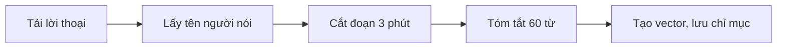
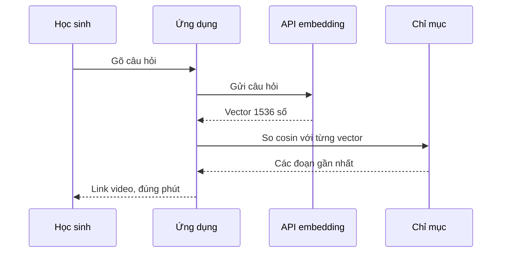

# Xây ứng dụng tìm kiếm bằng embedding

## Từ viết tắt

- **LLM** (Large Language Model) — mô hình ngôn ngữ lớn: mô hình AI học từ rất nhiều chữ để hiểu và viết văn bản.
- **AI** (Artificial Intelligence) — trí tuệ nhân tạo: máy làm được việc cần trí thông minh.
- **API** (Application Programming Interface) — giao diện lập trình: "cửa" để chương trình của bạn gọi một dịch vụ khác.
- **JSON** (JavaScript Object Notation) — một định dạng file chữ để lưu dữ liệu có cấu trúc.
- **ML** (Machine Learning) — học máy: cách cho máy tự học quy luật từ dữ liệu; Azure ML là dịch vụ học máy của Microsoft.

## Không chỉ để chat

LLM không chỉ dùng để trò chuyện hay viết văn bản. Ta còn dùng được nó để **tìm kiếm**, nhờ một thứ gọi là
**embedding**: một cách biến dữ liệu (ví dụ một đoạn chữ) thành một dãy số, còn gọi là **vector**.

Bài này đặt bạn vào một tình huống cụ thể. Một startup giáo dục phi lợi nhuận, dạy miễn phí cho học sinh ở các
nước đang phát triển, có rất nhiều video YouTube về AI. Họ muốn một ứng dụng để học sinh **gõ một câu hỏi** và
nhận lại các video liên quan. Ví dụ học sinh gõ "Jupyter Notebook là gì?" hay "Azure ML là gì?". Hay hơn nữa:
ứng dụng trả về **link nhảy thẳng tới đúng phút** trong video có câu trả lời.

Học xong bài, bạn sẽ:

1. phân biệt được tìm theo nghĩa và tìm theo từ khóa;
2. giải thích được embedding văn bản là gì;
3. làm được một ứng dụng dùng embedding để tìm dữ liệu.

## Tìm theo nghĩa và tìm theo từ khóa

**Tìm theo nghĩa** (semantic search) dùng **ý nghĩa** của các từ trong câu hỏi để trả về kết quả phù hợp.

Ví dụ bạn muốn mua xe và gõ "chiếc xe trong mơ của tôi" ("my dream car"). Tìm theo nghĩa hiểu rằng bạn không
**mơ** về xe, mà đang tìm chiếc xe **lý tưởng** để mua. Nó đoán được ý định của bạn.

Ngược lại, **tìm theo từ khóa** (keyword search) bám đúng từng chữ: nó đi tìm những giấc mơ về xe, và thường trả
về kết quả không liên quan.

## Embedding văn bản là gì

**Embedding văn bản** là cách biểu diễn một đoạn chữ bằng **các con số mang nghĩa**, để máy dễ "hiểu". Có nhiều
mô hình tạo embedding; bài này dùng mô hình embedding của OpenAI.

Ví dụ trong lời thoại một tập của kênh AI Show có câu:

```text
Today we are going to learn about Azure Machine Learning.
```

Gửi câu này cho API embedding của OpenAI, ta nhận lại một vector gồm **1536 con số**. Mỗi con số thể hiện một
khía cạnh khác nhau của câu. Vài số đầu trông như sau:

```python
[-0.006655829958617687, 0.0026128944009542465, 0.008792596869170666, -0.02446001023054123, ...]
```

Bạn không cần đọc hiểu từng số. Điều quan trọng là các con số này mang nghĩa của câu: đoạn chữ nghĩa gần nhau thì vector
cũng gần nhau, nhờ đó ta tìm được đoạn giống câu hỏi nhất.

## Chỉ mục embedding được tạo thế nào

Bài học có sẵn một **chỉ mục embedding** (embedding index) làm từ lời thoại các video của kênh YouTube AI Show
của Microsoft, tính đến tháng 10/2023. Bạn không phải tự tạo nó, nhưng nên biết nó được làm ra qua năm bước:

1. Tải lời thoại (transcript) của từng video trong danh sách phát AI Show.
2. Dùng tính năng gọi hàm của OpenAI để thử lấy **tên người nói** từ 3 phút đầu lời thoại.
3. Cắt lời thoại thành các **đoạn 3 phút**. Mỗi đoạn lấy thêm khoảng 20 từ của đoạn sau, để embedding của mỗi
   đoạn không bị cắt cụt và tìm kiếm có thêm ngữ cảnh.
4. Gửi từng đoạn cho API chat của OpenAI để **tóm tắt còn 60 từ**.
5. Gửi đoạn chữ cho API embedding để lấy **vector 1536 số**, rồi lưu đoạn chữ cùng vector vào chỉ mục.

Kết quả nằm trong file `embedding_index_3m.json`.



### Cơ sở dữ liệu vector

Cho bài học đơn giản, chỉ mục chỉ là một file JSON, được nạp vào một bảng dữ liệu Pandas (thư viện Python để xử lý bảng). Khi làm sản phẩm thật,
chỉ mục sẽ được lưu trong một **cơ sở dữ liệu vector** (vector database) như Azure Cognitive Search, Redis,
Pinecone hay Weaviate.

## Độ tương đồng cosin: tìm vector gần nhất

Có chỉ mục rồi, làm sao tìm đoạn video hợp với câu hỏi? Ta dùng **độ tương đồng cosin** (cosine similarity): một
cách đo hai vector giống nhau đến đâu. Cách tìm này còn được gọi là **tìm láng giềng gần nhất** (nearest neighbor
search). Các bước:

1. Biến câu hỏi thành vector bằng chính API embedding của OpenAI.
2. Tính độ tương đồng cosin giữa vector câu hỏi và **từng vector** trong chỉ mục (mỗi đoạn lời thoại có một vector).
3. Sắp xếp kết quả: các đoạn có độ tương đồng cao nhất là các đoạn gần câu hỏi nhất.

Về toán, độ tương đồng cosin đo **cosin của góc** giữa hai vector trong không gian nhiều chiều. Điểm lợi: hai tài
liệu có thể cách xa nhau theo khoảng cách thông thường (khoảng cách Euclid) chỉ vì độ dài khác nhau, nhưng góc giữa
chúng vẫn nhỏ, nên độ tương đồng cosin vẫn cao.



Ví dụ câu hỏi "can you use rstudio with azure ml?" trả về link YouTube có kèm mốc thời gian, dẫn thẳng tới chỗ
trong video có câu trả lời.

## Thử ngay

Bài nguồn có bài tập: tự tạo dịch vụ Azure OpenAI cho ứng dụng tìm kiếm. Bạn cần một tài khoản Azure. Lời giải
chạy được trên Windows 11, macOS và Ubuntu 22.04 với Python 3.10 trở lên.

1. Đăng nhập Azure portal, bấm biểu tượng **Cloud Shell** (cửa sổ dòng lệnh ngay trên trình duyệt) ở góc trên bên phải,
   chọn **Bash**.
2. Tạo một nhóm tài nguyên (resource group):

   ```shell
   az group create --name semantic-video-search --location eastus
   ```

3. Tạo một tài nguyên Azure OpenAI Service bằng `az cognitiveservices account create` (kiểu `OpenAI`).
4. Lấy **endpoint** (địa chỉ để gọi dịch vụ) và **khóa** của tài nguyên đó, dùng cho ứng dụng.
5. Triển khai mô hình embedding `text-embedding-ada-002`.
6. Mở notebook lời giải trong GitHub Codespaces, chạy theo hướng dẫn, rồi gõ câu hỏi vào ô nhập.

Đổi vùng (location) khác `eastus` thì xem trước bảng mô hình có sẵn ở từng vùng.

## Nhìn hình trả lời

Bạn gõ "chiếc xe trong mơ của tôi" vì muốn mua xe. Kiểu tìm kiếm nào hiểu đúng ý bạn, và nó so câu hỏi với dữ
liệu bằng cách nào?

<details>
<summary>Đáp án</summary>

Tìm theo nghĩa. Nó biến câu hỏi thành vector embedding, rồi dùng độ tương đồng cosin để tìm các vector gần nhất
trong chỉ mục. Tìm theo từ khóa sẽ đi tìm "giấc mơ về xe".

</details>

## Nguồn đối chiếu

- [Building a Search Applications](https://github.com/microsoft/generative-ai-for-beginners/blob/c35bc1950f9dc56af773d2c362dafce6f76e9a56/08-building-search-applications/README.md)

*Dựa trên bài 08 của microsoft/generative-ai-for-beginners (MIT License, © Microsoft Corporation).*
