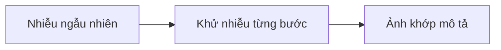

# Xây ứng dụng tạo ảnh

## Từ viết tắt

- **LLM** (Large Language Model) — mô hình ngôn ngữ lớn: mô hình AI học từ rất nhiều chữ để hiểu và viết văn bản.
- **API** (Application Programming Interface) — giao diện lập trình: "cửa" để chương trình của bạn gọi một dịch vụ khác.
- **URL** (Uniform Resource Locator) — địa chỉ web, ví dụ một đường link để tải file.
- **PNG** (Portable Network Graphics) — một định dạng file ảnh phổ biến.

## Không chỉ sinh chữ

LLM không chỉ viết chữ. Ta còn tạo được **ảnh từ một đoạn mô tả bằng chữ**. Ảnh có ích trong rất nhiều ngành: y tế,
kiến trúc, du lịch, làm game, marketing...

Bài này dùng họ mô hình **`gpt-image`** của OpenAI, thế hệ mô hình tạo ảnh hiện nay, có trên **Microsoft Foundry**
(dịch vụ AI trên đám mây của Microsoft) và nền tảng OpenAI. Chúng thay cho các mô hình DALL·E cũ.

Tình huống xuyên suốt: **Edu4All**, một startup (hư cấu) làm công cụ học tập, muốn tạo hình minh họa cho bài tập và
tài liệu học.

Học xong bài, bạn sẽ:

1. giải thích được tạo ảnh là gì và dùng vào đâu;
2. hiểu họ mô hình `gpt-image` khác các mô hình DALL·E cũ thế nào;
3. viết được một ứng dụng tạo ảnh bằng Python;
4. sửa ảnh và đặt "hàng rào" an toàn bằng metaprompt.

## Tạo ảnh là gì

Mô hình tạo ảnh nhận một **câu mô tả** (prompt) và vẽ ra một bức ảnh. Các mô hình hiện đại như `gpt-image` kết hợp
kiến trúc transformer (một kiểu cấu tạo mô hình) và kỹ thuật **khuếch tán** (diffusion):

1. Khi huấn luyện, mô hình học mối liên hệ giữa chữ và ảnh.
2. Khi bạn đưa prompt, nó bắt đầu từ **nhiễu ngẫu nhiên** (một mảng chấm lộn xộn).
3. Nó **khử nhiễu từng bước**, mỗi bước rõ hơn một chút.
4. Cuối cùng ra một bức ảnh khớp với mô tả.



Hai họ mô hình tạo ảnh nổi tiếng:

- **`gpt-image`** (OpenAI): thế hệ hiện nay, dùng trong bài. Tạo ảnh từ chữ và sửa ảnh (vẽ lại một vùng theo mặt nạ).
- **Midjourney**: mô hình của bên thứ ba, có dịch vụ riêng, làm việc qua ứng dụng chat Discord.

## Chọn mô hình `gpt-image` nào

Trên Microsoft Foundry, bài nguồn liệt kê:

| Mô hình | Ghi chú |
| --- | --- |
| `gpt-image-2` | Mới và mạnh nhất, nên dùng mặc định |
| `gpt-image-1.5` | Chất lượng tốt, chi phí thấp hơn |
| `gpt-image-1-mini` | Nhanh nhất, rẻ nhất |
| `gpt-image-1` | Chỉ bản xem trước (preview) |

**DALL·E 2** và **DALL·E 3** là mô hình cũ: DALL·E 3 không còn cho triển khai mới. Ứng dụng mới nên dùng `gpt-image`.
Danh sách mô hình và vùng có sẵn thay đổi, nên luôn xem trang danh sách mô hình của Foundry.

Một điểm rất quan trọng: `gpt-image` trả ảnh về dưới dạng **chuỗi base64** (`b64_json`), **không phải URL**.
Base64 là cách viết dữ liệu ảnh thành một chuỗi chữ dài. Code của bạn phải giải mã chuỗi đó thành byte (dữ liệu thô
của file ảnh) rồi tự lưu thành file; không có link nào để tải.

## Chuẩn bị

Ví dụ trong bài nguồn chạy được với Azure OpenAI trên Microsoft Foundry hoặc với nền tảng OpenAI. Dưới đây là cách
dùng Azure:

1. Tạo một tài nguyên Microsoft Foundry và triển khai một mô hình ảnh (nên chọn `gpt-image-2`).
2. Ghi endpoint, khóa và tên bản triển khai vào file `.env` (lấy ở trang **Deployments** trong Foundry portal):

   ```text
   AZURE_OPENAI_ENDPOINT=<your endpoint>
   AZURE_OPENAI_API_KEY=<your key>
   AZURE_OPENAI_DEPLOYMENT="gpt-image-2"
   ```

3. Cài ba thư viện `python-dotenv`, `openai`, `pillow` trong một môi trường ảo (virtual environment).

## Thử ngay: viết `app.py`

Phần cốt lõi của ứng dụng chỉ vài dòng: gọi `images.generate`, giải mã base64, lưu file PNG.

```python
result = client.images.generate(
    model=deployment, prompt="Bunny on a horse, holding a lollipop",
    size="1024x1024", n=1)
image_bytes = base64.b64decode(result.data[0].b64_json)
with open("images/generated-image.png", "wb") as f:
    f.write(image_bytes)
```

Trước đó, `client` là một `AzureOpenAI` tạo từ khóa và endpoint trong `.env`; mô hình ảnh cần một phiên bản API
(`api_version`) đủ mới, xem tài liệu Foundry. Kích thước có thể là `1024x1024`,
`1536x1024` (ngang), `1024x1536` (dọc) hoặc `"auto"`. Chạy `python app.py`, bạn có một file PNG trong thư mục
`images/`.

Cùng một prompt, mỗi lần gọi cho ra một ảnh khác. Mô hình ảnh **không có tham số `temperature`** (đó là nút chỉnh
của mô hình sinh chữ). Muốn nhiều kiểu hơn: gọi lại. Muốn ảnh ít thay đổi hơn: viết prompt cụ thể hơn.

## Sửa ảnh bằng mặt nạ

`gpt-image` còn **sửa** được một ảnh có sẵn. Bạn đưa vào ba thứ:

- **ảnh gốc**, ví dụ một phòng khách đầy nắng;
- **mặt nạ** (mask, không bắt buộc): đánh dấu vùng cần thay đổi;
- **prompt** mô tả thay đổi, ví dụ "thêm một hồ bơi có con hồng hạc".

Gọi `client.images.edit(...)`; kết quả cũng trả về dạng base64.

## Đặt giới hạn bằng metaprompt

Tạo được ảnh rồi thì cần **hàng rào** để ứng dụng không sinh ảnh nguy hiểm hay lạc phong cách. **Metaprompt** là đoạn
chữ bạn đặt **trước** prompt của người dùng để giới hạn đầu ra. Ví dụ cho ứng dụng vẽ cho trẻ em:

- vai trò: trợ lý thiết kế, tạo ảnh cho trẻ em;
- yêu cầu: an toàn, hợp với trẻ em, có màu, khổ ngang tỉ lệ 16:9;
- danh sách cấm: kiếm, bạo lực, máu, khỏa thân, nội dung người lớn...

Sau đó prompt gửi đi là `metaprompt + yêu cầu của người dùng`, ví dụ yêu cầu "vẽ chú thỏ cưỡi ngựa, cầm kẹo
mút". Mọi ảnh đều được tạo trong giới hạn đó. Kết hợp thêm bộ lọc nội dung có sẵn của Microsoft Foundry để có
nhiều lớp bảo vệ.

## Bài tập

Học sinh Edu4All cần ảnh cho bài kiểm tra. Hãy làm ứng dụng tạo ảnh các **công trình nổi tiếng** (bạn tự chọn) đặt
trong bối cảnh sáng tạo, ví dụ một công trình lúc hoàng hôn có một em bé đứng ngắm. Làm xong thì so với lời giải mẫu
(Python, TypeScript, .NET) trong bài nguồn.

## Nhìn hình trả lời

Bạn gọi `images.generate` với `gpt-image-2`, rồi tìm link ảnh trong kết quả để tải về nhưng không thấy. Vì sao, và phải
làm gì?

<details>
<summary>Đáp án</summary>

`gpt-image` không trả URL mà trả chuỗi base64 (`b64_json`). Bạn giải mã nó thành byte (`base64.b64decode`) rồi tự ghi
ra file PNG.

</details>

## Nguồn đối chiếu

- [Building Image Generation Applications](https://github.com/microsoft/generative-ai-for-beginners/blob/c35bc1950f9dc56af773d2c362dafce6f76e9a56/09-building-image-applications/README.md)

*Dựa trên bài 09 của microsoft/generative-ai-for-beginners (MIT License, © Microsoft Corporation).*
