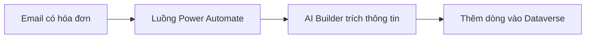

# Xây ứng dụng AI low-code

## Từ viết tắt

- **AI** (Artificial Intelligence) — trí tuệ nhân tạo: máy làm được việc cần trí thông minh.
- **GPT** (Generative Pre-trained Transformer) — họ mô hình ngôn ngữ của OpenAI, được huấn luyện trước trên rất nhiều dữ
  liệu để sinh chữ giống người viết.
- **API** (Application Programming Interface) — giao diện lập trình: "cửa" để chương trình gọi một dịch vụ khác.

## Low-code là gì

**Low-code** (ít code) là cách làm ứng dụng mà hầu như không phải viết code: bạn **kéo thả** các thành phần trong một môi
trường trực quan. Nhờ vậy cả lập trình viên lẫn người không biết lập trình đều làm được ứng dụng, nhanh hơn và tốn ít
nguồn lực hơn.

Bài này dùng **Power Platform** của Microsoft: một môi trường low-code/no-code giúp các nhóm tự làm giải pháp cho mình,
trong vài ngày hoặc vài tuần thay vì vài tháng hay vài năm. Power Platform gồm **5 sản phẩm chính**: Power Apps, Power
Automate, Power BI, Power Pages và Copilot Studio.

Học xong bài, bạn sẽ:

1. hiểu Copilot làm việc thế nào trong Power Platform;
2. làm một ứng dụng theo dõi bài tập của học sinh cho startup giáo dục;
3. làm một luồng tự động xử lý hóa đơn, dùng AI để trích thông tin từ hóa đơn;
4. biết mô hình Create Text with GPT dùng để làm gì;
5. hiểu Microsoft Copilot Studio là gì và dùng nó để làm agent.

## AI tạo sinh trong Power Platform

Mục tiêu của Power Platform là để **ai cũng làm được** ứng dụng, trang web, bảng điều khiển và quy trình tự động có AI,
**không cần chuyên môn khoa học dữ liệu**. AI được gắn vào theo hai dạng: **Copilot** và **AI Builder**.

### Copilot: mô tả bằng lời, nhận về ứng dụng

**Copilot** là trợ lý AI. Bạn **mô tả yêu cầu bằng ngôn ngữ thường**, qua vài lượt trò chuyện, và nó dựng giải pháp cho
bạn. Copilot có mặt trong cả 5 sản phẩm của Power Platform.

- Trong **Power Apps** (làm ứng dụng xem và quản lý dữ liệu, chạy trên trình duyệt, máy tính bảng, điện thoại): bạn tả
  ứng dụng cần theo dõi thông tin gì, Copilot tạo một **ứng dụng Canvas** và gợi ý luôn một **bảng Dataverse** với các
  cột cần thiết.
- Trong **Power Automate** (làm **luồng** tự động giữa các ứng dụng và dịch vụ, ví dụ gửi thư, thu thập dữ liệu, duyệt
  yêu cầu): bạn tả luồng cần làm gì, Copilot tạo luồng và gợi ý các bước (hành động) cần có.

Sau đó bạn vẫn chỉnh tiếp được theo ý mình.

### Dataverse: nơi lưu dữ liệu

**Dataverse** là nền tảng dữ liệu low-code bên dưới Power Platform. Dữ liệu nằm trong các **bảng**, giống nhiều trang tính
trong một file Excel, được lưu an toàn trên đám mây của Microsoft. Lợi ích cho startup:

- **dễ quản lý**: dữ liệu và mô tả dữ liệu đều ở trên đám mây, bạn chỉ lo làm ứng dụng;
- **bảo mật**: phân quyền ai được xem, sửa dữ liệu theo vai trò;
- **mô tả dữ liệu phong phú**: kiểu dữ liệu và quan hệ dùng thẳng trong Power Apps;
- **logic và kiểm tra**: quy tắc nghiệp vụ, trường tính toán, quy tắc kiểm tra giữ dữ liệu đúng.

## Thử ngay: ứng dụng theo dõi bài tập

Giáo viên của startup đang theo dõi bài tập bằng bảng tính và ngày càng khó quản lý. Họ cần một ứng dụng để thêm, xem,
sửa, xóa bài tập. Làm bằng Copilot trong Power Apps:

1. Mở trang chủ **Power Apps**.
2. Gõ mô tả vào ô chữ, ví dụ *"I want to build an app to track and manage student assignments"*, rồi bấm **Send**.
3. Copilot gợi ý một bảng Dataverse với các cột cần thiết và dữ liệu mẫu. Bạn chỉnh bảng bằng cách trò chuyện tiếp.
4. Thêm cột email học sinh: *"I want to add a column to store student email"*.
5. Bấm **Create app**: Copilot tạo ứng dụng Canvas. Muốn thêm màn hình gửi email thì nhờ Copilot thêm.
6. Bấm **Save** để lưu, rồi **Share** để chia sẻ cho giáo viên.

Bài tập về nhà: dùng Copilot trong Power Automate để tự gửi email cho học sinh khi các em nộp bài.

Làm tương tự, bạn có thể nhờ Copilot tạo một **bảng thông tin hóa đơn** trong Dataverse cho bộ phận tài chính.

## AI Builder: mô hình AI dựng sẵn

**AI Builder** là năng lực AI low-code trong Power Platform: dùng mô hình AI để **tự động hóa quy trình** và **dự đoán kết
quả**, nối với dữ liệu trong Dataverse hoặc các nguồn đám mây như SharePoint, OneDrive, Azure. Có hai loại mô hình:

- **Dựng sẵn** (prebuilt): Microsoft đã huấn luyện, dùng ngay, không phải tự thu thập dữ liệu hay huấn luyện. Ví dụ: trích
  cụm từ khóa, nhận diện ngôn ngữ, phân tích cảm xúc, đọc danh thiếp, nhận diện chữ trong ảnh, phát hiện vật thể, xử lý
  biểu mẫu, **xử lý hóa đơn**.
- **Tùy chỉnh** (custom): đưa mô hình của bạn vào AI Builder và huấn luyện bằng dữ liệu của bạn (có một số giới hạn).

### Luồng xử lý hóa đơn

Bộ phận tài chính cần trích thông tin từ hóa đơn và lưu vào bảng Dataverse. Trong Power Automate:

1. Mô tả cho Copilot: *"Process an invoice when it arrives in my mailbox"*. Copilot gợi ý các bước, bạn thiết lập kết nối
   rồi bấm **Create flow**.
2. Cho luồng chỉ chạy khi có **email kèm file** trong thư mục, ví dụ **Inbox**.
3. Bước **Extract Information from invoices** (mô hình xử lý hóa đơn) đọc file đính kèm.
4. Bước **Add a new row** ghi vào bảng hóa đơn: mã, số tiền, ngày, tên, email nhà cung cấp và trạng thái **Pending**.

### Sinh chữ với GPT

Mô hình **Create Text with GPT** trong AI Builder sinh chữ từ một prompt, chạy trên dịch vụ Azure OpenAI. Đưa nó vào luồng
tự động, bạn có thể tự soạn nháp email, mô tả sản phẩm, hay giúp nhân viên chăm sóc khách hàng trả lời nhanh hơn.

## Copilot Studio: làm agent không cần code

**Microsoft Copilot Studio** (trước gọi là Power Virtual Agents) là thành viên low-code để làm **agent AI**: trợ lý trò
chuyện biết trả lời câu hỏi, làm việc và tự động hóa thay người dùng. Bạn mô tả agent cần làm gì, Copilot Studio giúp dựng
phần hướng dẫn, kiến thức và hành động. Ví dụ startup có thể làm agent trả lời câu hỏi về khóa học, kiểm tra hạn nộp bài,
gửi email cho giáo viên.

Một số khả năng:

- **trả lời từ kiến thức của bạn**: nối website, SharePoint, OneDrive, Dataverse, file tải lên;
- **tự điều phối**: AI hiểu yêu cầu rồi tự chọn kiến thức và hành động cần kết hợp;
- **hành động**: dùng hơn 1.500 bộ kết nối có sẵn, luồng Power Automate, API tùy chỉnh;
- **agent tự chạy**: kích hoạt bởi sự kiện như email mới, rồi làm việc ở chế độ nền;
- **nhiều agent phối hợp**: agent gọi được agent khác;
- **xuất bản nhiều nơi**: Microsoft Teams, Microsoft 365 Copilot, website.

## Nhìn hình trả lời

Bộ phận tài chính muốn mỗi hóa đơn gửi tới hộp thư được tự động đọc và ghi vào bảng. Bạn dùng sản phẩm nào, và phần nào
"đọc" hóa đơn?

Đáp án

Dùng một luồng **Power Automate** (có thể nhờ Copilot tạo). Phần đọc hóa đơn là mô hình **xử lý hóa đơn dựng sẵn của AI
Builder**; kết quả được ghi thành một dòng mới trong bảng **Dataverse**.

## Nguồn đối chiếu

- [Building Low Code AI Applications](https://github.com/microsoft/generative-ai-for-beginners/blob/c35bc1950f9dc56af773d2c362dafce6f76e9a56/10-building-low-code-ai-applications/README.md)

*Dựa trên bài 10 của microsoft/generative-ai-for-beginners (MIT License, © Microsoft Corporation).*
