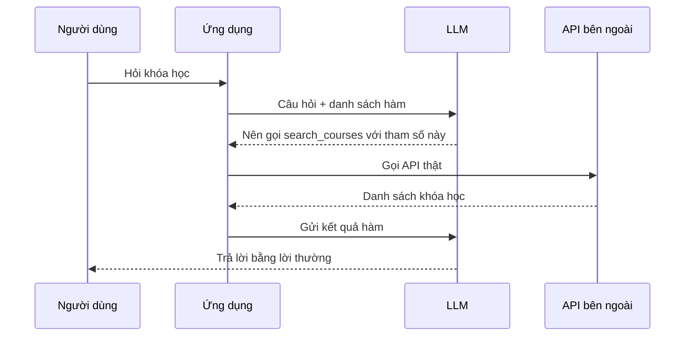

# Gọi hàm để nối ứng dụng bên ngoài

## Từ viết tắt

- **LLM** (Large Language Model) — mô hình ngôn ngữ lớn: mô hình AI học từ rất nhiều chữ để hiểu và viết văn bản.
- **API** (Application Programming Interface) — giao diện lập trình: "cửa" để chương trình gọi một dịch vụ khác.
- **JSON** (JavaScript Object Notation) — định dạng chữ để lưu dữ liệu có cấu trúc, dạng `"tên": "giá trị"`.
- **GPA** (Grade Point Average) — điểm trung bình học tập.
- **CSV** (Comma-Separated Values) — file bảng dữ liệu dạng chữ, các giá trị cách nhau bằng dấu phẩy.

## Hai vấn đề cần giải quyết

Ở các bài trước, ta đã làm được ứng dụng chat. Nhưng còn hai chỗ chưa ổn:

1. **Câu trả lời không nhất quán về định dạng.** Câu trả lời của LLM là chữ tự do, nên mỗi lần một kiểu. Lập trình viên
   phải viết nhiều code kiểm tra để xử lý đủ mọi kiểu.
2. **Không có dữ liệu bên ngoài.** Mô hình chỉ biết những gì có trong dữ liệu lúc được huấn luyện, nên không trả lời được
   câu như "Thời tiết ở Stockholm bây giờ thế nào?".

**Gọi hàm** (function calling) là tính năng của dịch vụ Azure OpenAI để giải quyết hai vấn đề đó.

Tình huống của bài: startup giáo dục muốn một chatbot giúp người học **tìm khóa học kỹ thuật** hợp với trình độ, vai trò
và công nghệ họ quan tâm. Ta kết hợp Azure OpenAI (trò chuyện), **Microsoft Learn Catalog API** (tìm khóa học) và gọi hàm
(chuyển câu hỏi thành lời gọi API).

Học xong bài, bạn sẽ:

1. giải thích được vì sao cần gọi hàm;
2. thiết lập gọi hàm với dịch vụ Azure OpenAI;
3. thiết kế lời gọi hàm hợp với ứng dụng của mình.

## Ví dụ: định dạng lệch nhau

Ta có hai đoạn mô tả sinh viên rất giống nhau (tên, ngành, trường, điểm, câu lạc bộ). Ta gửi cho LLM hai prompt giống hệt
nhau, nhờ nó trích thông tin `name`, `major`, `school`, `grades`, `club` và trả về dạng JSON.

Kết quả:

- sinh viên 1 (Emily Johnson, Duke University): `"grades": "3.7"`
- sinh viên 2 (Michael Lee, Stanford University): `"grades": "3.8 GPA"`

Prompt như nhau, mô tả giống nhau, vậy mà trường `grades` lúc có chữ "GPA", lúc không. Lý do: LLM nhận vào chữ tự do và
cũng trả ra chữ tự do. Muốn lưu hay dùng dữ liệu này, ta cần một **định dạng có cấu trúc** để biết trước sẽ nhận được gì.

## Gọi hàm hoạt động thế nào

Điều quan trọng nhất: **LLM không tự chạy hàm nào cả.** Ta đưa cho nó một **cấu trúc** (mô tả hàm và các tham số) để nó
trả lời theo. Dựa vào câu trả lời có cấu trúc đó, **ứng dụng của ta** biết phải chạy hàm nào. Kết quả của hàm lại được gửi
về cho LLM, và LLM viết câu trả lời bằng lời thường cho người dùng.



## Gọi hàm dùng vào đâu

- **Gọi công cụ bên ngoài.** Sinh viên nhắn "Gửi email cho thầy nói em cần hỗ trợ thêm môn này", chatbot gọi hàm
  `send_email(to, body)`.
- **Tạo truy vấn API hay cơ sở dữ liệu.** Giáo viên hỏi "Những em nào đã nộp bài tập gần nhất?", câu hỏi được chuyển thành
  lời gọi `get_completed(student_name, assignment, current_status)`.
- **Tạo dữ liệu có cấu trúc.** Từ một đoạn văn hay file CSV, trích ra thông tin quan trọng, ví dụ biến bài Wikipedia về
  các hiệp định hòa bình thành thẻ ghi nhớ bằng hàm `get_important_facts(agreement_name, date_signed, parties_involved)`.

## Tạo lời gọi hàm đầu tiên

Có **3 bước chính**:

1. **Gọi** Responses API (API của Azure OpenAI để gửi tin nhắn cho mô hình và nhận câu trả lời), gửi kèm danh sách hàm (tools) và tin nhắn của người dùng.
2. **Đọc** câu trả lời của mô hình để làm việc cần làm, ví dụ chạy một hàm hay gọi một API.
3. **Gọi lại** Responses API với kết quả của hàm, để mô hình dùng nó viết câu trả lời cho người dùng.

### Tin nhắn

Mỗi tin nhắn có `role` (vai: `system` đặt luật, `assistant` là mô hình, `user` là người dùng) và `content` (nội dung). Ví
dụ người dùng hỏi: *"Find me a good course for a beginner student to learn Azure."*

### Mô tả hàm

Ta mô tả hàm `search_courses` (tìm khóa học) với các phần:

| Phần | Ý nghĩa |
| --- | --- |
| `name` | tên hàm muốn được gọi |
| `description` | hàm làm gì; cần viết cụ thể, rõ ràng |
| `parameters` | các giá trị và định dạng mô hình phải trả ra: `role`, `product`, `level` |
| `required` | tham số bắt buộc, ở đây là `role` |

Lưu ý: phần mô tả hàm được đưa vào tin nhắn hệ thống, nên cũng tốn vào số token (mẩu chữ nhỏ mà mô hình đếm để tính giới hạn) bạn được dùng.

## Thử ngay: gọi mô hình với danh sách hàm

```python
response = client.responses.create(model=deployment, input=messages,
                                   tools=functions, tool_choice="auto", store=False)
print(response.output)
```

`tool_choice="auto"` nghĩa là để LLM tự quyết nên gọi hàm nào. Kết quả có một mục `function_call`:

```json
{"type": "function_call", "name": "search_courses",
 "arguments": "{\"role\": \"student\", \"product\": \"Azure\", \"level\": \"beginner\"}"}
```

Mô hình đã tự trích `student`, `Azure`, `beginner` từ câu hỏi và đặt vào tham số của hàm.

Sau đó, trong ứng dụng:

1. lấy các mục `function_call` trong `response.output`;
2. viết hàm Python thật `search_courses(role, product, level)` gọi Microsoft Learn API và lấy 5 khóa học đầu;
3. nối tên hàm với hàm Python, đọc tham số bằng `json.loads`, chạy hàm;
4. thêm mục `function_call` và kết quả (`function_call_output`) vào `messages`, rồi gọi lại mô hình để nhận câu trả lời
   bằng lời thường, kèm link các khóa học.

Bài tập: thêm tham số giúp tìm khóa học tốt hơn, thêm một hàm hỏi thêm thông tin người học (như tiếng mẹ đẻ), và xử lý lỗi
khi không tìm được khóa học phù hợp.

## Nhìn hình trả lời

Khi bạn bật gọi hàm và hỏi "Tìm khóa Azure cho người mới", ai là người thật sự gọi Microsoft Learn API?

- A. LLM tự gọi API
- B. Ứng dụng của bạn
- C. Microsoft Learn tự gửi tới
- D. Người dùng tự mở trang

<details>
<summary>Đáp án</summary>

B, ứng dụng của bạn. LLM chỉ trả về tên hàm `search_courses` và các tham số có cấu trúc; code của bạn chạy hàm, gọi API,
rồi gửi kết quả lại cho LLM để nó viết câu trả lời.

</details>

## Nguồn đối chiếu

- [Integrating with function calling](https://github.com/microsoft/generative-ai-for-beginners/blob/c35bc1950f9dc56af773d2c362dafce6f76e9a56/11-integrating-with-function-calling/README.md)

*Dựa trên bài 11 của microsoft/generative-ai-for-beginners (MIT License, © Microsoft Corporation).*
