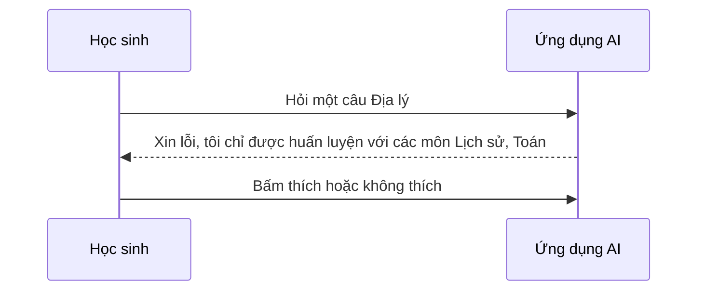

# Thiết kế trải nghiệm cho ứng dụng AI

## Từ viết tắt

- **AI** (Artificial Intelligence) — trí tuệ nhân tạo: máy làm được việc cần trí thông minh.
- **UX** (User Experience) — trải nghiệm người dùng: cảm nhận và cách một người dùng một sản phẩm.

## Trải nghiệm người dùng là gì

**Trải nghiệm người dùng** (UX) là cách một người tương tác và sử dụng một sản phẩm hay dịch vụ, dù đó là một hệ thống,
một công cụ hay một thiết kế. Người dùng cần làm việc với ứng dụng của bạn một cách **hiệu quả**. Nhưng chưa đủ: ứng
dụng còn phải **dùng được cho mọi người**, và với ứng dụng AI, trải nghiệm còn phải **có đạo đức**.

Tình huống của bài: startup (công ty khởi nghiệp) giáo dục (hư cấu) có hai nhóm người dùng chính, **giáo viên** và **học sinh**, mỗi nhóm có
nhu cầu riêng: ví dụ ứng dụng tự chấm bài
cho giáo viên, thẻ ghi nhớ giúp học sinh ôn tập. Thiết kế **lấy người dùng làm trung tâm** nghĩa là đặt người dùng lên trước, để sản phẩm thật sự hữu ích
cho đúng người cần nó.

Học xong bài, bạn sẽ:

1. hiểu cách làm ứng dụng AI đáp ứng nhu cầu người dùng;
2. thiết kế ứng dụng AI tạo được niềm tin và sự cộng tác.

## Bốn điều một ứng dụng tốt cần có

Ứng dụng cần **hữu ích, đáng tin cậy, dễ tiếp cận và dễ chịu**.

- **Hữu ích**: có chức năng đúng với mục đích, ví dụ tự chấm bài theo tiêu chí có sẵn, hay tạo thẻ ghi nhớ để ôn tập
  với câu hỏi đúng chủ đề và đa dạng.
- **Đáng tin cậy**: làm việc ổn định, không lỗi. Nhưng AI cũng như người, không hoàn hảo: có lúc cần con người can thiệp
  hoặc sửa lại.
- **Dễ tiếp cận**: người có khả năng khác nhau, kể cả người khuyết tật, đều dùng được; không ai bị bỏ lại.
- **Dễ chịu**: dùng thấy thích, khiến người dùng quay lại, và giúp tăng doanh thu.

Không phải vấn đề nào cũng giải được bằng AI. AI đến để **làm trải nghiệm tốt hơn**: tự động hóa việc làm tay, hay cá
nhân hóa trải nghiệm cho từng người.

## Niềm tin: không quá ít, không quá nhiều

Người dùng cần tin rằng ứng dụng làm được việc, cho kết quả ổn định và đúng thứ họ cần. Niềm tin cần vừa đủ, vì có
hai rủi ro:

- **Thiếu tin** (mistrust): người dùng gần như không tin hệ thống AI, nên bỏ ứng dụng của bạn.
- **Tin quá mức** (overtrust): người dùng đánh giá AI cao hơn khả năng thật. Ví dụ giáo viên tin hệ thống chấm bài tự
  động đến mức không xem lại bài nào, học sinh có thể bị điểm sai, không công bằng, và lỡ cơ hội được góp ý.

Hai cách đặt niềm tin vào giữa thiết kế: **giải thích được** và **quyền kiểm soát**.

### Giải thích được

**Giải thích được** (explainability) là giúp người dùng hiểu AI ra quyết định thế nào. Thiết kế cho điều này gồm thêm chi tiết cho thấy AI đi
đến kết quả thế nào, và:

- **nói rõ đây là AI**, không phải người. Ví dụ thay vì "Bắt đầu trò chuyện với gia sư của bạn ngay", hãy viết "Dùng gia
  sư AI tự điều chỉnh theo nhu cầu, giúp bạn học theo tốc độ của mình";
- **nói rõ AI dùng dữ liệu của người dùng thế nào**. Ví dụ với người dùng là học sinh, AI có thể không đưa thẳng đáp án mà
  gợi ý để em tự nghĩ cách giải;
- **giải thích đơn giản**: giáo viên và học sinh không phải chuyên gia AI, nên điều ứng dụng làm được và không làm được
  cần nói dễ hiểu.

### Quyền kiểm soát

AI tạo sinh là sự **cộng tác** giữa AI và người dùng: người dùng sửa prompt (câu mô tả gửi cho AI) để có kết quả khác,
và **sửa được kết quả** sau khi AI tạo ra. Ví dụ trong Microsoft Copilot (trước gọi là Bing Chat), bạn chỉnh prompt theo
định dạng, giọng văn, độ dài, rồi sửa tiếp câu trả lời.

Một kiểu kiểm soát khác là cho người dùng **chọn bật hoặc tắt** những dữ liệu AI được dùng. Ví dụ học sinh muốn AI dùng
cả ghi chép của mình lẫn tài liệu của giáo viên để ôn bài.

Bài nguồn nhấn mạnh: thiết kế có chủ đích để người dùng không tin quá mức. Một cách là tạo chút "ma sát" giữa prompt và
kết quả, nhắc người dùng rằng đây là AI, không phải một người thật.

## Cộng tác và góp ý

Nếu AI trả lời sai thì sao? Ứng dụng xử lý lỗi thế nào: đổ lỗi cho người dùng, hay dành thời gian giải thích?

- **Vòng góp ý**: ứng dụng nên nhận và đưa góp ý. Cách đơn giản là nút **thích / không thích** dưới mỗi câu trả lời. Góp ý
  giúp hệ thống tốt lên và tạo niềm tin.
- **Nói rõ khả năng và giới hạn**: khi người dùng hỏi ngoài phạm vi, ứng dụng cần có cách xử lý. Ví dụ ứng dụng chỉ học dữ
  liệu Lịch sử và Toán, gặp câu hỏi Địa lý thì trả lời: "Xin lỗi, sản phẩm của chúng tôi chỉ được huấn luyện
  với dữ liệu các môn: Lịch sử, Toán. Tôi không trả lời được câu bạn hỏi."

AI sẽ có lúc sai. Khi thiết kế, hãy chừa chỗ cho người dùng góp ý và xử lý lỗi theo cách đơn giản, dễ hiểu.

## Bài tập

Lấy một ứng dụng AI bạn đã làm, thử áp dụng:

- **Dễ chịu**: có giải thích ở mọi chỗ cần không? Có khuyến khích người dùng khám phá không? Thông báo lỗi viết thế nào?
- **Dễ dùng**: nếu là ứng dụng web, đi được bằng cả chuột lẫn bàn phím.
- **Niềm tin và minh bạch**: đừng tin hoàn toàn kết quả của AI; thêm một người kiểm tra vào quy trình.
- **Kiểm soát**: cho người dùng bật hoặc tắt việc thu thập dữ liệu của họ.

## Nhìn hình trả lời

Một giáo viên tin hệ thống chấm bài tự động đến mức không xem lại bài nào. Đây là rủi ro gì, và thiết kế nên làm gì?

- A. Thiếu tin
- B. Tin quá mức
- C. Giải thích được
- D. Vòng góp ý

Đáp án

B, **tin quá mức** (overtrust): học sinh có thể bị điểm sai, không công bằng. Thiết kế nên **giải thích** AI chấm thế
nào, nhắc rằng đây là AI, cho giáo viên **kiểm soát** (sửa điểm) và có **vòng góp ý** để báo chỗ sai.

## Nguồn đối chiếu

- [Designing UX for AI Applications](https://github.com/microsoft/generative-ai-for-beginners/blob/c35bc1950f9dc56af773d2c362dafce6f76e9a56/12-designing-ux-for-ai-applications/README.md)

*Dựa trên bài 12 của microsoft/generative-ai-for-beginners (MIT License, © Microsoft Corporation).*
