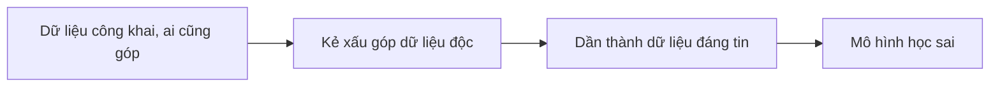

# Bảo mật ứng dụng AI tạo sinh

## Từ viết tắt

- **AI** (Artificial Intelligence) — trí tuệ nhân tạo: máy làm được việc cần trí thông minh.
- **ML** (Machine Learning) — học máy: cách cho máy tự học quy luật từ dữ liệu.
- **LLM** (Large Language Model) — mô hình ngôn ngữ lớn: mô hình AI học từ rất nhiều chữ để hiểu và viết văn bản.
- **ATLAS** (Adversarial Threat Landscape for Artificial-Intelligence Systems) — kho kiến thức của tổ chức MITRE về
  các chiến thuật tấn công hệ thống AI ngoài đời thật.
- **OWASP** (Open Web Application Security Project) — dự án cộng đồng về bảo mật ứng dụng web.
- **RBAC** (Role-Based Access Control) — phân quyền theo vai trò: ai được xem, sửa gì tùy vai trò của người đó.

## Bảo mật trong AI nghĩa là gì

AI và học máy ngày càng ảnh hưởng tới cuộc sống, và ngày càng được dùng để hỗ trợ những quyết định quan trọng, nơi một
quyết định sai có thể gây hậu quả nghiêm trọng. Vì vậy ta không chỉ bảo vệ **dữ liệu khách hàng**, mà còn phải bảo vệ
**chính hệ thống AI** trước các cuộc tấn công tinh vi, dù từ kẻ phá rối hay các nhóm có tổ chức.

Học xong bài, bạn sẽ hiểu:

1. các mối đe dọa và rủi ro với hệ thống AI;
2. các cách thường dùng để bảo vệ hệ thống AI;
3. vì sao kiểm thử bảo mật giúp tránh kết quả bất ngờ và giữ được niềm tin của người dùng.

### Vì sao dữ liệu công khai nguy hiểm

Mô hình học máy gần như **không phân biệt được** dữ liệu độc hại với dữ liệu lạ nhưng vô hại. Một phần lớn dữ liệu huấn
luyện lấy từ các bộ dữ liệu **công khai**, không ai chọn lọc hay kiểm duyệt, và **ai cũng góp được**. Kẻ tấn công không cần
đột nhập vào bộ dữ liệu, vì họ được tự do góp vào. Lâu dần, nếu đúng định dạng, dữ liệu độc hại "chưa đáng tin" sẽ trở
thành dữ liệu "đáng tin".

Vì thế phải giữ cho kho dữ liệu mà mô hình dùng để ra quyết định **toàn vẹn và được bảo vệ**.

## Các mối đe dọa

### Đầu độc dữ liệu

**Đầu độc dữ liệu** (data poisoning) là cố ý sửa dữ liệu dùng để huấn luyện AI, khiến nó làm sai. Bài nguồn coi đây là mối
đe dọa bảo mật lớn nhất với AI hiện nay, vì chưa có cách phát hiện và xử lý chuẩn, và vì ta vẫn dựa vào dữ liệu công khai
chưa được kiểm tra. Cần **theo dõi nguồn gốc** của dữ liệu; không thì đúng như câu "rác vào, rác ra". Bốn kiểu thường gặp:

- **Lật nhãn**: đổi nhãn một ít dữ liệu, ví dụ bộ lọc thư rác xếp thư thật vào thư rác.
- **Sửa đặc điểm**: chỉnh nhẹ dữ liệu để lái mô hình, ví dụ thêm từ khóa không liên quan vào mô tả sản phẩm để lái hệ
  thống gợi ý.
- **Chèn dữ liệu**: đưa dữ liệu độc vào, ví dụ đánh giá giả của người dùng làm lệch kết quả phân tích cảm xúc.
- **Cửa hậu** (backdoor): giấu một mẫu bí mật trong dữ liệu; gặp mẫu đó, mô hình làm sai, ví dụ hệ thống nhận diện khuôn
  mặt nhận nhầm một người cụ thể.

Tổ chức MITRE lập ra **ATLAS**, kho kiến thức về các chiến thuật kẻ tấn công đã dùng với hệ thống AI ngoài đời thật.

### Danh sách rủi ro của OWASP

**OWASP** có danh sách 10 lỗ hổng nghiêm trọng nhất trong ứng dụng dùng LLM. Ngoài đầu độc dữ liệu, có:

- **Chèn prompt** (prompt injection): kẻ tấn công viết đầu vào khéo léo để LLM làm việc ngoài ý định ban đầu.
- **Lỗ hổng chuỗi cung ứng**: các thành phần tạo nên ứng dụng, như thư viện Python hay bộ dữ liệu bên ngoài, có thể bị
  tấn công, gây kết quả bất ngờ hoặc thiên lệch.
- **Quá tin**: LLM có thể "bịa" (hallucinate), cho kết quả sai hoặc không an toàn; đã có người tin ngay và gặp hậu quả
  thật.

## Kiểm thử bảo mật

**Kiểm thử bảo mật** là đánh giá độ an toàn của hệ thống AI bằng cách tìm và thử khai thác lỗ hổng của nó. Lập trình viên,
người dùng hoặc bên kiểm toán độc lập đều có thể làm. Bốn cách thường dùng:

- **Làm sạch dữ liệu**: xóa hoặc ẩn danh thông tin nhạy cảm trong dữ liệu huấn luyện hay đầu vào, để tránh lộ dữ liệu.
- **Kiểm thử đối kháng**: cố tình đưa ví dụ "gài bẫy" vào để xem hệ thống có chống chịu được tấn công không.
- **Xác minh mô hình**: kiểm tra tham số và cấu trúc mô hình đúng và đủ, giúp chống trộm mô hình.
- **Kiểm tra đầu ra**: xem kết quả có nhất quán, chính xác không, để phát hiện bị thao túng.

OpenAI cũng có một loạt bài **đánh giá an toàn**, ví dụ thử xem một AI có lừa được AI khác nói ra một từ bí mật không.

## Bảo vệ dữ liệu

LLM có thể **nhớ và làm lộ** thông tin nhạy cảm trong dữ liệu huấn luyện, như tên, địa chỉ, mật khẩu hay số thẻ tín dụng.
Ba việc nên làm:

1. **Chia sẻ ít nhất có thể**: chỉ đưa cho LLM dữ liệu cần thiết; tránh dữ liệu nhạy cảm, bí mật, cá nhân; ẩn danh hoặc
   mã hóa khi cần.
2. **Kiểm tra dữ liệu LLM tạo ra**: luôn xem lại độ chính xác và chất lượng của kết quả.
3. **Báo cáo sự cố**: để ý khi LLM bỗng viết nội dung lạc đề, sai, xúc phạm hay có hại; đó có thể là dấu hiệu bị tấn công
   hoặc lộ dữ liệu.

Thêm vào đó: dùng dịch vụ đám mây có tính năng bảo vệ dữ liệu, dùng công cụ kiểm tra chất lượng dữ liệu, và có khung quản
trị để dữ liệu được dùng có trách nhiệm.

## Đội đỏ AI: giả lập tấn công thật

**Đội đỏ AI** (AI red teaming) là giả làm kẻ tấn công, dùng chính công cụ và chiến thuật của họ, để tìm rủi ro và thử khả
năng phòng thủ. Nay đây là việc chuẩn khi xây hệ thống AI vững vàng. Đội đỏ truyền thống chủ yếu lo bảo mật và chủ yếu
nhìn vào kẻ xấu; đội đỏ AI rộng hơn. Ba điều rút ra từ đội đỏ AI của Microsoft:

- **Phạm vi rộng hơn**: không chỉ lỗ hổng bảo mật (chèn prompt, đầu độc dữ liệu) mà cả **AI có trách nhiệm**: sự công bằng
  (ví dụ định kiến) và nội dung có hại (ví dụ cổ súy bạo lực).
- **Lỗi do kẻ xấu và lỗi vô tình**: không chỉ xem kẻ xấu phá hệ thống thế nào, mà cả cách người dùng bình thường gặp nội
  dung có hại.
- **Phải làm liên tục**: ứng dụng AI luôn thay đổi, nên đội đỏ cũng phải chạy liên tục.

Đội đỏ AI **không thay thế** các lớp bảo vệ khác như **phân quyền theo vai trò** (RBAC) và quản lý dữ liệu đầy đủ; nó bổ
sung cho chúng.

## Nhìn hình trả lời

Cách nào tốt để giữ dữ liệu toàn vẹn và tránh bị lạm dụng?

- A. Phân quyền chặt chẽ theo vai trò cho việc truy cập và quản lý dữ liệu
- B. Gắn nhãn dữ liệu và kiểm tra việc gắn nhãn
- C. Bảo đảm hạ tầng AI có lọc nội dung

Đáp án

A. Cả ba đều là gợi ý tốt, nhưng cấp đúng quyền truy cập dữ liệu cho đúng người giúp ngăn phần lớn việc sửa đổi và làm sai
lệch dữ liệu mà LLM dùng.

## Nguồn đối chiếu

- [Securing Your Generative AI Applications](https://github.com/microsoft/generative-ai-for-beginners/blob/c35bc1950f9dc56af773d2c362dafce6f76e9a56/13-securing-ai-applications/README.md)

*Dựa trên bài 13 của microsoft/generative-ai-for-beginners (MIT License, © Microsoft Corporation).*
