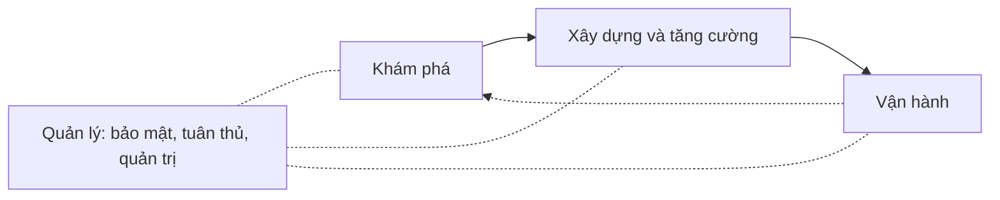

# Vòng đời ứng dụng AI tạo sinh

## Từ viết tắt

- **AI** (Artificial Intelligence) — trí tuệ nhân tạo: máy làm được việc cần trí thông minh.
- **ML** (Machine Learning) — học máy: cách cho máy tự học quy luật từ dữ liệu.
- **LLM** (Large Language Model) — mô hình ngôn ngữ lớn: mô hình AI học từ rất nhiều chữ để hiểu và viết văn bản.
- **MLOps** (Machine Learning Operations) — cách làm, triển khai và vận hành ứng dụng học máy.
- **LLMOps** (Large Language Model Operations) — cách làm, triển khai và vận hành ứng dụng dùng LLM.
- **RAG** (Retrieval Augmented Generation) — sinh câu trả lời có tra cứu thêm dữ liệu bên ngoài.
- **POC** (Proof of Concept) — bản thử để chứng minh một ý tưởng làm được.
- **SDK** (Software Development Kit) và **CLI** (Command-Line Interface) — bộ công cụ cho lập trình viên và giao diện
  dòng lệnh, để làm việc bằng code thay vì bấm chuột.

## Vì sao cần một vòng đời

AI thay đổi rất nhanh. Muốn ứng dụng AI luôn **hữu ích, đáng tin cậy và vững vàng**, bạn phải **theo dõi, đánh giá và cải
thiện** nó liên tục. Đó là lý do có **vòng đời ứng dụng AI tạo sinh**: một khung hướng dẫn qua các giai đoạn làm, triển khai
và duy trì ứng dụng. Nó giúp bạn đặt mục tiêu, đo hiệu quả, tìm ra khó khăn và cách giải quyết, đồng thời giữ ứng dụng đúng
chuẩn mực đạo đức và pháp lý.

Học xong bài, bạn sẽ hiểu:

1. sự chuyển từ MLOps sang LLMOps;
2. vòng đời của một ứng dụng dùng LLM;
3. các công cụ hỗ trợ vòng đời đó;
4. cách đo và đánh giá ứng dụng trong vòng đời.

## Từ MLOps sang LLMOps

LLM là công cụ mới, rất mạnh trong việc phân tích và tạo nội dung. Sức mạnh đó thay đổi cách ta làm ứng dụng AI. Có thể
chia ra: ứng dụng cũ là **"ứng dụng ML"**, ứng dụng mới là **"ứng dụng AI tạo sinh"** (gọi tắt là ứng dụng AI).

So với vòng đời MLOps quen thuộc, LLM có nhiều yêu cầu mới:

- **viết prompt** (câu mô tả gửi cho AI);
- các kỹ thuật mới để tăng chất lượng: **tinh chỉnh** (fine-tuning), **RAG**, **metaprompt**;
- đánh giá theo hướng **AI có trách nhiệm**;
- **chỉ số đo mới** (xem dưới).

Trong LLMOps, trọng tâm là **nhà phát triển ứng dụng**: chú trọng **tích hợp**, dùng **mô hình như một dịch vụ**
(Models-as-a-Service), và nghĩ tới các chỉ số đo dưới đây.

### Năm chỉ số đo

| Chỉ số | Đo điều gì |
| --- | --- |
| Chất lượng | câu trả lời tốt đến đâu |
| Tác hại | AI có trách nhiệm, không gây hại |
| Trung thực | câu trả lời có căn cứ: có hợp lý, có đúng không |
| Chi phí | ngân sách cho giải pháp |
| Độ trễ | thời gian trung bình để trả về câu trả lời |

## Vòng đời LLM: ba bước lớn

Vòng đời này **không đi theo đường thẳng**: nó gồm nhiều **vòng lặp** lồng nhau, làm đi làm lại, bên trong một vòng lớn
bao trùm.

1. **Khám phá** (ý tưởng): tìm hướng theo nhu cầu kinh doanh. Dùng kỹ thuật viết prompt để thử với nhiều LLM, xem giả
   thuyết có đúng không. Làm bản mẫu (prototype) bằng **PromptFlow** và thử xem đủ hiệu quả chưa.
2. **Xây dựng và tăng cường**: đánh giá trên bộ dữ liệu lớn hơn, dùng tinh chỉnh và RAG để kiểm tra độ vững. Chưa đạt
   thì làm lại: thêm bước vào luồng hoặc sắp xếp lại dữ liệu. Thử luồng và quy mô, đạt các chỉ số thì sang bước sau.
3. **Vận hành**: thêm hệ thống **giám sát và cảnh báo**, triển khai và tích hợp vào ứng dụng.

Bao trùm cả ba bước là vòng **quản lý**: bảo mật, tuân thủ và quản trị.

## Công cụ cho vòng đời

Microsoft có **nền tảng Azure AI** và **PromptFlow** để làm vòng đời này dễ hơn.

- **Microsoft Foundry** (trước gọi là Azure AI Studio): cổng web để khám phá mô hình, ví dụ mẫu và công cụ, quản lý tài
  nguyên, và làm việc bằng giao diện kéo thả hoặc bằng code qua SDK, CLI.
- **Azure AI**: quản lý vận hành, dịch vụ, dự án, tìm kiếm vector và cơ sở dữ liệu.
- **PromptFlow**: đưa ứng dụng từ **POC** tới ứng dụng quy mô lớn:
  1. thiết kế và xây ứng dụng trong VS Code (trình soạn code), với công cụ trực quan;
  2. thử và tinh chỉnh để ứng dụng đạt chất lượng;
  3. dùng Microsoft Foundry để tích hợp với đám mây, rồi đẩy lên và triển khai.

Muốn xem một ví dụ đầy đủ, bài nguồn gợi ý ứng dụng mẫu **Contoso Chat**.

## Nhìn hình trả lời

Bạn vừa thử prompt với vài LLM và làm một bản mẫu bằng PromptFlow để xem ý tưởng có khả thi. Bạn đang ở bước nào của
vòng đời?

- A. Khám phá
- B. Xây dựng và tăng cường
- C. Vận hành
- D. Quản lý

Đáp án

A, khám phá. Thử prompt với nhiều LLM và làm bản mẫu bằng PromptFlow là việc của bước khám phá. Đánh giá trên dữ liệu
lớn, tinh chỉnh, RAG thuộc bước xây dựng; giám sát và triển khai thuộc bước vận hành.

## Nguồn đối chiếu

- [The Generative AI Application Lifecycle](https://github.com/microsoft/generative-ai-for-beginners/blob/c35bc1950f9dc56af773d2c362dafce6f76e9a56/14-the-generative-ai-application-lifecycle/README.md)

*Dựa trên bài 14 của microsoft/generative-ai-for-beginners (MIT License, © Microsoft Corporation).*
