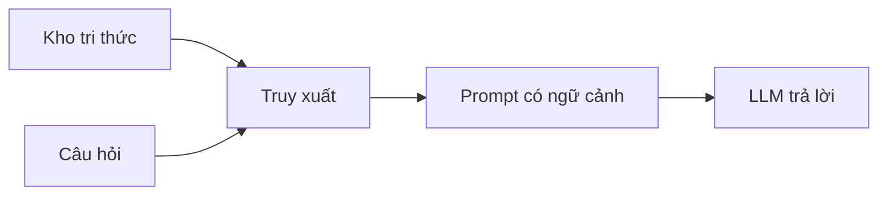

# RAG và cơ sở dữ liệu vector

Một chatbot dựa trên mô hình ngôn ngữ lớn chỉ biết những gì nó đã học lúc huấn luyện. Muốn nó trả lời
bằng ghi chú của chính bạn, ta phải đưa đúng mẩu ghi chú vào câu hỏi trước khi nó trả lời. Cách làm đó
gọi là RAG, và nơi cất ghi chú để tìm lại nhanh là cơ sở dữ liệu vector.

## Từ viết tắt

- **RAG** (Retrieval Augmented Generation) — sinh câu trả lời có tăng cường bằng truy xuất: tìm tài liệu liên quan rồi đưa vào câu hỏi cho mô hình.
- **LLM** (Large Language Model) — mô hình ngôn ngữ lớn: mô hình đọc và viết văn bản, như GPT.
- **AI** (Artificial Intelligence) — trí tuệ nhân tạo.
- **NLP** (Natural Language Processing) — xử lý ngôn ngữ tự nhiên: dạy máy hiểu và tạo ra ngôn ngữ của người.

## Bài này giúp bạn làm gì

Tình huống của bài: một công ty khởi nghiệp giáo dục muốn chatbot của mình dùng **ghi chú học tập riêng**
(bài *Mạng nơ-ron* trong khóa AI for Beginners) để giúp người học ôn thi: tạo câu hỏi luyện tập, thẻ ghi
nhớ và bản tóm tắt ngắn. Học xong, bạn sẽ:

1. giải thích được RAG là gì và vì sao nó quan trọng;
2. dựng được một ứng dụng RAG, "neo" câu trả lời của LLM vào dữ liệu của mình;
3. ghép RAG với cơ sở dữ liệu vector trong một ứng dụng LLM.

## Vì sao cần RAG

Chatbot LLM trả lời dựa trên hai thứ: ngữ cảnh bạn đưa vào và dữ liệu nó đã học. Vì vậy nó có hai chỗ
hổng:

- **Không biết chuyện mới.** Mỗi mô hình có một mốc kiến thức; ví dụ GPT-4 dừng ở tháng 9/2021, nên
  không biết chuyện xảy ra sau đó.
- **Không biết dữ liệu riêng.** Dữ liệu huấn luyện không có ghi chú cá nhân hay sổ tay sản phẩm nội bộ
  của một công ty.

RAG lấp hai chỗ hổng đó. Ba lợi ích bài nguồn nêu:

- **Thông tin đầy đủ, cập nhật**: trả lời bám vào kho tri thức nội bộ, làm tốt hơn ở việc chuyên ngành.
- **Bớt bịa**: câu trả lời dựa trên dữ liệu kiểm chứng được trong kho.
- **Rẻ hơn** so với tinh chỉnh (fine-tune) lại một LLM.

## RAG chạy thế nào

RAG có bốn bước:

1. **Kho tri thức**: tài liệu được nạp và xử lý trước. Tài liệu lớn được chia thành mẩu nhỏ, mỗi mẩu
   được biến thành embedding (một dãy số) rồi lưu vào cơ sở dữ liệu.
2. **Câu hỏi**: người dùng đặt câu hỏi.
3. **Truy xuất**: mô hình embedding tìm trong kho những đoạn liên quan để thêm ngữ cảnh vào prompt.
4. **Sinh câu trả lời có tăng cường**: LLM trả lời dựa trên cả kiến thức đã học lẫn ngữ cảnh vừa tìm được.



Bài báo gốc về RAG nêu hai cách làm: **RAG-Sequence** dùng các tài liệu tìm được để dự đoán câu trả lời
tốt nhất, còn **RAG-Token** dùng tài liệu để sinh từng token tiếp theo.

## Dựng kho tri thức: cơ sở dữ liệu vector

**Cơ sở dữ liệu vector** là loại cơ sở dữ liệu chuyên lưu, quản lý và tìm kiếm embedding, tức là dạng số
của tài liệu. Vì sao phải chia nhỏ? LLM chỉ nhận một số token giới hạn, nên không thể đưa cả kho vào.
Ta chia tài liệu thành mẩu; khi có câu hỏi, chỉ những mẩu giống câu hỏi nhất được gửi kèm. Chia nhỏ còn
giảm số token phải trả tiền.

- **Chia mẩu** theo câu hoặc theo đoạn. Có thể thêm ngữ cảnh cho mẩu, ví dụ tên tài liệu hay vài câu
  trước và sau nó.
- **Biến thành embedding** bằng một mô hình embedding, ví dụ `text-embedding-ada-002` của OpenAI hay
  word2vec. Chọn mô hình theo ngôn ngữ, loại nội dung (chữ, ảnh, âm thanh), độ dài đầu vào và độ dài
  embedding đầu ra.
- **Lưu vào cơ sở dữ liệu vector**. Vài cái tên phổ biến: Azure Cosmos DB, Pinecone, Chromadb, Qdrant,
  ScaNN, DeepLake.

## Tìm lại: từ khóa, vector hay kết hợp

Khi có câu hỏi, hệ thống biến câu hỏi thành vector rồi tìm trong chỉ mục những vector liên quan. Có ba
cách tìm:

- **Tìm theo từ khóa**: khớp chữ.
- **Tìm theo vector**: tìm theo nghĩa (tìm kiếm ngữ nghĩa), lấy những tài liệu có vector gần câu hỏi nhất.
- **Kết hợp (hybrid)**: dùng cả hai. Bài này chọn cách kết hợp.

Nếu kho không có gì thật sự giống câu hỏi, hệ thống vẫn trả về thứ gần nhất nó có. Để tránh trả lời lạc
đề, bạn có thể đặt **khoảng cách tối đa** được coi là liên quan, hoặc dùng tìm kiếm kết hợp.

**Đo độ giống nhau.** Phổ biến nhất là **cosine similarity**, dựa trên góc giữa hai vector. Ngoài ra có
**khoảng cách Euclid** (đường thẳng nối hai đầu vector) và **tích vô hướng** (cộng các tích của từng cặp
phần tử).

**Chỉ mục và xếp hạng lại.** Trước khi tìm, ta dựng một **chỉ mục tìm kiếm** để lấy nhanh các mẩu giống
nhất kể cả khi kho rất lớn (ví dụ `NearestNeighbors` của scikit-learn, lấy 5 láng giềng gần nhất). Sau
khi tìm, có thể **xếp hạng lại** kết quả từ liên quan nhất trở xuống; Azure AI Search làm việc này tự
động bằng bộ xếp hạng ngữ nghĩa.

## Thử ngay: ghép tất cả lại

Bước cuối là đưa LLM vào. Rút gọn từ ví dụ của bài nguồn:

```python
query_vector = create_embeddings(user_input)          # 1. câu hỏi thành vector
distances, indices = nbrs.kneighbors([query_vector])  # 2. tìm các mẩu gần nhất
history = [flattened_df['chunks'].iloc[i] for i in indices[0]]
history.append(user_input)                            # 3. ghép mẩu tìm được với câu hỏi
response = client.responses.create(model="gpt-5-mini", input="\n\n".join(history))  # 4. hỏi LLM
```

Với câu hỏi *"what is a perceptron?"*, chatbot trả lời dựa trên các mẩu ghi chú về perceptron vừa tìm được.

## Đánh giá và ứng dụng

Bốn tiêu chí chấm câu trả lời:

- **Chất lượng**: tự nhiên, trôi chảy, giống người viết.
- **Bám dữ liệu (groundedness)**: câu trả lời có đến từ tài liệu được cung cấp không.
- **Liên quan**: có đúng câu được hỏi không.
- **Trôi chảy**: có đúng ngữ pháp, có nghĩa không.

RAG và cơ sở dữ liệu vector dùng được cho: hỏi đáp trên dữ liệu công ty, hệ thống gợi ý (phim, nhà hàng
giống nhau), chatbot nhớ lịch sử trò chuyện để cá nhân hóa, và tìm ảnh bằng embedding. Muốn dựng RAG
nhanh hơn, có các framework như Semantic Kernel, LangChain hay AutoGen.

**Bài tập**: làm giao diện cho ứng dụng bằng framework bạn thích, hoặc dựng lại ứng dụng bằng LangChain
hay Semantic Kernel.

## Nhìn hình trả lời

Chatbot của bạn trả lời sai về một sản phẩm mới ra tháng trước, dù sổ tay sản phẩm đã có trong kho.
Theo bốn bước của RAG, bạn nên kiểm bước nào trước?

<details>
<summary>Đáp án</summary>

Bước **truy xuất**: xem hệ thống có tìm ra đúng mẩu của sổ tay không. Nếu mẩu đúng không được đưa vào
prompt, LLM chỉ còn kiến thức cũ của nó. Có thể thử tìm kiếm kết hợp hoặc đặt khoảng cách tối đa để
tránh lấy nhầm mẩu không liên quan.

</details>

## Nguồn đối chiếu

- [15-rag-and-vector-databases/README.md, ghim ở commit c35bc19](https://github.com/microsoft/generative-ai-for-beginners/blob/c35bc1950f9dc56af773d2c362dafce6f76e9a56/15-rag-and-vector-databases/README.md)

*Dựa trên bài 15 của microsoft/generative-ai-for-beginners (MIT License, © Microsoft Corporation).*
