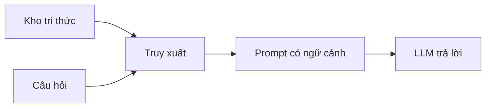

# RAG và cơ sở dữ liệu vector

Làm sao để chatbot trả lời bằng ghi chú của chính bạn? Một chatbot dựa trên mô hình ngôn ngữ lớn chỉ biết
những gì nó đã học lúc huấn luyện. Muốn nó dùng ghi chú riêng, ta phải đưa đúng mẩu ghi chú vào câu hỏi
trước khi nó trả lời. Cách làm đó gọi là RAG, và nơi cất các mẩu ghi chú để tìm lại nhanh là cơ sở dữ
liệu vector.

## Từ viết tắt

- **RAG** (Retrieval Augmented Generation) — sinh câu trả lời có tăng cường bằng truy xuất: tìm tài liệu liên quan rồi đưa vào câu hỏi cho mô hình.
- **LLM** (Large Language Model) — mô hình ngôn ngữ lớn, như GPT: mô hình đọc và viết văn bản.
- **AI** (Artificial Intelligence) — trí tuệ nhân tạo.
- **NLP** (Natural Language Processing) — xử lý ngôn ngữ tự nhiên: dạy máy hiểu và tạo ra ngôn ngữ của người.

## Bài này giúp bạn làm gì

Tình huống của bài: chatbot ôn thi dùng ghi chú riêng. Một công ty khởi nghiệp giáo dục muốn chatbot của
mình dùng **ghi chú học tập** (bài *Mạng nơ-ron* trong khóa AI for Beginners) để giúp người học ôn thi:
tạo **câu hỏi luyện tập**, **thẻ ghi nhớ** và **bản tóm tắt ngắn**. Học xong, bạn sẽ:

1. giải thích RAG là gì, vì sao quan trọng;
2. dựng ứng dụng RAG neo vào dữ liệu riêng, tức là câu trả lời của LLM dựa trên dữ liệu của bạn;
3. ghép RAG với cơ sở dữ liệu vector trong một ứng dụng LLM.

## Vì sao cần RAG

Chatbot LLM trả lời dựa trên hai thứ: ngữ cảnh bạn đưa vào và dữ liệu nó đã học. Vì vậy LLM có hai chỗ
hổng:

- **Chuyện mới sau mốc kiến thức.** Mỗi mô hình có một mốc kiến thức; ví dụ GPT-4 dừng ở tháng 9/2021,
  nên chỉ có LLM thì nó không biết chuyện xảy ra sau đó.
- **Dữ liệu riêng của bạn.** Dữ liệu huấn luyện không có ghi chú cá nhân hay sổ tay nội bộ của một công
  ty, ví dụ sổ tay sản phẩm.

Có RAG, cả hai thứ đó được lấy từ kho tri thức của bạn. Ba lợi ích bài nguồn nêu:

- **Cập nhật**, đầy đủ thông tin, nên giỏi việc chuyên ngành hơn nhờ dùng kho tri thức nội bộ.
- **Bớt bịa** nhờ dữ liệu kiểm chứng được trong kho.
- **Rẻ hơn** tinh chỉnh (fine-tune) LLM.

## RAG chạy thế nào

Bốn bước của RAG:

1. **Kho tri thức**: tài liệu được nạp và xử lý trước. Ta chia mẩu, biến thành embedding (một dãy số),
   lưu lại vào cơ sở dữ liệu.
2. **Câu hỏi**: người dùng đặt câu hỏi.
3. **Truy xuất**: mô hình embedding tìm mẩu liên quan trong kho, thêm vào prompt làm ngữ cảnh.
4. **Sinh câu trả lời**: LLM trả lời dựa trên kiến thức đã học và ngữ cảnh vừa tìm được.

Nhờ vậy câu trả lời được "neo" vào dữ liệu của bạn.



Bài báo gốc về RAG nêu hai cách làm: **RAG-Sequence** dùng các tài liệu tìm được để dự đoán câu trả lời
tốt nhất, còn **RAG-Token** dùng tài liệu để sinh từng token tiếp theo.

## Dựng kho tri thức: cơ sở dữ liệu vector

Gọn lại: chia mẩu, thành số, cất vào kho. **Cơ sở dữ liệu vector** là loại cơ sở dữ liệu chuyên lưu,
quản lý và tìm kiếm embedding, tức là dạng số của tài liệu.

Vì sao phải chia nhỏ? LLM nhận số token giới hạn, nên không thể đưa cả kho vào; ta chỉ gửi kèm mẩu giống
câu hỏi nhất. Chia nhỏ còn giảm số token phải trả tiền.

- **Chia mẩu** theo câu hoặc theo đoạn. Có thể thêm ngữ cảnh cho mẩu, ví dụ tên tài liệu hay vài câu
  trước và sau nó.
- **Biến thành embedding** bằng một mô hình embedding, ví dụ `text-embedding-ada-002` của OpenAI hay
  word2vec. Chọn mô hình theo ngôn ngữ, loại nội dung (chữ, ảnh, âm thanh), độ dài đầu vào và độ dài
  embedding đầu ra.
- **Lưu vào cơ sở dữ liệu vector**. Vài cái tên phổ biến: Azure Cosmos DB, Pinecone, Chromadb, Qdrant,
  ScaNN, DeepLake.

## Tìm lại: từ khóa, vector hay cả hai

Khi có câu hỏi, hệ thống biến câu hỏi thành vector rồi tìm trong chỉ mục những vector liên quan. Có ba
cách tìm:

- **Tìm theo từ khóa**: khớp chữ, câu hỏi và tài liệu phải có cùng từ.
- **Tìm theo vector**: tìm theo nghĩa (tìm kiếm ngữ nghĩa), lấy tài liệu có vector gần câu hỏi nhất.
- **Kết hợp (hybrid)**: dùng cả hai. Bài này chọn cách này.

Nếu kho không có gì giống câu hỏi, hệ thống vẫn trả về thứ gần nhất nó có. Để tránh trả lời lạc đề, bạn
có thể đặt **khoảng cách tối đa** được coi là liên quan, hoặc dùng tìm kiếm kết hợp.

**Đo độ giống nhau.** Các embedding gần nhau nghĩa là giống nhau. Phổ biến nhất là **cosine similarity**,
đo góc giữa hai vector. Ngoài ra có **khoảng cách Euclid** (đường thẳng nối hai đầu vector) và **tích vô
hướng** (cộng tích từng cặp phần tử của hai vector).

**Chỉ mục tìm kiếm và xếp hạng lại.** Trước khi tìm, ta dựng một chỉ mục tìm kiếm để lấy nhanh mẩu giống
nhất, kể cả kho lớn (ví dụ `NearestNeighbors` của scikit-learn, lấy 5 láng giềng gần nhất). Sau khi tìm,
có thể xếp hạng lại kết quả: mẩu liên quan nhất lên đầu. Azure AI Search làm việc này tự động bằng bộ
xếp hạng ngữ nghĩa.

## Thử ngay: ghép tất cả lại

Bước cuối là đưa LLM vào, theo bốn việc: câu hỏi thành vector, tìm các mẩu gần nhất, ghép mẩu với câu
hỏi, hỏi LLM. Python, rút gọn từ ví dụ của bài nguồn:

```python
q = create_embeddings(user_input)
dist, idx = nbrs.kneighbors([q])
history = [df['chunks'].iloc[i] for i in idx[0]]
history.append(user_input)
prompt = "\n\n".join(history)
response = client.responses.create(model=..., input=prompt)
```

Bài nguồn còn thêm một lời dặn hệ thống ("You are an AI assistant that helps with AI questions.") và dùng
mô hình `gpt-5-mini`. Hỏi *"what is a perceptron?"*: chatbot trả lời từ ghi chú về perceptron vừa tìm được.

## Ứng dụng và đánh giá

Dùng ở đâu, chấm thế nào? RAG và cơ sở dữ liệu vector dùng được cho:

- **Hỏi đáp**: nhân viên hỏi trên dữ liệu công ty.
- **Gợi ý**: tìm thứ giống nhau, ví dụ phim, nhà hàng giống nhau.
- **Chatbot**: nhớ lịch sử trò chuyện để cá nhân hóa.
- **Tìm ảnh**: tìm bằng embedding của ảnh.

Bốn tiêu chí chấm câu trả lời:

- **Chất lượng**: tự nhiên, trôi chảy, giống người viết.
- **Bám dữ liệu (groundedness)**: câu trả lời có đến từ tài liệu được cung cấp không.
- **Liên quan**: có đúng câu được hỏi không.
- **Trôi chảy**: có đúng ngữ pháp, có nghĩa không.

Muốn dựng RAG nhanh hơn, có các framework như Semantic Kernel, LangChain hay AutoGen.

**Bài tập**: làm giao diện cho ứng dụng bằng framework bạn thích, hoặc dựng lại ứng dụng bằng LangChain
hay Semantic Kernel.

## Nhìn hình trả lời

Sổ tay đã có trong kho, chatbot vẫn trả lời sai về sản phẩm mới. Theo bốn bước của RAG, kiểm bước nào
trước?

<details>
<summary>Đáp án</summary>

Bước 3: **truy xuất**. Xem hệ thống có tìm ra đúng mẩu của sổ tay không. Mẩu đúng không vào prompt thì
LLM chỉ còn kiến thức cũ. Có thể thử tìm kiếm kết hợp hoặc đặt khoảng cách tối đa để tránh lấy nhầm mẩu
không liên quan.

</details>

## Nguồn đối chiếu

- [15-rag-and-vector-databases/README.md, ghim ở commit c35bc19](https://github.com/microsoft/generative-ai-for-beginners/blob/c35bc1950f9dc56af773d2c362dafce6f76e9a56/15-rag-and-vector-databases/README.md)

*Dựa trên bài 15 của microsoft/generative-ai-for-beginners (MIT License, © Microsoft Corporation).*
