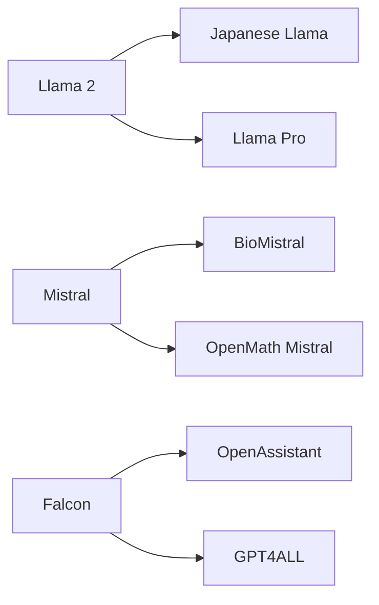
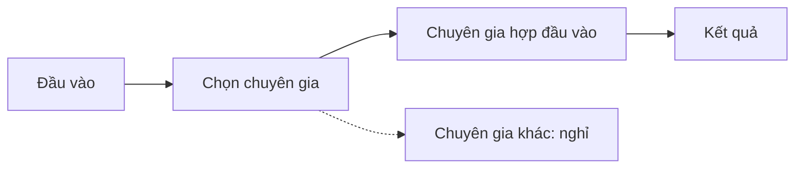

# Mô hình mã nguồn mở và Hugging Face

Thế giới LLM mở đang sôi động và thay đổi liên tục. Bài này giải thích thế nào mới thật sự là mã nguồn mở, mô hình mở có lợi gì, ba họ mô hình
mở tiêu biểu (một gốc mở, nhiều nhánh tinh chỉnh), và cách chọn một mô hình cho việc của bạn.

## Từ viết tắt

- **LLM** (Large Language Model) — mô hình ngôn ngữ lớn: mô hình đọc và viết văn bản.
- **OSI** (Open Source Initiative) — tổ chức đặt ra định nghĩa phần mềm mã nguồn mở.
- **AI** (Artificial Intelligence) — trí tuệ nhân tạo.
- **TII** (Technology Innovation Institute) — viện nghiên cứu đã tạo ra mô hình Falcon.
- **GPT** (Generative Pre-trained Transformer) — họ mô hình đóng của OpenAI, ở đây dùng để so sánh.

## Bài này giúp bạn làm gì

Học xong, bạn sẽ:

1. hiểu mô hình mã nguồn mở là gì;
2. biết lợi ích khi làm việc với mô hình mở;
3. khám phá các mô hình mở trên Hugging Face và danh mục mô hình Microsoft Foundry.

## Mô hình mở là gì

Với phần mềm, OSI đặt ra 10 tiêu chí: mã nguồn phải được chia sẻ công khai theo một giấy phép OSI chấp
nhận. Làm ra một LLM giống làm phần mềm nhưng không hẳn, nên cộng đồng vẫn tranh luận "mã nguồn mở" với
LLM nghĩa là gì. Muốn khớp định nghĩa truyền thống, một mô hình phải công khai năm thứ:

| Thứ phải công khai |
|---|
| Dữ liệu dùng để huấn luyện |
| Toàn bộ trọng số của mô hình trong quá trình huấn luyện |
| Mã đánh giá |
| Mã tinh chỉnh |
| Trọng số đầy đủ và các chỉ số huấn luyện |

Hiện rất ít mô hình đạt đủ; **OLMo** của AllenAI (Allen Institute for Artificial Intelligence) là một
trong số đó. Vì thế bài gọi chung là **"mô hình mở"**: nhiều mô hình chưa chắc đạt đủ năm thứ trên.

## Ba lợi ích của mô hình mở

- **Tùy biến cao.** Mô hình mở đi kèm thông tin huấn luyện chi tiết, nên người làm có thể sửa bên trong
  mô hình và tinh chỉnh nó cho một việc hẹp, ví dụ sinh mã, làm toán hay sinh học.
- **Chi phí.** Giá mỗi token (mẩu chữ mô hình đọc và viết) khi dùng và triển khai thấp hơn mô hình đóng. Khi làm ứng dụng, hãy cân
  hiệu năng với giá cho đúng việc của bạn.
- **Linh hoạt.** Bạn đổi qua lại hoặc kết hợp nhiều mô hình. Ví dụ HuggingChat Assistants cho người dùng
  chọn mô hình ngay trên giao diện.

## Ba họ mô hình mở và các nhánh tinh chỉnh

Mỗi họ có một mô hình gốc, rồi cộng đồng tinh chỉnh ra nhiều nhánh cho từng việc:

- **Llama 2** (của Meta) được tối ưu cho ứng dụng trò chuyện, vì khi tinh chỉnh nó học rất nhiều hội
  thoại và phản hồi của con người, nên câu trả lời hợp kỳ vọng của người dùng hơn. Nhánh: *Japanese
  Llama* chuyên tiếng Nhật, *Llama Pro* là bản nâng cấp của mô hình gốc.
- **Mistral** nhắm vào hiệu năng cao và tiết kiệm. Nhánh: *BioMistral* cho y khoa, *OpenMath Mistral*
  cho tính toán.
- **Falcon** do TII tạo ra. Falcon-40B có 40 tỷ tham số (các con số mô hình học được), được cho là làm tốt hơn GPT-3 với ít tài nguyên
  tính toán hơn. Nhờ thuật toán FlashAttention và multiquery attention (các kỹ thuật giảm bộ nhớ), nó cần ít bộ nhớ hơn lúc chạy,
  nên hợp với ứng dụng trò chuyện. Nhánh: *OpenAssistant*, trợ lý xây trên mô hình mở; *GPT4ALL*, cho
  hiệu năng cao hơn mô hình gốc.

## Mistral chọn chuyên gia thế nào

Mistral dùng cách **Mixture-of-Experts** (hỗn hợp chuyên gia): gom nhiều mô hình chuyên gia vào một hệ
thống. Tùy đầu vào, chỉ vài chuyên gia được chọn để xử lý. Mỗi chuyên gia chỉ lo phần đầu vào nó giỏi,
nên tính toán hiệu quả hơn.

## Chọn mô hình thế nào

Không có một đáp án chung. Có hai việc: tra cứu, rồi tự thử.

- **Nơi tra cứu**: bộ lọc theo task (loại việc) của danh mục mô hình Microsoft Foundry (kho mô hình trên Azure) (cho biết mô hình được huấn
  luyện cho việc gì); bảng xếp hạng LLM Leaderboard của Hugging Face (mô hình tốt nhất theo từng chỉ số);
  Artificial Analysis (so sánh nhiều loại LLM).
- **Cách thử**: tìm các bản tinh chỉnh cùng lĩnh vực với việc của bạn; thử vài mô hình mở, so với kỳ vọng
  của bạn và người dùng.

## Thử ngay

Điểm hay nhất của mô hình mở là bạn bắt đầu rất nhanh:

1. Mở danh mục mô hình Microsoft Foundry tại `ai.azure.com`.
2. Vào bộ sưu tập Hugging Face có các mô hình trong bài.
3. Lọc theo task bạn cần.
4. Thử vài mô hình, so kết quả với kỳ vọng.

## Nhìn hình trả lời

Bạn cần một mô hình trả lời câu hỏi y khoa. Theo sơ đồ "gốc và nhánh tinh chỉnh", bạn nên thử mô hình
nào trước, và vì sao?

Đáp án

Thử **BioMistral**, nhánh của Mistral được tinh chỉnh cho y khoa. Bài khuyên tìm bản tinh chỉnh cùng
lĩnh vực với việc của mình, rồi thử và so với kỳ vọng của người dùng.

## Nguồn đối chiếu

- [16-open-source-models/README.md, ghim ở commit c35bc19](https://github.com/microsoft/generative-ai-for-beginners/blob/c35bc1950f9dc56af773d2c362dafce6f76e9a56/16-open-source-models/README.md)

*Dựa trên bài 16 của microsoft/generative-ai-for-beginners (MIT License, © Microsoft Corporation).*
