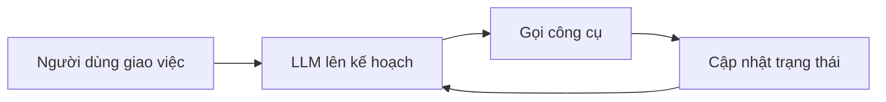

# AI agent

Chatbot thường chỉ trả lời. Một AI agent thì làm được việc: nó lên kế hoạch, gọi công cụ, nhớ mình đã
làm gì rồi làm tiếp. Bài này cho bạn một định nghĩa đơn giản về agent, giới thiệu năm framework để dựng
agent, và cho thấy nhiều agent phối hợp với nhau ra sao.

## Từ viết tắt

- **AI** (Artificial Intelligence) — trí tuệ nhân tạo.
- **LLM** (Large Language Model) — mô hình ngôn ngữ lớn, như GPT-5, GPT-4o hay Llama 3.3.
- **API** (Application Programming Interface) — cổng để một chương trình gọi chức năng của chương trình khác.
- **SDK** (Software Development Kit) — bộ công cụ và thư viện để lập trình với một nền tảng.
- **MCP** (Model Context Protocol) — giao thức chuẩn để nối mô hình với công cụ bên ngoài.
- **JSON** (JavaScript Object Notation) — định dạng chữ để máy trao đổi dữ liệu có cấu trúc.

## Bài này giúp bạn làm gì

Học xong, bạn sẽ:

1. giải thích được AI agent là gì và dùng vào việc gì;
2. thấy khác biệt giữa vài framework agent phổ biến;
3. hiểu agent vận hành ra sao để dựng ứng dụng với nó.

Framework agent cho LLM quyền dùng công cụ và giữ trạng thái. Chúng còn giúp **nhìn thấy** agent định làm
gì, nên người dùng và người làm ứng dụng theo dõi được từng bước.

## Agent là gì

Bài dùng một định nghĩa đơn giản: **AI agent cho LLM làm việc bằng cách trao cho nó trạng thái và công cụ.**
Một agent gồm ba thứ:

- **LLM** (bộ não): như GPT-5, GPT-4o hay Llama 3.3; nó lên kế hoạch cho việc được giao.
- **Trạng thái (state)**, tức trí nhớ: ngữ cảnh LLM đang làm việc. LLM dựa vào việc đã làm và ngữ cảnh hiện tại để
  quyết định bước tiếp. Framework giúp giữ ngữ cảnh này dễ hơn.
- **Công cụ (tools)**, tức đôi tay: thứ LLM cần để làm xong việc người dùng giao. Ví dụ: một cơ sở dữ liệu, một API,
  một ứng dụng khác, thậm chí một LLM khác.

Vì LLM dựa vào việc đã làm và ngữ cảnh hiện tại để quyết bước tiếp, ta có thể hình dung công việc của
agent như một vòng (đây là cách nhìn của bài viết lại, không phải của bài nguồn): lên kế hoạch → gọi
công cụ → cập nhật trạng thái → lặp lại.



## Năm framework, mỗi cái một kiểu

Cả năm đều trả lời hai câu: giữ trạng thái thế nào, đưa công cụ thế nào.

| Framework | Giữ trạng thái | Công cụ |
|---|---|---|
| LangChain Agents | `AgentExecutor` lưu lịch sử chat | Danh mục công cụ của cộng đồng |
| AutoGen | Agent viết mã Python để làm việc | Hàm được gọi, có thể chờ người duyệt |
| Microsoft Agent Framework | Luồng hội thoại (thread), lưu lại được | Hàm Python, máy chủ MCP |
| TaskWeaver | `Planner` chia việc; `experience` nhớ lâu dài | `Plugins`: lớp Python, trình chạy mã |
| JARVIS | Một LLM điều phối | Các mô hình AI chuyên biệt |

- **LangChain Agents**: `AgentExecutor` nhận agent và các công cụ, lưu lịch sử chat làm ngữ cảnh. Công
  cụ lấy từ một danh mục do cộng đồng và đội LangChain làm. Để thấy LLM dùng công cụ nào và vì sao, đội
  LangChain làm thêm LangSmith.
- **AutoGen** xoay quanh hội thoại. Để thay đổi và giữ trạng thái, agent trợ lý tự viết mã Python để làm
  việc. Agent **trò chuyện được** (một LLM mở và nối tiếp cuộc trò chuyện với
  LLM khác, qua các `AssistantAgent` có system message riêng) và **tùy biến được** (agent có thể là một
  người dùng hay một công cụ; `UserProxyAgent` hỏi ý kiến người dùng để làm tiếp hoặc dừng).
- **Microsoft Agent Framework** là SDK mã nguồn mở của Microsoft cho Python và .NET, gộp thế mạnh doanh
  nghiệp của Semantic Kernel và khả năng điều phối nhiều agent của AutoGen. Với dự án mới, đây là bản kế
  nhiệm được khuyên dùng thay AutoGen. Nó có sẵn khả năng theo dõi agent qua OpenTelemetry.
- **TaskWeaver** là agent "code-first": làm việc với DataFrame của Python chứ không chỉ chuỗi chữ, nên
  hợp với phân tích dữ liệu như vẽ biểu đồ. Plugin được lưu dưới dạng embedding để LLM tìm đúng plugin;
  mã được kiểm trước khi chạy.
- **JARVIS** dùng một LLM để điều phối; công cụ là các mô hình AI chuyên biệt (nhận diện vật thể, chép
  lời, viết chú thích ảnh). LLM xác định việc cần làm, gửi yêu cầu dạng JSON cho mô hình chuyên biệt, rồi
  gom kết quả để trả lời người dùng.

## AutoGen gọi công cụ thế nào

Ví dụ của bài nguồn: hỏi nên mặc gì khi đến New York tuần sau.

1. Một LLM được cho **system message**: việc thời tiết thì chỉ dùng các hàm được cấp, xong thì trả lời
   TERMINATE.
2. `user_proxy` (người dùng) mở cuộc trò chuyện với chatbot.
3. Chatbot **đề xuất gọi công cụ** `get_weather` kèm tham số (địa điểm, thời gian, đơn vị nhiệt độ).
4. Tùy cấu hình, hàm được **chạy tự động** hoặc **chờ người dùng đồng ý**, rồi kết quả quay về chatbot.

## Nhiều agent phối hợp

Microsoft Agent Framework mạnh nhất ở chỗ điều phối nhiều agent:

- **Lần lượt**: các agent chạy nối tiếp, mỗi agent chuyển ngữ cảnh cho agent sau (ví dụ: nghiên cứu →
  viết → biên tập).
- **Song song**: chia việc cho nhiều agent cùng lúc (ví dụ ba agent phân tích A, B, C) rồi gom câu trả lời
  của chúng lại.

Khung này đi từ một agent trò chuyện đơn lẻ lên tới các luồng nhiều agent phức tạp.

## Thử ngay

Một agent, một công cụ tự viết, rút gọn từ ví dụ Microsoft Agent Framework (cài bằng
`pip install agent-framework-core`; bản đầy đủ còn import `Agent` và `OpenAIChatClient`):

```python
def get_weather(location: str) -> str:
    return f"The weather in {location} is sunny."
agent = Agent(client=OpenAIChatClient(), tools=[get_weather],
    instructions="You are a helpful assistant that can answer weather questions.")
response = await agent.run("What's the weather in Amsterdam?")
```

Công cụ chỉ là một hàm Python bình thường. Kiểu tham số của hàm được tự đổi thành mô tả, nên mô hình biết khi nào và gọi hàm ra sao (function calling).

**Bài tập**: dùng Microsoft Agent Framework mô phỏng một cuộc họp của công ty khởi nghiệp giáo dục. Viết
system message cho từng phòng ban (vai trò, ưu tiên riêng); người dùng trình bày ý tưởng sản phẩm mới; mỗi
phòng ban đặt câu hỏi tiếp theo để làm ý tưởng tốt hơn.

## Nhìn hình trả lời

Bạn muốn agent hỏi ý kiến người dùng trước khi chạy hàm `get_weather`. Trong AutoGen, thành phần nào lo
việc đó?

<details>
<summary>Đáp án</summary>

`UserProxyAgent`: agent đại diện người dùng, hỏi ý kiến để làm tiếp hoặc dừng. Tùy cấu hình, hàm được chạy
tự động hoặc chờ người dùng đồng ý.

</details>

## Nguồn đối chiếu

- [17-ai-agents/README.md, ghim ở commit c35bc19](https://github.com/microsoft/generative-ai-for-beginners/blob/c35bc1950f9dc56af773d2c362dafce6f76e9a56/17-ai-agents/README.md)

*Dựa trên bài 17 của microsoft/generative-ai-for-beginners (MIT License, © Microsoft Corporation).*
