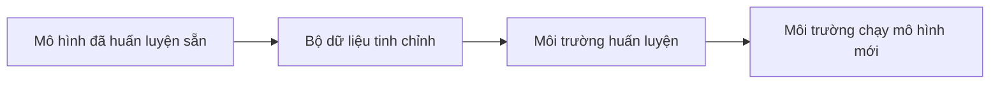

# Tinh chỉnh LLM

Làm sao để câu trả lời của mô hình đúng và sát việc hơn? Các bài trước sửa **prompt** (đoạn chữ gửi cho
mô hình) bằng kỹ thuật viết prompt hoặc RAG. Bài này nói về cách thứ ba: **tinh chỉnh** (fine-tuning), tức
huấn luyện lại chính mô hình bằng dữ liệu thêm.

## Từ viết tắt

- **LLM** (Large Language Model) — mô hình ngôn ngữ lớn: mô hình đọc và viết văn bản.
- **RAG** (Retrieval Augmented Generation) — tìm tài liệu liên quan rồi đưa vào prompt cho mô hình.
- **SFT** (Supervised Fine-Tuning) — tinh chỉnh có giám sát: học từ các cặp đầu vào và đầu ra mẫu.
- **DPO** (Direct Preference Optimization) — học từ cặp câu trả lời "được chọn" và "không được chọn".
- **RFT** (Reinforcement Fine-Tuning) — tinh chỉnh bằng học tăng cường, dựa trên điểm thưởng của bộ chấm.
- **LoRA** (Low-Rank Adaptation) — cách tinh chỉnh tiết kiệm, không phải huấn luyện lại mọi trọng số.
- **JSONL** (JSON Lines) — tệp mỗi dòng là một bản ghi JSON (một định dạng dữ liệu có cấu trúc).

## Bài này giúp bạn làm gì

Tinh chỉnh là huấn luyện lại chính mô hình bằng dữ liệu thêm. Học xong, bạn trả lời được bốn câu:

1. Tinh chỉnh mô hình ngôn ngữ là gì?
2. Khi nào, và vì sao, nên tinh chỉnh?
3. Tinh chỉnh một mô hình đã huấn luyện sẵn thế nào?
4. Tinh chỉnh có những giới hạn gì?

## Ba cách nâng chất lượng câu trả lời

1. **Kỹ thuật viết prompt**: thêm hướng dẫn hoặc vài ví dụ vào prompt (few-shot). Có hai giới hạn: số token
   (mẩu chữ mô hình đọc) có hạn nên không đưa được nhiều ví dụ, và mỗi prompt thêm ví dụ là tốn thêm tiền.
2. **RAG**: thêm dữ liệu tìm được vào prompt.
3. **Tinh chỉnh**: lấy mô hình đã huấn luyện sẵn, huấn luyện lại với một bộ ví dụ chọn lọc cho đúng việc
   hay đúng lĩnh vực, để có một **mô hình riêng** chính xác và sát việc hơn. Lợi thêm: cần ít ví dụ trong
   prompt hơn, nên đỡ token và đỡ tiền.

Hai cách đầu sửa đầu vào; cách thứ ba sửa chính mô hình. Gọn lại, cần bốn thứ: mô hình, dữ liệu, và hai
nơi chạy (một nơi để huấn luyện, một nơi để chạy mô hình mới). Ở bài này, tinh chỉnh là tinh chỉnh **có giám
sát**: thêm dữ liệu mới không có trong bộ huấn luyện ban đầu.

## Khi nào nên tinh chỉnh

Tinh chỉnh là kỹ thuật nâng cao, cần chuyên môn. Làm sai có thể không cải thiện gì, thậm chí làm mô hình
kém đi trong lĩnh vực của bạn. Trước khi làm, tự hỏi:

- **Việc gì?** Bạn muốn cải thiện điều gì ở mô hình hiện có?
- **Đã thử cách khác chưa?** Thử kỹ thuật viết prompt và RAG trước, lấy làm mốc để so.
- **Chi phí**: mô hình có cho tinh chỉnh không; công chuẩn bị dữ liệu và đánh giá; tài nguyên tính toán
  để chạy và triển khai; đủ ví dụ chất lượng không.
- **Lợi ích**: có hơn mốc so sánh không; có bớt token nhờ prompt gọn hơn không; có dùng lại mô hình gốc
  cho lĩnh vực mới được không.

Chỉ nên làm khi **lợi ích lớn hơn chi phí**. Trên Foundry, cần biết ba bước (chọn kỹ thuật, tầng huấn
luyện, mô hình gốc) và vài kinh nghiệm hay.

## Cần gì để tinh chỉnh

Bốn thứ, theo thứ tự:

## Tinh chỉnh trên Microsoft Foundry

Microsoft Foundry là nơi tinh chỉnh, triển khai và quản lý mô hình riêng trên Azure. Bên dưới, Foundry dùng
**LoRA** nên huấn luyện nhanh và rẻ hơn huấn luyện lại mọi trọng số.

**Bước 1, chọn kỹ thuật** (bắt đầu với SFT):

| Kỹ thuật | Làm gì | Khi nào dùng |
|---|---|---|
| SFT | Học từ cặp đầu vào và đầu ra mẫu | Mặc định cho hầu hết việc |
| DPO | Học từ cặp câu trả lời được chọn và không được chọn | Nâng chất lượng, an toàn khi có phản hồi so sánh |
| RFT | Tối ưu theo điểm thưởng của bộ chấm | Toán, hóa, lý: có đúng sai rõ ràng; cần nhiều chuyên môn hơn |

**Bước 2, chọn tầng huấn luyện** (chọn tầng, rồi chọn mô hình gốc): **Standard** chạy trong vùng (khu trung tâm dữ liệu của Azure) của bạn, giữ dữ liệu tại vùng; **Global**
rẻ hơn và xếp hàng nhanh hơn nhờ dùng máy ở vùng khác (dữ liệu được chép ra ngoài vùng, nên dùng khi
không bắt buộc giữ dữ liệu tại vùng); **Developer** rẻ nhất, dùng máy đang rảnh, hợp để thử nghiệm.

**Bước 3, chọn mô hình gốc**, ví dụ `gpt-4.1-mini`, `gpt-4o` hay mô hình mở như `Llama-3.3-70B-Instruct`.
Luôn xem danh sách mô hình tinh chỉnh được mới nhất.

**Kinh nghiệm hay** của Foundry:

- **Đo mốc trước** bằng kỹ thuật viết prompt và RAG, để chứng minh tinh chỉnh có lợi.
- **Bắt đầu nhỏ**: 50–100 ví dụ chất lượng cao để kiểm cách làm, rồi tăng lên 500+ khi chạy thật. Chất
  lượng hơn số lượng.
- **Đúng định dạng**: tệp JSONL, UTF-8 có BOM, dưới 512 MB; luôn có tệp kiểm định để phát hiện học vẹt
  (overfitting).
- **Giữ nguyên system message** (lời dặn cố định gửi kèm mọi prompt) lúc dùng như lúc huấn luyện.
- **Chọn checkpoint (bản lưu giữa chừng khi huấn luyện) tốt nhất**, đừng mặc định triển khai cái cuối.
- **Để ý phí chạy**: mô hình riêng tính tiền theo giờ; bản triển khai bỏ không 15 ngày sẽ bị gỡ.

**Bài tập**: chọn một hướng dẫn có sẵn (OpenAI, Microsoft Foundry, Hugging Face, AutoTrain hoặc Unsloth)
và làm theo từ đầu đến cuối.

## Nhìn hình trả lời

Bạn mới có 60 ví dụ tốt và chưa thử RAG. Theo bài, bước tiếp theo hợp lý là gì?

Đáp án

Thử kỹ thuật viết prompt và RAG trước để có **mốc so sánh**. 60 ví dụ nằm trong khoảng 50–100 để kiểm
cách làm, nhưng chỉ tinh chỉnh khi lợi ích (hơn mốc, bớt token) lớn hơn chi phí.

## Nguồn đối chiếu

- [18-fine-tuning/README.md, ghim ở commit c35bc19](https://github.com/microsoft/generative-ai-for-beginners/blob/c35bc1950f9dc56af773d2c362dafce6f76e9a56/18-fine-tuning/README.md)

*Dựa trên bài 18 của microsoft/generative-ai-for-beginners (MIT License, © Microsoft Corporation).*
