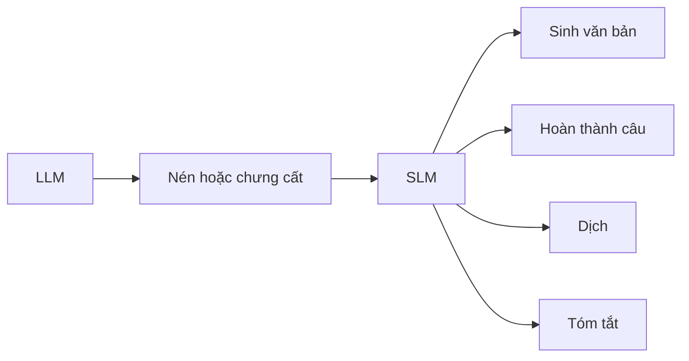

# Làm việc với mô hình ngôn ngữ nhỏ

Không phải việc nào cũng cần một mô hình khổng lồ chạy trên cụm máy chủ. **Mô hình ngôn ngữ nhỏ** (SLM)
là bản thu nhỏ của mô hình ngôn ngữ lớn: gọn hơn, nhẹ hơn, chạy được cả trên điện thoại hay máy tính của
bạn. Bài này lấy họ mô hình Phi-3 / Phi-3.5 của Microsoft làm ví dụ.

## Từ viết tắt

- **SLM** (Small Language Model) — mô hình ngôn ngữ nhỏ: bản thu nhỏ của một LLM.
- **LLM** (Large Language Model) — mô hình ngôn ngữ lớn, như GPT-4.
- **NLP** (Natural Language Processing) — xử lý ngôn ngữ tự nhiên: dạy máy hiểu và tạo ra ngôn ngữ của người.
- **GPU** (Graphics Processing Unit) — chip xử lý đồ họa, dùng để tăng tốc tính toán cho AI.
- **MoE** (Mixture of Experts) — hỗn hợp chuyên gia: nhiều mô-đun chuyên gia, mỗi lần chỉ vài mô-đun làm việc.
- **NIM** (NVIDIA Inference Microservices) — bộ dịch vụ nhỏ của NVIDIA để chạy mô hình AI.
- **ONNX** (Open Neural Network Exchange) — định dạng chuẩn để lưu mô hình học máy.

## Bài này giúp bạn làm gì

Học xong, bạn trả lời được bốn câu:

1. SLM là gì?
2. SLM khác LLM ở đâu?
3. Họ mô hình Microsoft Phi-3 / 3.5 gồm những gì?
4. Chạy suy luận (inference) với họ Phi-3 / 3.5 thế nào?

*Suy luận* là lúc mô hình nhận prompt (đoạn chữ gửi cho mô hình) và dựa vào những gì đã học để sinh ra câu
trả lời hợp lý nhất.

## SLM là gì

SLM là bản thu nhỏ của một LLM. Nó dùng lại nhiều nguyên lý kiến trúc và kỹ thuật của LLM, nhưng cần ít
tài nguyên tính toán hơn hẳn. SLM thường được làm bằng cách **nén** hoặc **chưng cất** (distill) một LLM,
cố giữ phần lớn khả năng ngôn ngữ của mô hình gốc. Mô hình nhỏ hơn thì đỡ phức tạp, tốn ít bộ nhớ và ít
tính toán hơn.



Dù nhỏ, SLM vẫn làm được nhiều việc NLP: **sinh văn bản** mạch lạc, **hoàn thành câu** từ một prompt,
**dịch** giữa các ngôn ngữ, **tóm tắt** văn bản dài. Đổi lại, hiệu năng hoặc độ hiểu sâu có thể kém mô
hình lớn.

SLM được huấn luyện như LLM: thu thập dữ liệu chữ, làm sạch, huấn luyện, rồi tinh chỉnh cho việc cụ thể.
Nó ra đời vì cần mô hình chạy được ở nơi ít tài nguyên, như **thiết bị di động** hay **thiết bị biên**
(edge, máy đặt gần nơi dùng), nơi LLM đầy đủ quá nặng. Ứng dụng: chatbot chăm sóc khách hàng, hỗ trợ viết
nội dung, giáo dục (viết bài, học ngoại ngữ), công cụ cho người khuyết tật như chuyển chữ thành giọng nói.

## SLM khác LLM ở đâu

Cả hai cùng dựa trên học máy xác suất, giống nhau về cách thiết kế, huấn luyện và đánh giá. Khác nhau ở
năm điểm:

| | LLM | SLM |
|---|---|---|
| **Kích thước** | GPT-4 ước tính khoảng 1,76 nghìn tỷ tham số | Mistral 7B khoảng 7 tỷ tham số |
| **Độ hiểu** | Rộng, giỏi nhiều lĩnh vực | Chuyên một lĩnh vực, hiểu bối cảnh rộng kém hơn |
| **Tính toán** | Cần cụm GPU lớn, hàng nghìn GPU để huấn luyện | Chạy được trên máy có GPU vừa phải |
| **Thiên lệch** | Dễ thiên lệch do học dữ liệu thô trên mạng | Ít bị hơn nhờ dữ liệu hẹp, nhưng không miễn nhiễm |
| **Tốc độ suy luận** | Cần nhiều máy song song; chậm khi đông người dùng | Nhanh, chạy được trên máy cục bộ |

*Tham số* là những con số mô hình học được. Gọn lại: LLM đa năng nhưng nặng; SLM hiệu quả trong một lĩnh
vực, cần ít tài nguyên hơn.

## Họ Phi-3 / Phi-3.5

Họ Phi nhắm ba nhóm việc: chữ, hình ảnh và agent (MoE).

- **Instruct** (hiểu và viết chữ): sinh văn bản, trò chuyện, trích thông tin.
  - **Phi-3-mini**: 3,8 tỷ tham số, có trên Microsoft Foundry, Hugging Face và Ollama; hơn cả mô hình
    gấp đôi cỡ nó.
  - **Phi-3-small** (7 tỷ) hơn GPT-3.5T ở nhiều bài kiểm tra ngôn ngữ, suy luận, viết mã và toán;
    **Phi-3-medium** (14 tỷ) hơn Gemini 1.0 Pro.
  - **Phi-3.5-mini**: bản nâng cấp của Phi-3-mini, giữ nguyên số tham số, hỗ trợ hơn 20 ngôn ngữ và ngữ
    cảnh dài hơn.
- **Vision** (cho Phi "đôi mắt"):
  - **Phi-3-Vision**: 4,2 tỷ tham số, hơn Claude-3 Haiku và Gemini 1.0 Pro V ở suy luận hình ảnh, đọc
    chữ trong ảnh (OCR), hiểu bảng và sơ đồ.
  - **Phi-3.5-Vision**: thêm khả năng nhận nhiều ảnh cùng lúc, nên suy luận được trên nhiều khung hình.
- **Phi-3.5-MoE**: gồm 16 mô-đun chuyên gia, mỗi mô-đun 3,8 tỷ tham số; mỗi lần chỉ dùng 6,6 tỷ tham số
  mà suy luận, hiểu ngôn ngữ và làm toán ngang mô hình lớn hơn nhiều. MoE cho phép huấn luyện trước với ít
  tính toán hơn hẳn.

Khác LLM, bạn có thể đặt Phi-3/3.5-mini hoặc Phi-3/3.5-Vision lên **thiết bị biên**.

## Chạy họ Phi thế nào

Hai hướng: gọi qua đám mây, hoặc chạy trên máy của bạn.

| Cách chạy | Ở đâu | Ghi chú |
|---|---|---|
| Microsoft Foundry Models | Đám mây | Cách trực tiếp nhất; gọi bằng SDK hoặc thử trong Playground |
| Microsoft Foundry | Đám mây | Dùng cho bản Vision và MoE |
| NVIDIA NIM | Đám mây, trung tâm dữ liệu | Triển khai bằng một lệnh, tối ưu cho GPU NVIDIA |
| Hugging Face Transformers | Máy của bạn | Phổ biến nhất, nhưng cần GPU |
| Ollama | Máy của bạn | Một lệnh là chạy |
| Foundry Local | Máy của bạn | Không cần mạng, không cần tài khoản Azure |
| ONNX Runtime for GenAI | Nhiều nền tảng | Windows, Linux, macOS, Android, iOS |

Vài điểm cần nhớ:

- **Foundry Models** thay cho GitHub Models (GitHub Models ngừng cuối tháng 7/2026).
- **Transformers** cần GPU: bản Vision và MoE tính rất nhiều, chạy trên CPU sẽ rất chậm nếu chưa lượng
  tử hóa (quantize, giảm độ chính xác số để mô hình nhẹ hơn).
- **Foundry Local** tự chọn bộ xử lý tốt nhất có trên máy (NPU, GPU hoặc CPU) và mở một địa chỉ gọi giống
  OpenAI, nên mã cũ dùng thư viện `openai` chỉ cần sửa ít.
- Ngoài ra còn Apple MLX, Qualcomm QNN, Intel OpenVINO cho từng loại phần cứng.

## Thử ngay

Cách nhanh nhất để chạy Phi-3.5 trên máy của bạn là Ollama (có cho macOS, Linux và Windows). Cài Ollama,
rồi gõ:

```bash
ollama run phi3.5
```

Hoặc dùng Foundry Local trên Windows:

```bash
winget install Microsoft.FoundryLocal
foundry model run phi-3.5-mini
```

Muốn tìm hiểu sâu hơn, đọc Phi-3 Cookbook của Microsoft.

## Nhìn hình trả lời

Bạn cần một mô hình tóm tắt ghi chú ngay trên laptop, không có mạng và không có tài khoản Azure. Theo
bảng "Chạy họ Phi thế nào", bạn chọn mô hình và cách chạy nào?

<details>
<summary>Đáp án</summary>

Một SLM như **Phi-3.5-mini**, chạy bằng **Foundry Local** (không cần mạng, không cần tài khoản Azure)
hoặc **Ollama** (`ollama run phi3.5`). SLM nhỏ nên chạy được trên máy cục bộ, và tóm tắt là việc SLM làm
được.

</details>

## Nguồn đối chiếu

- [19-slm/README.md, ghim ở commit c35bc19](https://github.com/microsoft/generative-ai-for-beginners/blob/c35bc1950f9dc56af773d2c362dafce6f76e9a56/19-slm/README.md)

*Dựa trên bài 19 của microsoft/generative-ai-for-beginners (MIT License, © Microsoft Corporation).*
