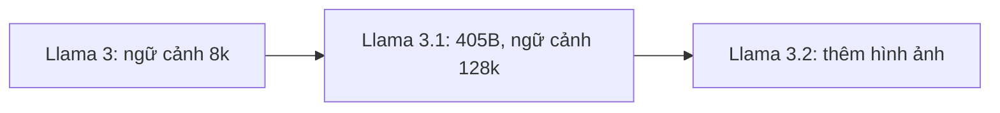

# Làm việc với họ mô hình Meta

Họ mô hình của Meta, còn gọi là "đàn Llama" (Llama Herd), là các mô hình mở dùng được trong danh mục
Microsoft Foundry Models. Bài này giới thiệu hai mô hình chính, **Llama 3.1** và **Llama 3.2**: mỗi mô hình
hợp với việc gì, và ví dụ mã cho thấy điểm riêng của từng mô hình.

## Từ viết tắt

- **LLM** (Large Language Model) — mô hình ngôn ngữ lớn: mô hình đọc và viết văn bản.
- **RAG** (Retrieval Augmented Generation) — tìm tài liệu liên quan rồi đưa vào prompt cho mô hình.
- **GenAI** (Generative AI) — AI tạo sinh: AI tạo ra nội dung mới như chữ, ảnh.
- **API** (Application Programming Interface) — cổng để một chương trình gọi chức năng của chương trình khác.

## Bài này giúp bạn làm gì

Học xong, bạn sẽ:

1. biết hai mô hình chính của Meta: Llama 3.1 và Llama 3.2;
2. hiểu mỗi mô hình hợp với việc gì;
3. đọc được ví dụ mã cho thấy điểm riêng của từng mô hình.

## Họ Llama trong bài

Llama 3.1 là bản nâng cấp của Llama 3; Llama 3.2 thêm khả năng hiểu hình ảnh mà Llama 3.1 còn thiếu.



Các biến thể có trong Microsoft Foundry Models:

- Llama 3.1, 70B Instruct
- Llama 3.1, 405B Instruct
- Llama 3.2, 11B Vision Instruct
- Llama 3.2, 90B Vision Instruct

*B* là tỷ (billion) tham số; *tham số* là những con số mô hình học được. Llama 3 cũng có trong danh mục
nhưng bài này không bàn tới. Lưu ý: GitHub Models ngừng hoạt động cuối tháng 7/2026; bài nguồn
hướng dẫn dùng Microsoft Foundry Models.

## Llama 3.1

Với 405 tỷ tham số, Llama 3.1 thuộc nhóm LLM mã nguồn mở. So với Llama 3, nó có:

- **Cửa sổ ngữ cảnh lớn hơn**: 128k token so với 8k. *Token* là mẩu chữ mô hình đọc; cửa sổ ngữ cảnh là
  lượng chữ mô hình đọc được một lần.
- **Trả lời dài hơn**: tối đa 4096 token đầu ra so với 2048.
- **Hỗ trợ nhiều ngôn ngữ tốt hơn**, nhờ học nhiều token hơn khi huấn luyện.

Nhờ vậy Llama 3.1 làm được những việc phức tạp hơn khi dựng ứng dụng GenAI:

- **Gọi hàm có sẵn** (native function calling): gọi công cụ và hàm bên ngoài luồng làm việc của LLM.
- **RAG tốt hơn**, nhờ cửa sổ ngữ cảnh lớn.
- **Sinh dữ liệu tổng hợp**: tạo dữ liệu dùng được cho việc như tinh chỉnh.

## Llama 3.1 gọi hàm thế nào

Llama 3.1 được tinh chỉnh để gọi hàm hay công cụ tốt hơn. Nó có sẵn hai công cụ, và tự nhận ra khi nào cần
dùng dựa vào prompt của người dùng:

| Công cụ | Dùng để |
|---|---|
| Brave Search | Tìm trên mạng để lấy thông tin mới, như thời tiết |
| Wolfram Alpha | Tính toán phức tạp, khỏi phải tự viết hàm |

Bạn cũng tự tạo được công cụ riêng cho LLM gọi.

Ví dụ của bài nguồn, theo thứ tự:

1. Khai báo các công cụ có thể dùng (`brave_search`, `wolfram_alpha`) trong system prompt (lời dặn hệ thống
   gửi kèm prompt).
2. Gửi prompt của người dùng hỏi thời tiết ở một thành phố.
3. LLM trả lời bằng một lệnh gọi công cụ Brave Search:

```text
<|python_tag|>brave_search.call(query="Stockholm weather")
```

Ví dụ này chỉ tạo lệnh gọi. Muốn có kết quả thật, bạn cần tạo tài khoản miễn phí trên trang Brave API và
tự định nghĩa hàm.

## Llama 3.2

Dù là một LLM, Llama 3.1 có một giới hạn: không **đa phương thức** (multimodal), tức không nhận được các
loại đầu vào khác như hình ảnh để trả lời. Đây là điểm chính của Llama 3.2:

- **Đa phương thức**: đọc được cả prompt chữ lẫn prompt ảnh.
- **Cỡ nhỏ đến vừa (11B và 90B)**: nhiều lựa chọn triển khai linh hoạt.
- **Bản chỉ có chữ (1B và 3B)**: đặt được lên thiết bị biên hoặc điện thoại, độ trễ thấp.

Hỗ trợ đa phương thức là một bước tiến lớn với mô hình mã nguồn mở. Ví dụ của bài nguồn gửi cho
Llama 3.2 90B cả một ảnh lẫn một prompt chữ để nhận phân tích về bức ảnh.

## Nhìn hình trả lời

Bạn cần mô hình đọc một tấm ảnh hóa đơn rồi tóm tắt nội dung. Theo sơ đồ "Họ Llama trong bài", bạn chọn
Llama 3.1 hay Llama 3.2?

<details>
<summary>Đáp án</summary>

**Llama 3.2** (bản Vision 11B hoặc 90B). Llama 3.1 không đa phương thức nên không nhận ảnh làm đầu vào;
Llama 3.2 đọc được cả prompt chữ lẫn prompt ảnh.

</details>

## Nguồn đối chiếu

- [21-meta/README.md, ghim ở commit c35bc19](https://github.com/microsoft/generative-ai-for-beginners/blob/c35bc1950f9dc56af773d2c362dafce6f76e9a56/21-meta/README.md)

*Dựa trên bài 21 của microsoft/generative-ai-for-beginners (MIT License, © Microsoft Corporation).*
