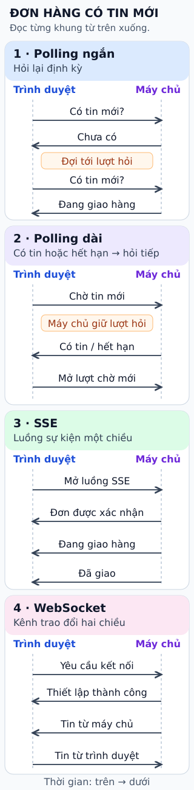

# Polling ngắn, polling dài, SSE và WebSocket

**Đơn hàng chuyển sang “đang giao”. Trình duyệt biết tin bằng cách nào?**

## Đọc hình

**1. Polling ngắn — hỏi lại định kỳ.** Máy chủ trả lời mỗi lượt, dù chưa có tin mới.
Hỏi thường xuyên hơn giúp cập nhật nhanh hơn, nhưng tăng số request.

**2. Polling dài — hỏi rồi chờ.** Máy chủ giữ lượt hỏi tới khi có tin hoặc hết hạn.
Trình duyệt nhận phản hồi rồi mở lượt hỏi tiếp. Cách này vẫn dùng tài nguyên cho các request chờ.

**3. SSE — nhận luồng sự kiện.** Trình duyệt mở luồng HTTP; máy chủ gửi trạng thái mới qua luồng đó.
SSE truyền sự kiện từ máy chủ tới trình duyệt. Muốn hủy đơn, trình duyệt vẫn gửi được HTTP request riêng.

**4. WebSocket — hai chiều.** Sau khi thiết lập kết nối, cả hai phía đều có thể chủ động gửi message.
Hợp với chat hoặc tương tác hai chiều liên tục; ứng dụng cần xử lý nối lại khi mất kết nối.

Các mũi tên đi xuống theo thời gian. “Đơn được xác nhận” là dữ liệu đơn hàng,
không phải xác nhận do SSE tạo ra. Request mới trong polling có thể dùng lại kết nối HTTP.

## Chọn theo nhu cầu

- **Chấp nhận đợi:** cân nhắc polling ngắn.
- **Chờ tin qua từng lượt HTTP:** cân nhắc polling dài.
- **Chủ yếu nhận thông báo:** cân nhắc SSE.
- **Trao đổi liên tục hai chiều:** cân nhắc WebSocket.

Đây là gợi ý lựa chọn; tải hệ thống và hạ tầng kết nối vẫn cần được xem xét.

## Nhìn hình trả lời

Trong khung 3., sau khi mở luồng SSE, phía nào gửi các trạng thái đơn hàng?

Xem đáp án

Máy chủ gửi các trạng thái về trình duyệt. Những mũi tên này đi cùng một chiều trong luồng SSE.

Xem sâu hơn: mất kết nối thì sao?

Polling cần xử lý lỗi và gửi lại request theo chính sách ứng dụng. Khi long polling hết hạn,
trình duyệt mở lượt chờ mới; không giả định request được giữ vô hạn.

Với API `EventSource`, trình duyệt có cơ chế kết nối lại theo các điều kiện của tiêu chuẩn.
`Last-Event-ID` có thể báo ID sự kiện cuối nhận được; máy chủ vẫn phải hỗ trợ phát lại hoặc
ứng dụng phải tải trạng thái hiện tại. Tự reconnect không bảo đảm lấy lại mọi dữ liệu bị bỏ lỡ.

WebSocket cung cấp kênh hai chiều; ứng dụng phải quyết định cách nối lại và đồng bộ trạng thái.
Luồng dữ liệu liên tục cũng có thể bị ảnh hưởng bởi proxy hoặc timeout trung gian.

## Nguồn đối chiếu

- [ByteByteGo — bài nguồn, phiên bản cố định](https://github.com/ByteByteGoHq/system-design-101/blob/b28380a4710c5ec9638ec037d4168e288f334cba/data/guides/shortlong-polling-sse-websocket.md).
- [RFC 6202 §2.1–2.2](https://www.rfc-editor.org/rfc/rfc6202.html): polling và timeout.
- [WHATWG HTML §9.2](https://html.spec.whatwg.org/multipage/server-sent-events.html): SSE và reconnect.
- [RFC 6455 §1.2](https://www.rfc-editor.org/rfc/rfc6455.html): WebSocket hai chiều sau handshake.

Đã đọc các nguồn trên ngày 2026-10-12. Hình là thiết kế mới; giữ chủ đề bài gốc và làm rõ
rằng giới hạn một chiều của SSE không ngăn trình duyệt gửi request HTTP khác.
