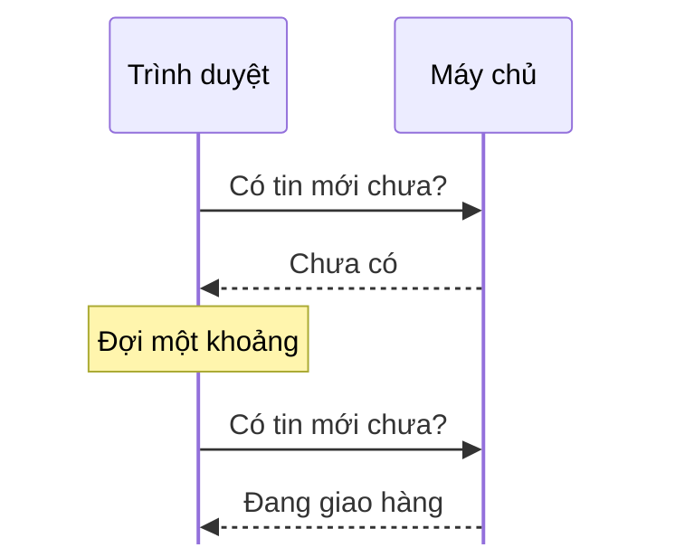
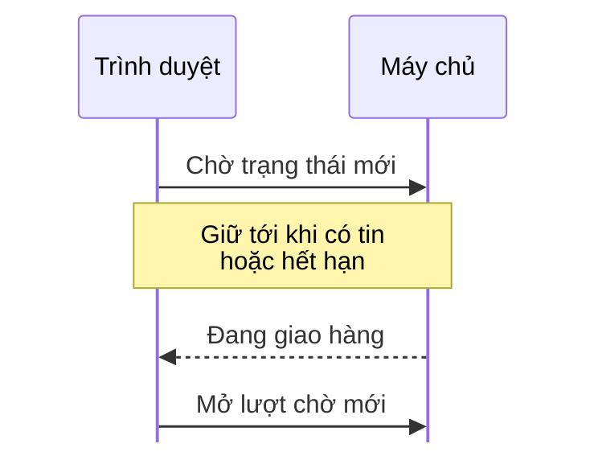
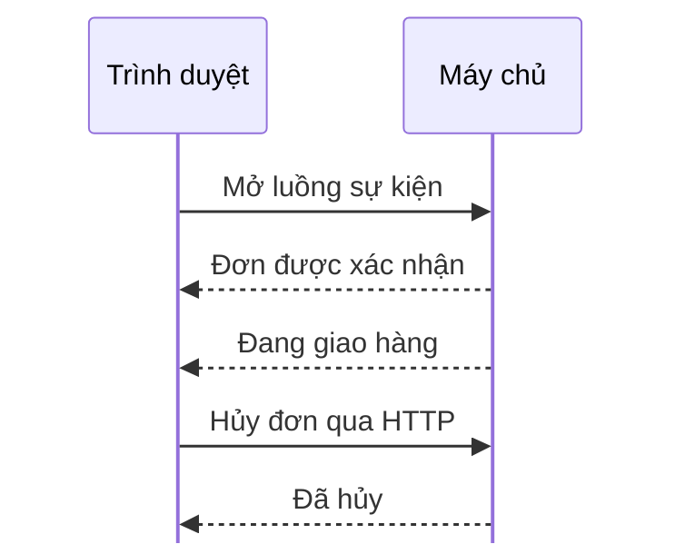
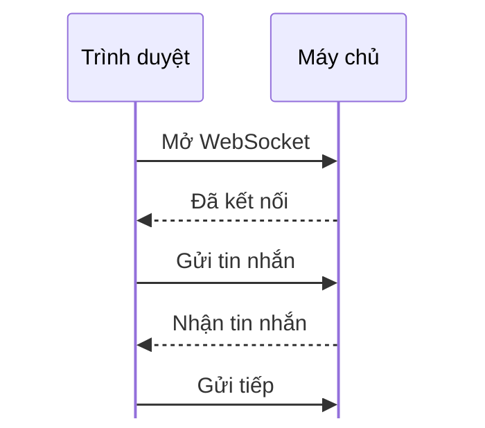

# Polling ngắn, polling dài, SSE hay WebSocket?

> Bản nháp `sd-01-001`, chưa duyệt. Trạng thái và các bước kiểm chứng ở [lesson.yaml](lesson.yaml).

**Bảng theo dõi đơn hàng nhận trạng thái mới bằng cách nào?** Máy chủ web không tự gọi vào trình
duyệt được, nên cả bốn cách dưới đây đều do trình duyệt mở kết nối trước.

## 1. Polling ngắn: hỏi theo chu kỳ

Máy chủ trả lời ngay, kể cả khi chưa có gì mới. Dễ làm; hỏi thưa thì chậm, hỏi dày thì tốn lượt hỏi.

## 2. Polling dài: giữ lượt hỏi đến khi có tin

Máy chủ giữ lượt hỏi cho tới khi có tin hoặc hết hạn, rồi trình duyệt mở lượt chờ mới. Ít phản hồi
rỗng hơn, nhưng máy chủ phải giữ nhiều lượt chờ cùng lúc.

## 3. SSE: máy chủ đẩy sự kiện một chiều

Một kết nối mở sẵn, máy chủ đẩy từng sự kiện xuống. Chỉ luồng sự kiện là một chiều; yêu cầu hủy đơn
đi bằng một HTTP request riêng.

## 4. WebSocket: hai chiều trên một kết nối

Sau bước bắt tay, hai phía gửi tin cho nhau bất cứ lúc nào. Hợp với chat hoặc thao tác liên tục; đổi
lại, ứng dụng tự lo giữ kết nối và nối lại khi mất mạng.

## Chọn theo nhu cầu

| Nhu cầu | Cân nhắc |
|---|---|
| Dữ liệu đổi ít, chấp nhận chờ | Polling ngắn |
| Muốn nhanh hơn, vẫn dùng HTTP thường | Polling dài |
| Chỉ cần máy chủ báo cho trình duyệt | SSE |
| Hai phía trao đổi liên tục | WebSocket |

**Ngộ nhận hay gặp:** "SSE một chiều nên trình duyệt không gửi được gì". Thực ra chỉ luồng sự kiện
là một chiều; trình duyệt vẫn gửi HTTP request bình thường. Với đơn hàng, SSE cộng một request hủy
thường là đủ.

**Nhìn hình:** nhận trạng thái đơn hàng liên tục, chỉ thỉnh thoảng gửi yêu cầu hủy. Có bắt buộc dùng
WebSocket không?

Xem gợi ý

Không. Hình 3 nhận trạng thái qua SSE và gửi yêu cầu hủy bằng một HTTP request riêng. Chọn theo nhu
cầu, hạ tầng và mức phức tạp chấp nhận được.

Xem sâu hơn (tùy chọn, chưa kiểm chứng bằng tiêu chuẩn)

- Kết nối dài có thể bị proxy hoặc bộ cân bằng tải đóng khi im lặng quá lâu. Thường gửi tin giữ
  nhịp (SSE dùng dòng chú thích, WebSocket có ping/pong) hoặc đặt thời gian chờ phù hợp.
- SSE: trình duyệt tự nối lại khi mất kết nối và có thể gửi `Last-Event-ID` để máy chủ gửi bù. Nối
  lại không tự bảo đảm không mất sự kiện; máy chủ phải hỗ trợ việc gửi bù.
- Với HTTP/1.1, trình duyệt giới hạn số kết nối mỗi tên miền, nên nhiều tab SSE có thể chạm giới
  hạn. HTTP/2 đỡ vấn đề này.
- `EventSource` gốc không cho tự đặt header tùy ý, nên gắn token xác thực cần thiết kế riêng.
  WebSocket thì cần xác thực ngay ở bước bắt tay.
- WebSocket không tự có bảo đảm giao tin, thứ tự giữa nhiều kết nối hay phát lại; nếu cần, phải tự
  thiết kế.

## Liên hệ nguồn

Chủ đề và thứ tự theo mục `sd-01-001` của
[bài ByteByteGo, bản đã ghim](https://github.com/ByteByteGoHq/system-design-101/blob/b28380a4710c5ec9638ec037d4168e288f334cba/data/guides/shortlong-polling-sse-websocket.md).
Bài này viết bằng lời riêng, sơ đồ thiết kế mới. Nguồn nói với SSE thì trình duyệt không gửi được
request mới; bài này nói rõ hơn rằng chỉ luồng SSE là một chiều. Các điểm kỹ thuật chưa đối chiếu
với RFC 6202, WHATWG (Server-sent events) và RFC 6455 trong bản nháp này.
