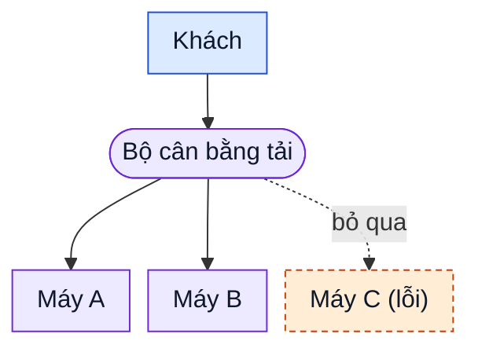

# Bộ cân bằng tải làm những việc gì?

> Bản nháp `sd-01-002`, chưa duyệt. Trạng thái và các bước kiểm chứng ở [lesson.yaml](lesson.yaml).

**Cửa hàng online chạy trên ba máy chủ, khách chỉ biết một địa chỉ.** Ai quyết định khách vào máy
nào, và chuyện gì xảy ra khi một máy hỏng? Đó là việc của bộ cân bằng tải.

Khách chỉ nói chuyện với bộ cân bằng tải. Nó chia khách vào các máy còn khỏe và bỏ qua máy C đang lỗi.

## Sáu việc thường gặp

1. **Kiểm tra sức khỏe:** định kỳ hỏi từng máy "còn làm việc được không?", chỉ chuyển khách vào máy
   trả lời tốt.
2. **Xử lý khi máy hỏng:** máy không qua kiểm tra bị tạm loại khỏi danh sách; khi hồi phục thì được
   nhận lại. Khách không phải biết máy nào hỏng.
3. **Định tuyến theo nền tảng:** nhìn vào thông tin đi kèm mỗi yêu cầu (đường dẫn, hoặc header là dòng
   mô tả như loại thiết bị) để đưa khách di động và khách web tới các nhóm máy khác nhau.
4. **Kết thúc SSL:** HTTPS là kết nối được mã hóa (bằng SSL/TLS) để người ngoài không đọc được. Bộ cân
   bằng tải giải mã ở cửa vào rồi chuyển yêu cầu cho các máy phía sau, nên các máy đó đỡ việc mã hóa
   (nếu đoạn sau không mã hóa lại).
5. **Cân bằng giữa nhiều vùng:** vùng là khu vực (hoặc nhóm trung tâm dữ liệu) tách biệt nhau. Chia
   khách ra máy ở nhiều vùng, một vùng gặp sự cố thì vùng khác vẫn phục vụ.
6. **Giữ phiên:** phiên là chuỗi thao tác liền nhau của một khách, như giỏ hàng. Đưa khách vào cùng
   một máy suốt phiên để dữ liệu phiên lưu trên máy đó vẫn dùng được.

**Giới hạn cần nhớ:** nếu chỉ có một bộ cân bằng tải thì chính nó là điểm hỏng duy nhất. Hệ thống
thật thường chạy từ hai bộ trở lên hoặc dùng dịch vụ được quản lý.

**Nhìn hình:** trong hình, máy C báo lỗi. Khách mới sẽ được đưa tới máy nào, và bộ cân bằng tải biết
C lỗi bằng cách nào?

Xem gợi ý

Khách mới đi vào máy A hoặc B. Bộ cân bằng tải biết nhờ kiểm tra sức khỏe định kỳ (việc 1): máy C
không trả lời tốt nên bị bỏ qua (việc 2).

Xem sâu hơn (tùy chọn, chưa kiểm chứng bằng tài liệu)

- Kết thúc SSL nghĩa là đoạn từ bộ cân bằng tải tới máy phía sau có thể đi không mã hóa. Nếu mạng
  nội bộ chưa đủ tin cậy thì mã hóa lại đoạn đó; khi ấy các máy phía sau vẫn phải mã hóa và giải mã
  đoạn này.
- Giữ phiên có giá: tải có thể lệch, và máy chết thì mất phiên trên máy đó. Nhiều hệ thống lưu phiên
  ở một kho dùng chung để không cần giữ phiên.
- Kiểm tra sức khỏe quá nông (chỉ thấy cổng mở) có thể bỏ sót lỗi của ứng dụng; nên kiểm tra một
  đường dẫn phản ánh đúng tình trạng làm việc.
- Định tuyến theo nội dung yêu cầu cần bộ cân bằng tải đọc được HTTP (tầng ứng dụng), không chỉ
  chuyển các gói tin.

## Liên hệ nguồn

Chủ đề và thứ tự theo mục `sd-01-002` của
[bài ByteByteGo, bản đã ghim](https://github.com/ByteByteGoHq/system-design-101/blob/b28380a4710c5ec9638ec037d4168e288f334cba/data/guides/load-balancer-realistic-use-cases-you-may-not-know.md).
Bài này viết bằng lời riêng, sơ đồ thiết kế mới. Bài nguồn dùng cùng một URL ảnh với bài về mã HTTP
(`sd-01-003`, xem hai bản đã ghim); ảnh đó chưa được mở, nên bài này không dùng ảnh nguồn và dựng lại
hình từ các ý ở trên. Các điểm kỹ thuật chưa đối chiếu với tài liệu chính thức trong bản nháp này.

Các bài cùng chủ đề (bộ cân bằng tải, reverse proxy, API gateway) nằm ở những mục sau trong mục lục
nguồn; sẽ thêm tên và liên kết khi các bài đó được viết.
