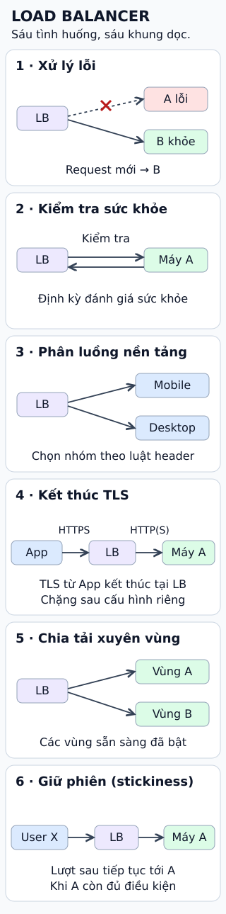

# Ứng dụng thực tế của bộ cân bằng tải

**Một máy chủ lỗi: người dùng có phải gặp lỗi theo không?**

Bộ cân bằng tải (**Load Balancer, LB**) đứng trước các máy chủ xử lý request.
Ngoài chia tải, một LB phù hợp còn hỗ trợ các tình huống dưới đây khi được cấu hình.

## Đọc hình

**1. Xử lý lỗi.** Khi A bị loại khỏi nhóm phục vụ, request mới có thể đi tới B còn khỏe.
LB không tự cứu request đang xử lý dở trên A.

**2. Kiểm tra sức khỏe.** LB gửi request kiểm tra định kỳ. Kết quả giúp quyết định máy nào
được nhận lưu lượng; bài kiểm tra cần phản ánh khả năng phục vụ thật.

**3. Phân luồng theo nền tảng.** LB ở lớp HTTP có thể dùng luật theo header để chọn
nhóm máy phục vụ mobile hoặc desktop. Nó không tự nhận diện chính xác mọi thiết bị.

**4. Kết thúc TLS.** Kết nối HTTPS từ người dùng kết thúc tại LB. LB xử lý mã hóa trên chặng đó;
chặng tới máy phía sau có thể cấu hình HTTP hoặc HTTPS riêng.

**5. Chia tải xuyên vùng sẵn sàng.** Có thể phân phối request tới máy ở nhiều vùng sẵn sàng
đã bật. Đây không đồng nghĩa với định tuyến xuyên quốc gia.

**6. Giữ phiên — stickiness.** Nhiều lượt của cùng người dùng được hướng về cùng máy theo
chính sách đã chọn. Máy đó lỗi thì việc giữ phiên không bảo đảm giữ nguyên trạng thái ứng dụng.

## Giới hạn cần nhớ

Không phải mọi LB đều có đủ sáu khả năng. Ví dụ AWS Application Load Balancer có thể
**fail open**: nếu mọi máy trong nhóm đều không khỏe, nó vẫn gửi request tới các máy đó.
Vì vậy đừng hiểu “health check” là cam kết hệ thống luôn hoạt động.

## Nhìn hình trả lời

Trong khung 1., A lỗi và B vẫn khỏe: mũi tên request mới đi tới máy nào?

Xem đáp án

Máy B. Đường tới A bị gạch bỏ. Hình mô tả quyết định cho request mới,
không thể hiện việc phục hồi công việc A đang xử lý dở.

Xem sâu hơn: giữ phiên có thay cho lưu trạng thái không?

Không. Nếu trạng thái phiên chỉ nằm trong bộ nhớ của A, chuyển sang B khi A lỗi có thể mất
trạng thái đó. Ứng dụng cần cách lưu hoặc khôi phục phù hợp, chẳng hạn kho phiên dùng chung.

Health check cũng có khoảng thời gian phát hiện lỗi và ngưỡng đánh giá. Một kiểm tra quá đơn giản
có thể báo “khỏe” dù chức năng chính đã hỏng. Header do client gửi không nên dùng làm bằng chứng
ủy quyền; phân luồng giao diện và kiểm soát truy cập là hai nhiệm vụ riêng.

## Nguồn đối chiếu

- [ByteByteGo — phiên bản cố định](https://github.com/ByteByteGoHq/system-design-101/blob/b28380a4710c5ec9638ec037d4168e288f334cba/data/guides/load-balancer-realistic-use-cases-you-may-not-know.md): sáu tình huống gốc.
- [AWS — health checks](https://docs.aws.amazon.com/elasticloadbalancing/latest/application/target-group-health-checks.html): kiểm tra sức khỏe và fail open.
- [AWS — listener rule conditions](https://docs.aws.amazon.com/elasticloadbalancing/latest/application/rule-condition-types.html): luật theo HTTP header.
- [AWS — target group protocols](https://docs.aws.amazon.com/elasticloadbalancing/latest/application/load-balancer-target-groups.html): HTTP/HTTPS tới máy phía sau.
- [AWS — HTTPS certificates](https://docs.aws.amazon.com/elasticloadbalancing/latest/application/https-listener-certificates.html): TLS ở LB.
- [AWS — target group attributes](https://docs.aws.amazon.com/elasticloadbalancing/latest/application/edit-target-group-attributes.html): cross-zone và stickiness.

Đã đọc nguồn ngày 2026-10-12. URL ảnh của bài gốc có tên HTTP status codes, không phù hợp
chủ đề; chương trình không dùng ảnh đó. Hình mới được dựng từ các cơ chế đã đối chiếu với tài liệu AWS.
