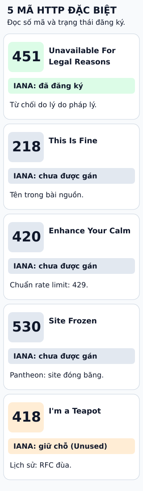

# Năm mã trạng thái HTTP kỳ lạ

**Một mã HTTP có tên lạ không có nghĩa nó là mã chuẩn.** Mã trạng thái nằm trong phản hồi,
cho biết kết quả xử lý yêu cầu. Hãy nhìn cả số mã lẫn nơi quy định ý nghĩa của nó.

## Đọc hình

**451 — Unavailable For Legal Reasons.** Mã đã đăng ký cho trường hợp truy cập bị từ chối
do yêu cầu pháp lý. Đây là mã chuẩn, dù bài gốc xếp nó trong danh sách “kỳ lạ”.

**218 — This Is Fine.** Tên trong bài nguồn; số 218 nằm trong dải chưa được IANA gán.
Không thể suy ra một ý nghĩa HTTP chính thức chỉ từ tên này.

**420 — Enhance Your Calm.** Số 420 chưa được IANA gán. Khi cần thông báo quá nhiều
yêu cầu trong một khoảng thời gian, mã chuẩn liên quan là **429 Too Many Requests**.

**530 — Site Frozen.** IANA chưa gán số này. Pantheon dùng nó cho site bị đóng băng;
ý nghĩa riêng của một nhà cung cấp không tự thành ý nghĩa chuẩn cho mọi dịch vụ.

**418 — I'm a Teapot.** Tên xuất phát từ RFC đùa ngày Cá tháng Tư.
Trong registry hiện hành, số 418 được giữ chỗ với nhãn **Unused**, không phải mã chưa được gán.

## Giới hạn cần nhớ

Tên trong bài nguồn, mã đã đăng ký và mã do sản phẩm dùng riêng là ba điều khác nhau.
Nếu một ý nghĩa đã có mã chuẩn phù hợp, đừng tự chọn một số lạ chỉ vì tên dễ nhớ.

## Nhìn hình trả lời

Mã nào trên hình vừa có ý nghĩa pháp lý vừa được đăng ký chính thức?

Xem đáp án

451. Thẻ ghi “Đã đăng ký” và nêu lý do pháp lý. 418 là giữ chỗ; 218, 420 và 530 chưa được gán.

Xem sâu hơn: đâu là chuyện lịch sử chưa kiểm chứng?

Bài ByteByteGo kể rằng Twitter từng dùng 420 để báo giới hạn tần suất, và gắn 218 với meme
“This Is Fine” cùng một cách xử lý trang lỗi. Những câu chuyện này chưa được xác minh độc lập
trong đợt biên soạn này; không xem chúng là hướng dẫn dùng API hiện tại.

Tài liệu X hiện được mở dẫn tới trang mã phản hồi, nhưng không có mục 420. Điều đó không đủ
để bác bỏ cách dùng trong quá khứ. Phần chính chỉ khẳng định trạng thái đăng ký đã đối chiếu IANA.

Pantheon nêu site có thể bị đóng băng do không hoạt động; không suy ra rằng mọi 530 đều do
nợ phí. Một sản phẩm khác có thể dùng cùng số với ý nghĩa khác.

## Nguồn đối chiếu

- [ByteByteGo — bài nguồn, phiên bản cố định](https://github.com/ByteByteGoHq/system-design-101/blob/b28380a4710c5ec9638ec037d4168e288f334cba/data/guides/5-http-status-codes-that-should-never-have-been-created.md).
- [IANA — registry mã HTTP](https://www.iana.org/assignments/http-status-codes): 218 thuộc 209–225; 420 thuộc 419–420; 530 thuộc 512–599 chưa được gán; 418 là Unused; 451 đã đăng ký.
- [RFC 7725 §3](https://www.rfc-editor.org/rfc/rfc7725.html): ý nghĩa 451.
- [RFC 9110 §15.5.19](https://www.rfc-editor.org/rfc/rfc9110.html): trạng thái giữ chỗ 418.
- [RFC 2324 §2.3.2](https://www.rfc-editor.org/rfc/rfc2324.html): tên I'm a Teapot trong RFC đùa.
- [RFC 6585 §4](https://www.rfc-editor.org/rfc/rfc6585.html): ý nghĩa 429.
- [Pantheon — Platform and Site Information](https://docs.pantheon.io/guides/platform-considerations/platform-site-info): 530 cho site bị đóng băng.

Đã đọc các nguồn trên ngày 2026-10-12. Đây là bài viết độc lập và hình thiết kế mới,
không dùng ảnh nguồn. Trạng thái và giới hạn kiểm chứng lưu trong [metadata JSON](../../metadata/sd-01-003.json).
