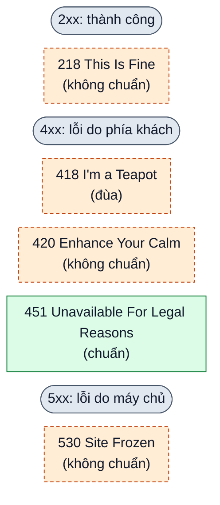

# Năm mã trạng thái HTTP kỳ lạ

> Bản nháp `sd-01-003`, chưa duyệt. Trạng thái và các bước kiểm chứng ở [lesson.yaml](lesson.yaml).

**Mỗi phản hồi HTTP có một mã trạng thái gồm ba chữ số cho biết kết quả: 200 là ổn, 404 là không tìm
thấy.** Nhưng có vài mã kỳ lạ, có mã nghe như đùa. Chúng từ đâu ra, và có nên dùng không?

Đọc hình: chữ số đầu cho biết nhóm (2xx thành công, 4xx lỗi do phía khách, 5xx lỗi do máy chủ). Viền
liền là mã chuẩn: danh sách mã HTTP chính thức của IANA (tổ chức giữ các danh sách số và tên chính
thức của Internet) gán cho nó một ý nghĩa. Viền đứt là mã không được gán ý nghĩa trong danh sách đó:
do một sản phẩm tự đặt, hoặc chỉ là trò đùa. RFC (văn bản mô tả giao thức Internet) nhắc tới một mã
chưa chắc làm nó thành mã chuẩn.

- **418 I'm a Teapot:** trò đùa Cá tháng Tư trong một RFC năm 1998 về "giao thức điều khiển ấm pha cà
  phê". Danh sách chính thức chỉ giữ chỗ số này, đánh dấu "không dùng".
- **420 Enhance Your Calm:** Twitter từng trả mã này khi bị gọi quá nhiều lần, tức vượt giới hạn tần
  suất. Mã chuẩn tương ứng là 429.
- **451 Unavailable For Legal Reasons:** máy chủ từ chối vì lý do pháp lý, như lệnh của tòa án. Đây là
  mã chuẩn (RFC 7725).
- **218 This Is Fine:** tên lấy từ một meme (hình hài hước lan truyền trên mạng). Theo nguồn, nó dùng để
  vượt qua cơ chế ghi đè lỗi của máy chủ, tức cơ chế thay phản hồi lỗi bằng một trang lỗi chung.
- **530 Site Frozen:** Pantheon (một dịch vụ lưu trữ website) dùng khi một trang bị "đóng băng". Lý do
  đóng băng do nhà cung cấp quy định.

**Giới hạn cần nhớ:** mã không chuẩn chỉ có nghĩa với hệ thống đã đặt ra nó, và cùng một số có thể mang
nghĩa khác ở nơi khác. Khi tự làm dịch vụ, hãy dùng mã chuẩn nếu đã có, như 429 cho vượt giới hạn tần
suất.

**Nhìn hình:** mã nào nằm ở nhóm thành công (2xx) nhưng viền đứt cho biết nó không phải mã chuẩn?

Xem gợi ý

Mã 218 This Is Fine. Tên nghe như một cảnh báo nhưng nó thuộc nhóm thành công, và vì không chuẩn nên
chỉ nên hiểu theo hệ thống đặt ra nó.

## Liên hệ nguồn

Chủ đề và thứ tự theo mục `sd-01-003` của
[bài ByteByteGo, bản đã ghim](https://github.com/ByteByteGoHq/system-design-101/blob/b28380a4710c5ec9638ec037d4168e288f334cba/data/guides/5-http-status-codes-that-should-never-have-been-created.md).
Bài này viết bằng lời riêng, sơ đồ thiết kế mới. Bài nguồn dùng cùng một URL ảnh với bài nguồn về bộ
cân bằng tải (`load-balancer-realistic-use-cases-you-may-not-know`, xem hai bản đã ghim). Tên file ảnh
nói về mã trạng thái HTTP nên có thể đúng chủ đề bài này, nhưng ảnh chưa được mở, và bài này không dùng
ảnh nguồn. Các mã, tên nhà cung cấp, số RFC và trạng thái trong danh sách đăng ký chưa được đối chiếu với tài
liệu chính thức trong bản nháp này; những chỗ ghi "theo nguồn" chỉ dựa vào bài nguồn. Bài nguồn còn
nêu một nguyên nhân cho mã 530; bài này không lặp lại vì chưa kiểm chứng và có thể không đúng.
