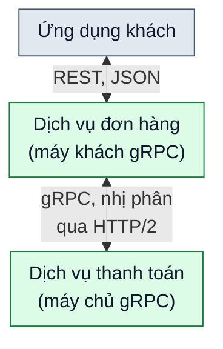

# gRPC hoạt động thế nào?

> Bản nháp `sd-01-004`, chưa duyệt. Trạng thái và các bước kiểm chứng ở [lesson.yaml](lesson.yaml).

**Ứng dụng đặt hàng cần hỏi dịch vụ thanh toán xem giao dịch có hợp lệ không, và hai dịch vụ này chạy trên hai máy khác nhau. Làm sao để chúng nói chuyện nhanh và gọn?**

## 🏠 Hiểu bằng chuyện đời thường

Hai phòng ban của một công ty lớn ngồi ở hai tòa nhà khác nhau. Cách quen thuộc là viết thư tay đầy đủ câu chữ
rồi gửi qua lại: dễ đọc nhưng dài dòng (giống dữ liệu JSON dạng chữ). gRPC giống như hai phòng thống nhất trước
một **biểu mẫu in sẵn**: mỗi ô có tên và kiểu dữ liệu rõ ràng, điền xong thì ép gọn thành một mã ngắn rồi gửi đi.
Bên nhận có cùng biểu mẫu nên đọc ra ngay. Nhờ vậy thư ngắn hơn, xử lý nhanh hơn, và việc nhờ phòng kia làm gì đó
nghe gần như nhờ đồng nghiệp ngồi cạnh.

## 🗺️ Nhìn hình

Đọc hình, từ trên xuống (mũi tên hai chiều là đi và về trên cùng một đường): ứng dụng khách gửi yêu cầu REST tới dịch vụ đơn hàng. Dịch vụ đơn hàng
lúc này đóng vai **máy khách gRPC**: nó gọi một hàm của dịch vụ thanh toán, dữ liệu được ép thành dạng nhị phân
và gửi qua mạng bằng HTTP/2. Dịch vụ thanh toán (máy chủ gRPC) giải mã, xử lý, rồi gửi kết quả về theo đường cũ.
Cuối cùng dịch vụ đơn hàng trả lời ứng dụng khách.

## 🔍 Các ý chính

- 📞 **RPC (gọi hàm từ xa):** chương trình gọi một hàm nằm trên máy khác, nhưng viết ra gần như gọi hàm tại chỗ.
  Thường gặp khi hệ thống được chia thành nhiều dịch vụ nhỏ.
- 🧑 **Stub (người đại diện tại chỗ):** đoạn mã sinh sẵn ở mỗi bên. Bạn gọi stub như một hàm thường; stub lo ép
  dữ liệu thành nhị phân rồi gửi đi.
- 📦 **Nhị phân:** dữ liệu mã hóa thành các byte gọn thay vì chữ. Nhỏ hơn và máy xử lý nhanh hơn, nhưng người khó
  đọc trực tiếp.
- 🛣️ **HTTP/2:** giao thức mà gRPC chạy trên đó, cho phép nhiều yêu cầu chạy xen kẽ trên cùng một kết nối.
- 📜 **Biểu mẫu chung:** hai bên thường dùng một file mô tả dịch vụ (viết theo Protocol Buffers) để sinh stub cho
  nhiều ngôn ngữ lập trình.

## ⚠️ Giới hạn cần nhớ

- Theo nguồn, gRPC có thể nhanh hơn JSON nhiều lần nhờ dữ liệu nhị phân và tối ưu mạng. Mức nhanh thực tế phụ
  thuộc dữ liệu và cách đo, nên đừng coi đó là một con số cố định.
- Dữ liệu nhị phân khó đọc bằng mắt, nên gỡ lỗi cần công cụ riêng.
- Trình duyệt thường không gọi gRPC trực tiếp được, cần thêm lớp chuyển đổi như gRPC-Web. Vì vậy gRPC hay dùng
  giữa các dịch vụ phía máy chủ.

## ❓ Nhìn hình trả lời

Trong hình, chặng nào dùng gRPC: từ ứng dụng khách tới dịch vụ đơn hàng, hay từ dịch vụ đơn hàng tới dịch vụ
thanh toán?

Xem đáp án

Chặng giữa dịch vụ đơn hàng và dịch vụ thanh toán. Ứng dụng khách vẫn gọi dịch vụ đơn hàng bằng yêu cầu REST
thông thường; gRPC chỉ nằm ở chặng giữa hai dịch vụ.

## 🔗 Liên hệ nguồn

Chủ đề và thứ tự theo mục `sd-01-004` của
[bài ByteByteGo, bản đã ghim](https://github.com/ByteByteGoHq/system-design-101/blob/b28380a4710c5ec9638ec037d4168e288f334cba/data/guides/how-does-grpc-work.md).
Bài này viết bằng lời riêng, sơ đồ thiết kế mới, không dùng ảnh nguồn. Những nhận định kỹ thuật ngoài bài nguồn
chưa được đối chiếu với tài liệu chính thức trong bản nháp này; chỗ ghi "theo nguồn" chỉ dựa vào bài nguồn.
