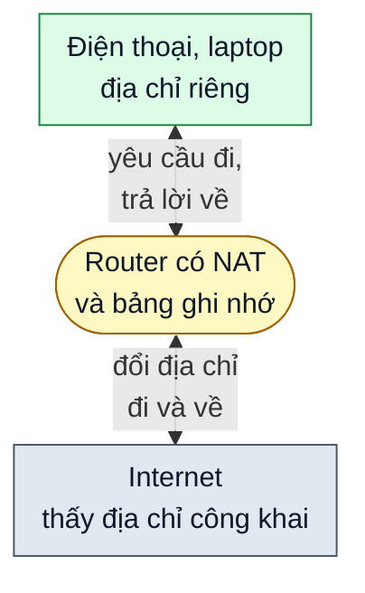

# NAT giúp Internet mở rộng ra sao?

> Bản nháp `sd-01-005`, chưa duyệt. Trạng thái và các bước kiểm chứng ở [lesson.yaml](lesson.yaml).

**Cả nhà bạn có điện thoại, laptop, tivi cùng vào mạng, nhưng nhà mạng thường chỉ cấp một địa chỉ Internet. Vì sao mọi thiết bị vẫn dùng được?**

## 🏠 Hiểu bằng chuyện đời thường

Một tòa nhà có **một số điện thoại chung** và **một lễ tân**. Mỗi phòng có số nội bộ riêng, chỉ có nghĩa bên trong
tòa nhà. Khi phòng 12 muốn gọi ra ngoài, lễ tân dùng số chung để gọi và ghi vào sổ: "cuộc gọi này của phòng 12".
Khi bên kia trả lời, lễ tân tra sổ rồi nối về đúng phòng 12. Người ngoài chỉ thấy số chung, không biết phòng nào đã
gọi. Còn nếu một người lạ tự gọi vào số chung mà sổ không có dòng nào liên quan, lễ tân không biết nối cho ai.
**NAT** (dịch địa chỉ mạng) chính là người lễ tân đó, nằm trong router của nhà bạn.

## 🗺️ Nhìn hình

Đọc hình, từ trên xuống (mũi tên hai chiều là đi và về trên cùng một đường): thiết bị trong nhà gửi yêu cầu tới router, kèm địa chỉ riêng của mình. Router đổi
địa chỉ riêng thành địa chỉ công khai của nhà rồi mới đẩy ra Internet, đồng thời ghi nhớ "yêu cầu này của máy nào".
Khi câu trả lời về, router tra bảng, đổi địa chỉ ngược lại và chuyển đúng cho thiết bị đã hỏi.

## 🔍 Các ý chính

- 🧮 **Tiết kiệm và chia sẻ địa chỉ:** địa chỉ IPv4 có khoảng 4,3 tỷ giá trị (2 mũ 32), không đủ để mỗi
  thiết bị trên thế giới có một địa chỉ công khai riêng. NAT cho cả nhà hay cả văn phòng dùng chung một địa chỉ
  công khai.
- 🧱 **Che địa chỉ nội bộ:** bên ngoài không thấy địa chỉ riêng của từng máy. Kèm theo, gói tin không có dòng
  tương ứng trong bảng ghi nhớ thường bị bỏ (xem phần giới hạn); đây chưa phải sự bảo vệ thật sự.
- 🛠️ **Dễ quản lý:** mạng nội bộ tự đặt địa chỉ riêng mà không cần xin một địa chỉ công khai cho từng máy.

## ⚠️ Giới hạn cần nhớ

- NAT không phải tường lửa. Che địa chỉ chỉ là hệ quả đi kèm; muốn chặn truy cập trái phép vẫn cần tường lửa thật.
- Thông thường bảng ghi nhớ chỉ có dòng cho những kết nối do bên trong mở ra. Muốn người bên ngoài chủ động gọi
  vào một máy trong nhà (ví dụ chơi game, chạy một máy chủ riêng) thường phải cấu hình thêm, như chuyển tiếp cổng.
- IPv6 có số địa chỉ lớn hơn rất nhiều nên không cần NAT chỉ vì thiếu địa chỉ.

## 📖 Từ khó, giải nghĩa

- **Địa chỉ IP:** dãy số định danh một thiết bị trên mạng.
- **Địa chỉ riêng / công khai:** địa chỉ riêng chỉ dùng trong mạng nội bộ (nhiều mạng gia đình dùng dạng
  `192.168.x.x`), địa chỉ công khai là địa chỉ Internet nhìn thấy.
- **Router:** thiết bị nối mạng trong nhà với Internet.

## ❓ Nhìn hình trả lời

Một máy chủ ngoài Internet tự gửi dữ liệu tới địa chỉ công khai của nhà bạn, dù bạn chưa gửi yêu cầu nào. Router
NAT thường làm gì?

Xem đáp án

Thường router không chuyển gói đó cho máy nào và bỏ nó đi, vì bảng ghi nhớ chưa có dòng tương ứng. Trừ khi bạn đã cấu hình sẵn một quy tắc chuyển tiếp.

## 🔗 Liên hệ nguồn

Chủ đề và thứ tự theo mục `sd-01-005` của
[bài ByteByteGo, bản đã ghim](https://github.com/ByteByteGoHq/system-design-101/blob/b28380a4710c5ec9638ec037d4168e288f334cba/data/guides/how-nat-made-the-growth-of-the-internet-possible.md).
Bài này viết bằng lời riêng, sơ đồ thiết kế mới, không dùng ảnh nguồn. Những nhận định kỹ thuật ngoài bài nguồn
chưa được đối chiếu với tài liệu chính thức trong bản nháp này; chỗ ghi "theo nguồn" chỉ dựa vào bài nguồn.
