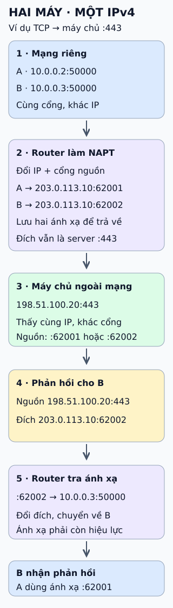

# NAT giúp Internet mở rộng ra sao?

Hai máy, một IPv4 phía ngoài: router đổi địa chỉ và nhớ đường về.
Hình minh họa **NAPT** — dạng NAT đổi cả địa chỉ lẫn cổng.

- **Đi:** đổi IP và cổng nguồn; đích vẫn là máy chủ, cổng 443.
- **Về:** tra ánh xạ còn hiệu lực để đổi đích về máy trong mạng.
- **Lợi ích:** nhiều máy chia sẻ một IPv4 công khai, giảm nhu cầu địa chỉ.

Các IP phía ngoài trong hình dành cho tài liệu, không dùng để kết nối thật.

## Nhìn hình thử trả lời

Phản hồi TCP tới `203.0.113.10:62002` được đưa về A hay B?

Xem đáp án

B: bảng ánh xạ đưa nó về `10.0.0.3:50000`.

## Giới hạn cần nhớ

Phản hồi của kết nối đã tạo khác với kết nối mới từ ngoài vào: kết nối mới cần cấu hình ánh xạ phù hợp. NAT không thay thế chính sách tường lửa và không mã hóa dữ liệu.

Xem sâu hơn

**Basic NAT** chỉ đổi địa chỉ; **NAPT** còn đổi cổng TCP/UDP. Không phải mọi NAT đều hoạt động như hình.

Bảng là hai ánh xạ minh họa cho TCP tới cùng máy chủ; router thực tế còn quản lý giao thức, trạng thái và thời hạn. Mất trạng thái ánh xạ có thể làm kết nối gián đoạn. Các gói của phiên cần đi qua bộ dịch có trạng thái phù hợp.

NAT giúp dùng tiết kiệm IPv4; nó không tạo thêm địa chỉ IPv4 hay loại bỏ giới hạn tài nguyên.

Bài nguồn gọi NAT là “tường lửa cơ bản”; ở đây tách việc đổi địa chỉ khỏi chính sách bảo mật. URL ảnh nguồn có tên `http-header`, nên không dùng ảnh đó làm bằng chứng cho NAT hoặc làm mẫu vẽ.

## Nguồn đối chiếu

- [ByteByteGo: nội dung tại snapshot cố định](https://github.com/ByteByteGoHq/system-design-101/blob/b28380a4710c5ec9638ec037d4168e288f334cba/data/guides/how-nat-made-the-growth-of-the-internet-possible.md).
- [RFC 3022, §2–2.2: Basic NAT và NAPT](https://www.rfc-editor.org/rfc/rfc3022.html#section-2).
- [RFC 1918, §3: địa chỉ riêng](https://www.rfc-editor.org/rfc/rfc1918.html#section-3).
- [RFC 5737, §3: địa chỉ ví dụ](https://www.rfc-editor.org/rfc/rfc5737.html#section-3).
- [RFC 4864, §2.2: NAT và bảo mật](https://www.rfc-editor.org/rfc/rfc4864.html#section-2.2).
