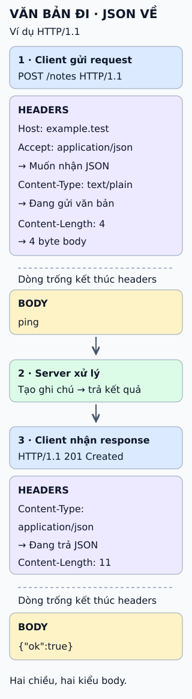

# Những điều cần biết về HTTP headers

Gửi một ghi chú dạng văn bản, nhận kết quả dạng JSON: headers giúp hai phía hiểu cách đọc dữ liệu.

- **Headers:** các trường tên–giá trị mô tả thông điệp hoặc cách xử lý.
- **Accept trong request:** loại dữ liệu muốn nhận lại.
- **Content-Type:** loại dữ liệu đang gửi; có thể xuất hiện ở cả hai chiều.
- **Body:** dữ liệu của ví dụ — văn bản đi, JSON về.

Hình là ví dụ HTTP/1.1; một số giá trị được xuống dòng để dễ đọc trên điện thoại, không phải bản sao bytes trên mạng.

## Nhìn hình thử trả lời

Request có `Accept: application/json`. Body của request là JSON hay văn bản? Trường nào cho biết?

Xem đáp án

Văn bản: `Content-Type: text/plain`. `Accept` nói về phản hồi mong muốn, không nói body gửi đi là gì.

## Ngộ nhận dễ gặp

Đổi nhãn `Content-Type` không tự chuyển dữ liệu sang định dạng khác. `Accept` cũng không bảo đảm server luôn trả đúng loại mong muốn: client cần kiểm tra phản hồi thực tế.

Xem sâu hơn

Trong HTTP/1.1, dòng trống kết thúc phần headers; body có thể không có. Dòng đầu chứa method/đích hoặc status, không phải header.

Tên trường không phân biệt hoa thường: `Content-Type` và `content-type` cùng tên. Quy tắc của giá trị tùy từng trường; không tự chuyển mọi giá trị thành chữ thường.

`Content-Length` ở ví dụ đếm byte body: `ping` là 4 byte, `{"ok":true}` là 11 byte, không có newline cuối. Khi lập trình, để thư viện tính độ dài; số ký tự không luôn bằng số byte.

Nguồn Markdown chỉ giải thích vai trò chung, không liệt kê từng header. Các ví dụ cụ thể ở đây được viết mới và đối chiếu tài liệu bên dưới; không dùng ảnh nguồn để suy ra một danh sách chưa đọc.

## Nguồn đối chiếu

- [ByteByteGo tại snapshot cố định](https://github.com/ByteByteGoHq/system-design-101/blob/b28380a4710c5ec9638ec037d4168e288f334cba/data/guides/important-things-about-http-headers-you-may-not-know.md).
- [MDN: Accept](https://developer.mozilla.org/en-US/docs/Web/HTTP/Reference/Headers/Accept) và [Content-Type](https://developer.mozilla.org/en-US/docs/Web/HTTP/Reference/Headers/Content-Type).
- [RFC 9110: tên trường (§5.1), kiểu nội dung (§8.3), độ dài (§8.6), lựa chọn nội dung (§12.4.1)](https://www.rfc-editor.org/rfc/rfc9110.html).
- [RFC 9112 §2.1: cấu trúc HTTP/1.1](https://www.rfc-editor.org/rfc/rfc9112.html#section-2.1).
