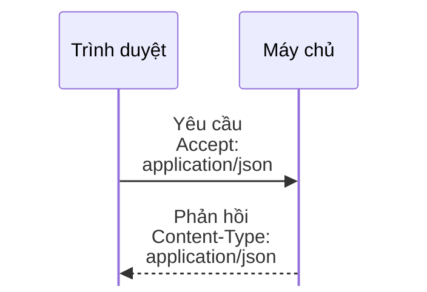

# Những điều cần biết về HTTP headers

> Bản nháp `sd-01-006`, chưa duyệt. Trạng thái và các bước kiểm chứng ở [lesson.yaml](lesson.yaml).

**Mỗi lần mở một trang web, trình duyệt và máy chủ trao đổi nhiều hơn là chỉ "cho tôi trang này": còn có những dòng thông tin đi kèm. Đó là gì?**

## 🏠 Hiểu bằng chuyện đời thường

Hãy nghĩ tới một lá thư gửi bưu điện. **Lá thư bên trong** là nội dung chính. **Phong bì bên ngoài** ghi thêm vài chỉ dẫn: thư thuộc loại nào, viết bằng ngôn ngữ gì, dặn dò đặc biệt như "giao tận tay". Người đưa thư đọc phong bì để biết
xử lý thế nào, chưa cần mở thư. **HTTP header** chính là phần ghi trên phong bì của mỗi yêu cầu và mỗi câu trả lời
trên web.

## 🗺️ Nhìn hình

Đọc hình: mỗi lần trao đổi là một cặp **yêu cầu** rồi **phản hồi**, và cả hai thường mang theo header. Trong yêu cầu, header `Accept` cho biết trình duyệt nhận được JSON (giá trị chuẩn là `application/json`). Trong phản hồi, header `Content-Type` cho biết nội dung gửi về là JSON, cũng bằng giá trị `application/json`. Header của yêu cầu nói về người hỏi và điều họ muốn; header của phản hồi nói về thứ máy chủ đang
gửi và cách dùng nó.

## 🔍 Vài header quen thuộc

| Header | Thường gặp ở | Hiểu đơn giản |
|---|---|---|
| `Content-Type` | cả hai (khi có nội dung) | Nội dung bên trong thuộc loại gì, như văn bản, JSON hay hình |
| `Accept` | yêu cầu | Tôi nhận được những loại nội dung nào |
| `User-Agent` | yêu cầu | Tôi là phần mềm nào, như một trình duyệt hay một ứng dụng |
| `Authorization` | yêu cầu | Đây là thông tin để máy chủ xác nhận tôi là ai |
| `Cache-Control` | chủ yếu phản hồi | Có được lưu lại để dùng lại không, và trong bao lâu |
| `Set-Cookie` | phản hồi | Hãy lưu mẩu thông tin nhỏ này và gửi lại cho tôi ở lần sau (trình duyệt gửi lại bằng header `Cookie`) |

Hiểu header giúp hai bên hiểu đúng nhau: gửi đúng loại dữ liệu và đọc đúng câu trả lời. Đây là điều cần biết khi
xây dựng các ứng dụng giao tiếp theo kiểu REST.

## ⚠️ Giới hạn cần nhớ

- Header thường đi kèm các yêu cầu và phản hồi. Nếu kết nối không được mã hóa (HTTPS), người đứng giữa đường có thể đọc chúng, nên
  thông tin nhạy cảm như `Authorization` cần dùng HTTPS.
- Phía gửi tự điền header, nên có thể điền sai hoặc giả (ví dụ `User-Agent`). Máy chủ không nên tin hoàn toàn.

## 📖 Từ khó, giải nghĩa

- **Kiểu nội dung (media type):** tên chuẩn của một loại dữ liệu, viết dạng `loại/phụ`, như `application/json` cho JSON hay `image/png` cho ảnh PNG. Các header `Accept` và `Content-Type` dùng kiểu này.
- **Header (tiêu đề):** các dòng thông tin kèm theo một yêu cầu hoặc phản hồi, mỗi dòng gồm một tên và một giá trị.
- **HTTPS:** HTTP có mã hóa kết nối, để người đứng giữa đường không đọc được nội dung và header.
- **Yêu cầu (request) và phản hồi (response):** một lần hỏi và một lần đáp giữa trình duyệt và máy chủ.
- **Nội dung (body):** phần dữ liệu chính, như trang web hay dữ liệu JSON.
- **Cookie:** mẩu thông tin nhỏ trình duyệt lưu lại theo yêu cầu của máy chủ, thường để nhớ bạn đã đăng nhập.

## ❓ Nhìn hình trả lời

Trong hình, header nào của phản hồi cho trình duyệt biết nội dung bên trong là JSON?

Xem đáp án

`Content-Type`. Nếu máy chủ gửi một hình ảnh, header này vẫn có mặt nhưng ghi một kiểu hình ảnh (ví dụ `image/png`) thay vì `application/json`.

## 🔗 Liên hệ nguồn

Chủ đề và thứ tự theo mục `sd-01-006` của
[bài ByteByteGo, bản đã ghim](https://github.com/ByteByteGoHq/system-design-101/blob/b28380a4710c5ec9638ec037d4168e288f334cba/data/guides/important-things-about-http-headers-you-may-not-know.md).
Bài này viết bằng lời riêng, sơ đồ thiết kế mới, không dùng ảnh nguồn. Những nhận định kỹ thuật ngoài bài nguồn
chưa được đối chiếu với tài liệu chính thức trong bản nháp này; chỗ ghi "theo nguồn" chỉ dựa vào bài nguồn.
