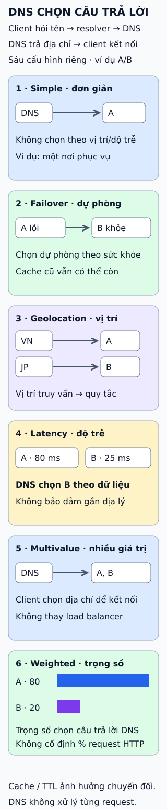

# Chính sách định tuyến lưu lượng Internet

Một tên miền, nhiều nơi phục vụ: DNS có thể chọn câu trả lời theo chính sách. Sáu cách dưới đây đối chiếu theo Amazon Route 53; mỗi khung là một cấu hình riêng.

**Đọc hình:** A/B là hai nơi phục vụ minh họa. DNS chọn câu trả lời; client dùng địa chỉ nhận được để kết nối. DNS không đứng giữa mọi request của ứng dụng.

## Nhìn hình thử trả lời

Trong khung Latency, A là 80 ms, B là 25 ms theo dữ liệu minh họa. DNS chọn nơi nào? Có thể kết luận nơi đó gần hơn về địa lý không?

Xem đáp án

Chọn B. Độ trễ thấp hơn không chứng minh gần hơn về địa lý; Geolocation và Latency dùng tiêu chí khác nhau.

## Giới hạn cần nhớ

DNS có cache: TTL cho biết thời gian lưu câu trả lời. Chuyển dự phòng không tức thì với mọi client; cache cũ còn có thể được dùng. Weighted cũng không bảo đảm đúng tỷ lệ từng request HTTP.

Xem sâu hơn

- **Simple:** ví dụ một nơi phục vụ; bản ghi thường vẫn có thể chứa nhiều IP. Không có health check trực tiếp cho bản ghi simple.
- **Failover:** kiểm tra sức khỏe quyết định chọn chính hay dự phòng. Hình giả định B khỏe khi A lỗi.
- **Geolocation:** suy vị trí từ truy vấn DNS/IP, không phải GPS. Cần bản ghi mặc định cho vị trí không nhận diện hoặc chưa có quy tắc.
- **Latency:** Route 53 dùng dữ liệu độ trễ tới vùng AWS theo thời gian, không đo từng request đang gửi.
- **Multivalue:** trả tối đa tám bản ghi được coi là khỏe; có thể gắn health check riêng. Khi tất cả lỗi, Route 53 vẫn có thể trả bản ghi lỗi. Client có thể thử địa chỉ khác; đây không thay thế load balancer.
- **Weighted:** trọng số tương đối, ví dụ 80 và 20 cho hai lựa chọn hợp lệ. Resolver dùng cache, nên tỷ lệ request thực tế có thể khác tỷ lệ lựa chọn DNS.

Health check, tình huống tất cả nơi phục vụ lỗi và cách dùng cache phụ thuộc cấu hình/dịch vụ. Sáu khung không là toàn bộ chính sách Route 53, cũng không là định tuyến gói tin bằng BGP.

## Nguồn đối chiếu

- [ByteByteGo tại snapshot cố định](https://github.com/ByteByteGoHq/system-design-101/blob/b28380a4710c5ec9638ec037d4168e288f334cba/data/guides/internet-traffic-routing-policies.md).
- AWS Route 53: [Simple](https://docs.aws.amazon.com/Route53/latest/DeveloperGuide/routing-policy-simple.html), [Failover](https://docs.aws.amazon.com/Route53/latest/DeveloperGuide/routing-policy-failover.html), [Geolocation](https://docs.aws.amazon.com/Route53/latest/DeveloperGuide/routing-policy-geo.html), [Latency](https://docs.aws.amazon.com/Route53/latest/DeveloperGuide/routing-policy-latency.html), [Multivalue](https://docs.aws.amazon.com/Route53/latest/DeveloperGuide/routing-policy-multivalue.html), [Weighted](https://docs.aws.amazon.com/Route53/latest/DeveloperGuide/routing-policy-weighted.html).
- [TTL và cache](https://docs.aws.amazon.com/Route53/latest/DeveloperGuide/resource-record-sets-values-basic.html#rrsets-values-basic-ttl).
