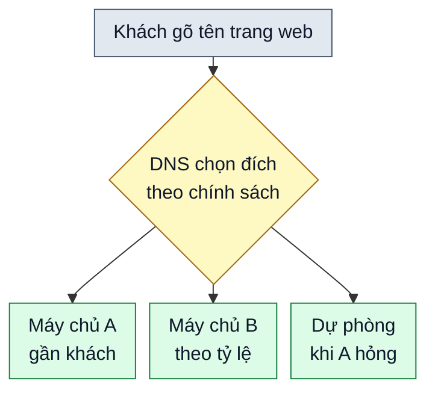

# Chính sách định tuyến lưu lượng Internet

> Bản nháp `sd-01-007`, chưa duyệt. Trạng thái và các bước kiểm chứng ở [lesson.yaml](lesson.yaml).

**Một cửa hàng online đặt máy chủ ở nhiều nước. Khi khách gõ địa chỉ trang web, ai quyết định đưa họ tới máy chủ nào?**

## 🏠 Hiểu bằng chuyện đời thường

Hãy hình dung một tổng đài chỉ đường cho chuỗi cửa hàng. Khách gọi hỏi "cửa hàng ở đâu?", tổng đài tùy theo luật mà
đọc ra một địa chỉ: có khi luôn là một chi nhánh, có khi chi nhánh chính đóng cửa thì chỉ sang chi nhánh dự phòng,
có khi chỉ chi nhánh gần khách nhất. **DNS** là tổng đài đó: nó là danh bạ đổi tên trang web thành địa chỉ máy chủ,
và các **chính sách định tuyến** là luật tổng đài dùng để chọn địa chỉ nào.

## 🗺️ Nhìn hình

Đọc hình: khách hỏi DNS, DNS áp dụng chính sách rồi trả về địa chỉ của một máy chủ. Mỗi mũi tên là một kiểu luật
khác nhau; bảng dưới đây nêu cả sáu.

## 🔍 Sáu chính sách

| Chính sách | DNS làm gì | Ví dụ dễ hiểu |
|---|---|---|
| **Simple** (đơn giản) | Luôn trả về một đích | Trang nhỏ chỉ có một máy chủ |
| **Failover** (dự phòng) | Trả về đích chính, nếu hỏng thì chuyển sang đích phụ | Máy chủ chính sập mà trang vẫn mở được |
| **Geolocation** (theo vị trí) | Chọn theo vị trí địa lý của người hỏi | Khách ở châu Á đến máy chủ châu Á, hoặc nội dung theo từng vùng |
| **Latency** (độ trễ) | Chọn đích phản hồi nhanh nhất cho người hỏi | Trang tải nhanh hơn |
| **Multivalue answer** (nhiều giá trị) | Trả về nhiều địa chỉ để máy khách tự chọn | Không thay thế bộ cân bằng tải |
| **Weighted** (theo trọng số) | Chia khách theo tỷ lệ đặt trước | Cho một phần nhỏ khách thử máy chủ mới |

Các tên gọi này khớp với cách đặt tên ở một số dịch vụ DNS đám mây, như Amazon Route 53.

## ⚠️ Giới hạn cần nhớ

- DNS chỉ trả về địa chỉ. Nó không nhìn thấy máy chủ đang bận hay rảnh như một bộ cân bằng tải. Vì vậy chính sách
  nhiều giá trị không phải là cách thay thế cho bộ cân bằng tải.
- Câu trả lời của DNS thường được lưu tạm (cache) trong một khoảng thời gian, nên khi đổi chính sách, một số khách
  vẫn thấy địa chỉ cũ trong lúc chờ hết hạn.

## 📖 Từ khó, giải nghĩa

- **DNS:** hệ thống danh bạ đổi tên trang web thành địa chỉ máy chủ.
- **Độ trễ:** thời gian một yêu cầu đi và nhận lại câu trả lời; càng thấp càng nhanh.
- **Trọng số:** con số thể hiện phần chia, ví dụ máy chủ A nhận gấp ba lần máy chủ B.

## ❓ Nhìn hình trả lời

Hai chính sách Geolocation và Latency khác nhau chỗ nào?

Xem đáp án

Geolocation chọn theo vị trí địa lý của người hỏi. Latency chọn theo độ trễ mạng, nên có thể chọn một nơi xa hơn nếu
nơi đó trả lời nhanh hơn.

## 🔗 Liên hệ nguồn

Chủ đề và thứ tự theo mục `sd-01-007` của
[bài ByteByteGo, bản đã ghim](https://github.com/ByteByteGoHq/system-design-101/blob/b28380a4710c5ec9638ec037d4168e288f334cba/data/guides/internet-traffic-routing-policies.md).
Bài này viết bằng lời riêng, sơ đồ thiết kế mới, không dùng ảnh nguồn. Những nhận định kỹ thuật ngoài bài nguồn
chưa được đối chiếu với tài liệu chính thức trong bản nháp này; chỗ ghi "theo nguồn" chỉ dựa vào bài nguồn.
