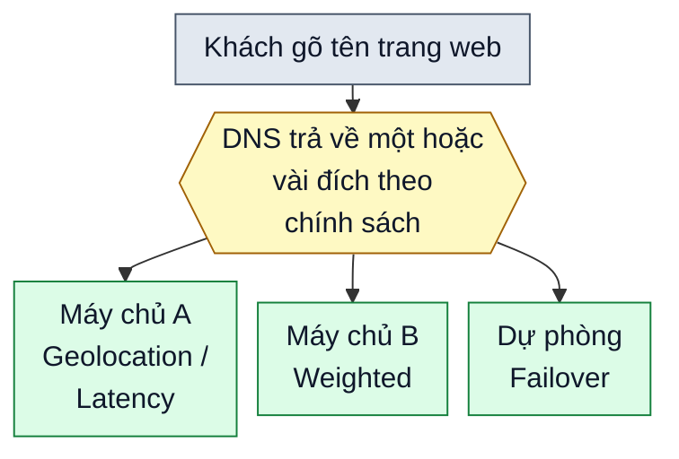

# Chính sách định tuyến lưu lượng Internet

> Bản nháp `sd-01-007`, chưa duyệt. Trạng thái và các bước kiểm chứng ở [lesson.yaml](lesson.yaml).

**Một cửa hàng online đặt máy chủ ở Tokyo, Singapore và Hà Nội. Khi khách gõ tên trang web, ai quyết định họ được dẫn tới máy chủ nào?**

## 🏠 Hiểu bằng chuyện đời thường

Hãy hình dung một tổng đài chỉ đường cho chuỗi cửa hàng. Khách gọi hỏi "cửa hàng ở đâu?", và tổng đài không nhất thiết đọc cùng một địa chỉ cho mọi người. Nó có thể hỏi lại "anh đang ở đâu?", kiểm tra chi nhánh nào đang mở cửa, hay chia khách theo tỷ lệ cho từng chi nhánh. **DNS** là tổng đài đó: danh bạ đổi tên trang web thành địa chỉ máy chủ. Còn **chính sách định tuyến** là bộ luật tổng đài dùng để chọn địa chỉ nào sẽ được đọc ra.

## 🗺️ Nhìn hình

Đọc hình: khách hỏi DNS, DNS áp dụng chính sách rồi trả về địa chỉ của một hoặc vài máy chủ. Mỗi máy chủ trong hình ghi tên chính sách dẫn tới nó: máy chủ A ứng với chính sách theo vị trí hoặc theo độ trễ, máy chủ B ứng với chính sách theo trọng số, và máy chủ dự phòng ứng với chính sách dự phòng (Failover) khi nơi chính hỏng. Mục tiếp theo gom sáu chính sách phổ biến theo câu hỏi mà DNS tự đặt ra trước khi trả lời.

## 🔍 Sáu chính sách, gom theo câu hỏi DNS đặt ra

- 🎯 **"Có cần chọn gì không?"** Chính sách **Simple** (đơn giản) không chọn: ai hỏi cũng nhận cùng một câu trả lời. Hợp với trang nhỏ chỉ có một máy chủ.
- 🩺 **"Máy chủ nào còn sống?"** **Failover** (dự phòng) dùng đích chính và chỉ chuyển sang đích phụ khi đích chính được xác định là hỏng, nhờ kiểm tra sức khỏe. **Multivalue answer** (nhiều giá trị) đưa ra vài địa chỉ để máy khách tự thử; nếu một máy hỏng, trình duyệt có thể thử địa chỉ khác.
- 🧭 **"Người hỏi ở đâu, đường nào nhanh?"** **Geolocation** (theo vị trí) chọn đích tương ứng với nơi DNS suy ra người hỏi đang ở, ví dụ khách ở châu Á đến máy chủ châu Á. **Latency** (độ trễ) chọn đích mà dự kiến người hỏi nhận được câu trả lời nhanh nhất, nên có thể dẫn khách ở Nhật tới một máy chủ không phải gần nhất nếu máy đó được cho là đáp nhanh hơn.
- ⚖️ **"Chia câu trả lời thế nào?"** **Weighted** (theo trọng số) chia các câu trả lời DNS theo một tỷ lệ định trước, ví dụ để một phần nhỏ câu trả lời trỏ tới một máy chủ mới. Đây là tỷ lệ xấp xỉ của các câu trả lời, không phải một phép chia khách chính xác: câu trả lời được lưu tạm và nhiều khách dùng chung một bộ phân giải, nên tỷ lệ khách thực tế có thể lệch.

## ⚠️ Giới hạn cần nhớ

- Các chính sách này do dịch vụ DNS cung cấp, không phải mọi dịch vụ DNS đều có đủ cả sáu.
- DNS chỉ trả về địa chỉ rồi đứng ngoài; bộ cân bằng tải thì nằm trên đường đi của yêu cầu và có thể dùng thông tin về sức khỏe hoặc tải của máy chủ để chọn. Vì vậy kiểu trả về nhiều địa chỉ rồi để máy khách chọn không thay được bộ cân bằng tải.
- Vị trí của người hỏi được suy ra từ địa chỉ của bên gửi câu hỏi tới DNS, nên có thể lệch so với vị trí thật của khách.
- Câu trả lời của DNS thường được lưu tạm (cache) trong một khoảng thời gian, nên khi đổi chính sách, một số khách vẫn thấy địa chỉ cũ trong lúc chờ hết hạn. Việc chuyển sang đích dự phòng cũng chịu độ trễ này.

## 📖 Từ khó, giải nghĩa

- **DNS:** hệ thống danh bạ đổi tên trang web thành địa chỉ máy chủ.
- **Độ trễ:** thời gian một yêu cầu đi và nhận lại câu trả lời; càng thấp càng nhanh.
- **Trọng số:** con số thể hiện phần chia, ví dụ máy chủ A nhận gấp ba lần máy chủ B.
- **Bộ cân bằng tải:** thiết bị hoặc phần mềm đứng trên đường đi của yêu cầu, trước nhiều máy chủ, và chia các yêu cầu tới từng máy theo một thuật toán; thuật toán đó có thể đơn giản là lần lượt, hoặc dựa vào sức khỏe và tải của máy.
- **Kiểm tra sức khỏe:** việc gửi thử yêu cầu tới một máy chủ theo định kỳ để biết nó còn phục vụ được không.
- **Cache (lưu tạm):** giữ lại một câu trả lời để dùng lại một lúc thay vì hỏi lại từ đầu.

## ❓ Nhìn hình trả lời

Trong hình, nếu máy chủ A hỏng thì khách được dẫn tới đâu, và nhờ chính sách nào?

Xem đáp án

Tới máy chủ dự phòng, nhờ chính sách Failover (dự phòng). DNS chỉ chuyển sang đích phụ khi đích chính được xác định là hỏng, và việc chuyển này vẫn chịu độ trễ do cache.

## 🔗 Liên hệ nguồn

Chủ đề và thứ tự theo mục `sd-01-007` của
[bài ByteByteGo, bản đã ghim](https://github.com/ByteByteGoHq/system-design-101/blob/b28380a4710c5ec9638ec037d4168e288f334cba/data/guides/internet-traffic-routing-policies.md).
Bài này viết bằng lời riêng, sơ đồ thiết kế mới, không dùng ảnh nguồn. Những nhận định kỹ thuật ngoài bài nguồn
chưa được đối chiếu với tài liệu chính thức trong bản nháp này; chỗ ghi "theo nguồn" chỉ dựa vào bài nguồn.
